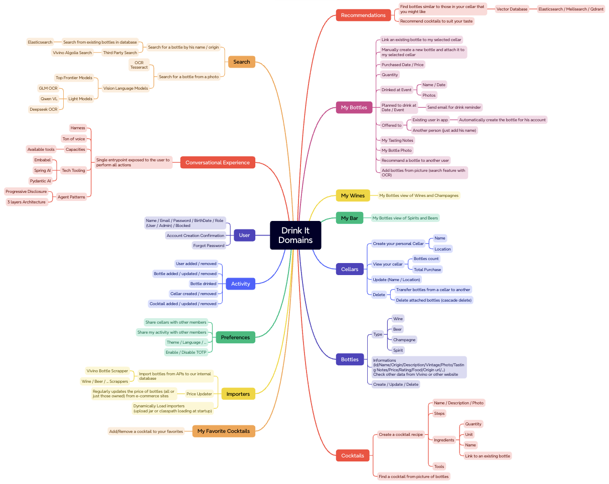
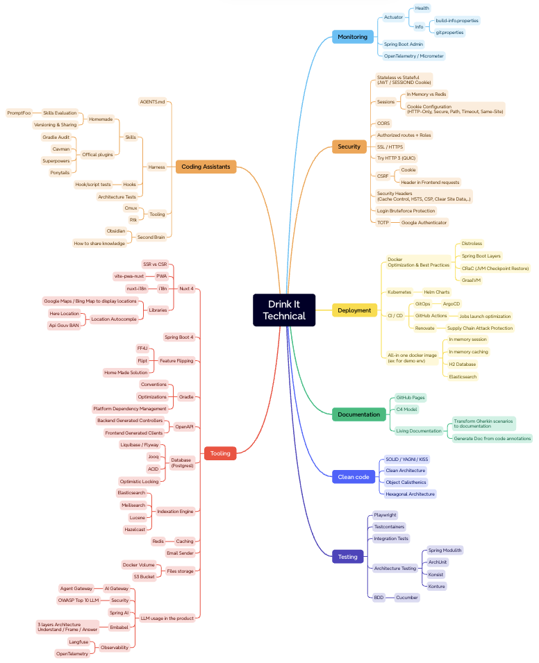

# DrinkIt

DrinkIt manages wine and spirit cellars, and the cocktails you make from them. It is also a sandbox to try
engineering practices on a real product, from the architecture to the coding agents that work on it.

<p align="center">
  <a href="docs/files/DrinkIt-Domains.png"></a>
  <a href="docs/files/DrinkIt-Technical.png"></a>
</p>

The domain map (left) and the technical map (right) show what DrinkIt does and what it aims to do. Many of
their branches are still ideas: the [DrinkIt Roadmap](https://github.com/users/mboisnard/projects/2) tracks
what is built and in which order.

## The product

A cellar manager comes first. Its users keep track of what they own, what they drank and with whom.

- **Cellars and bottles.** Create cellars and add wines, champagnes, beers and spirits, each with its purchase
  date and price, quantity, photos and tasting notes. My Wines and My Bar show the wines and the spirits apart.
- **Moments.** Record when and at which event a bottle was drunk, plan one for a date with an email reminder,
  or offer it to someone, a member or not.
- **Search and import.** Find a bottle by name or origin, or from a photo through OCR and vision language
  models. Import bottles from Vivino and other sources, and keep their prices up to date.
- **Cocktails.** Write recipes whose ingredients link to your bottles, find a cocktail from a picture of
  bottles, and keep your favorites.
- **Recommendations and sharing.** Bottles similar to the ones in your cellar, cocktails to your taste, and
  cellars and activity shared with other members.
- **A conversational assistant.** One entry point where an agent carries out every action for you.

## The engineering sandbox

DrinkIt is where practices get tried on a codebase that keeps growing, before they are used elsewhere.

- **Architecture.** A Kotlin and Spring Boot backend in a hexagonal architecture and a modular monolith, with
  event sourcing and a contract-first API, and a Nuxt frontend.
- **Reusable foundations.** Tech starters, one technical concern each, and Gradle convention plugins over a
  shared platform.
- **Quality.** Testcontainers, architecture tests, detekt, and a documentation site generated in part from the
  code.
- **Security and delivery.** Session security, headers, TOTP, then optimized images, Kubernetes, GitOps and
  OpenTelemetry.
- **AI.** Language models in the product (Spring AI, Embabel, an AI gateway, Langfuse), and coding agents that
  work on the code through a harness: `AGENTS.md`, skills, hooks, and a CI that guards master.

Links and tools to look at later are on the [ideas page](docs/src/engineering/ideas.md).

## What's inside

- `drinkit/`: the application, a Kotlin and Spring Boot backend built along a hexagonal architecture, and a
  Nuxt frontend.
- `tech-starters/backend/`: technical libraries, one concern each, with no business code.
- `build-logic/`: the Gradle convention plugins the modules apply.
- `.hooks/`: the git hooks and the Claude Code hooks of the harness, with their bats suites, which
  `npm cit --prefix .hooks` runs.
- The [documentation site](https://mboisnard.github.io/drinkit/): architecture, guidelines, the pages
  generated from the code, and the [harness](docs/src/engineering/coding-assistants/harness.md) that guards master.

## Quick start

[CONTRIBUTING.md](CONTRIBUTING.md#setup) lists what it needs. The backend starts its own containers, but on
the first run the database has no schema yet: run the updater once, as the same section explains.

```
./gradlew :drinkit-backend:bootRun     # starts deployment/local/compose.yml, then the API
```

- API: `http://localhost:8080/drinkit/api/cellars`
- OpenAPI documentation: `http://localhost:8080/drinkit/openapi/ui` (admin role)
- Actuator: `http://localhost:8080/drinkit/actuator` (admin role)

The frontend needs `java` on the `PATH` to generate its API client:

```
cd drinkit/drinkit-frontend
npm ci
npm run generate:client-api
npm run dev                            # http://localhost:3000
```

## Contributing

[CONTRIBUTING.md](CONTRIBUTING.md) explains how to write issues and pull requests. [AGENTS.md](AGENTS.md)
holds the build commands, the git rules and which skill to read before each kind of change, for people and coding
agents alike.

## License

DrinkIt is licensed under the [Apache License 2.0](LICENSE). Copyright 2024-2026 Mathieu Boisnard.
