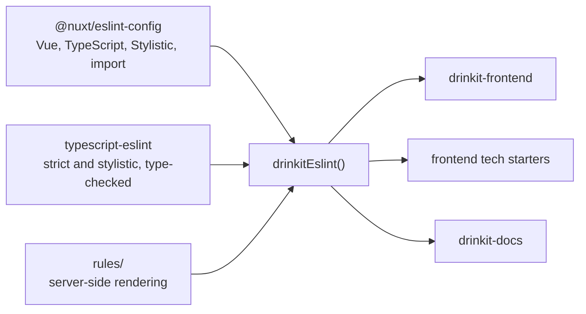

# ESLint config

The rule set of every DrinkIt Nuxt app, frontend tech starter and the documentation site, published in the pnpm
workspace as `@drinkit/eslint-config`. It is tooling, as detekt is for the Kotlin code: no runtime package depends on
it. Every finding is an error, so a commit or a CI run never lets one through. The
[frontend coding conventions](https://github.com/mboisnard/drinkit/blob/master/docs/content/en/1.engineering/5.writing-code/1.best-practices/6.frontend-coding-conventions.md)
give the reason of each rule.



## Usage

```json
{
  "devDependencies": {
    "@drinkit/eslint-config": "workspace:*"
  }
}
```

```ts
// eslint.config.ts
import { drinkitEslint } from '@drinkit/eslint-config';

export default drinkitEslint({ tsconfigRootDir: import.meta.dirname });
```

A package adds its own rules with `.append({ files, rules })`, as a starter that brings a concern brings its rules.

## Presets

| Preset | What it brings |
|---|---|
| `@nuxt/eslint-config` | The Vue and TypeScript parsers, the Vue style guide up to `recommended`, ESLint Stylistic, the import rules, the Nuxt rules, single-word names allowed for pages and layouts, the ignored build folders and `.gitignore` |
| `typescript-eslint` `strictTypeChecked`, `stylisticTypeChecked` | The strictest rules, those that read the types included |
| `@eslint-community/eslint-comments` `recommended` | No useless nor unlimited `eslint-disable` |
| `eslint-plugin-compat` `flat/recommended` | No browser API missing from `.browserslistrc` |
| `eslint-plugin-check-file` | The file name conventions, one glob each |
| `@vitest/eslint-plugin` `recommended` | On `*.test.ts` and `*.spec.ts` |
| `eslint-plugin-playwright` `flat/recommended` | On `test/ui/**` |

## DrinkIt settings

| Rule | Setting |
|---|---|
| `@stylistic/*` | Indent of 2, single quotes, semicolons, trailing comma on multiline, parentheses around arrow parameters, `1tbs` braces |
| `@stylistic/max-len` | 120 characters, URLs and strings excepted |
| `@stylistic/no-multiple-empty-lines` | One blank line at most, none at the start or end of a file |
| `vue/script-indent` | A `<script>` block indented by one level, as a `<template>` |
| `vue/no-undef-components` | A component used without an import fails |
| `import/order` | `vue`, then `#imports` `#components` `#app`, then `@drinkit/**`, then `~/**`, then relative, alphabetical |
| `import/no-default-export` | Named exports only, except the files Nuxt reads by their default export |
| `@typescript-eslint/consistent-type-imports` | `import type` for a type |
| `func-style` | A named function is a declaration |
| `@typescript-eslint/consistent-type-definitions` | `interface` for an object |
| `@typescript-eslint/array-type` | `T[]` for a simple type, `Array<T>` otherwise |
| `@typescript-eslint/consistent-type-assertions` | No `as` on an object literal |
| `@typescript-eslint/ban-ts-comment` | No `@ts-ignore` nor `@ts-nocheck`; `@ts-expect-error` with a description, in tests only |
| `no-restricted-syntax` | No `Intl.*Format` |
| `no-restricted-properties` | No `toLocaleString`, `toLocaleDateString`, `toLocaleTimeString` |
| `eqeqeq` | `===` only |
| `@typescript-eslint/naming-convention` | camelCase, PascalCase for types, UPPER_CASE for constants, no `I` prefix, `_` for an unused parameter, PascalCase for a functional component |
| `@typescript-eslint/no-unused-vars` | `_` marks a parameter left unused on purpose |
| `@typescript-eslint/switch-exhaustiveness-check` | A `switch` on a union covers every case |
| `no-console` | No console output |
| `@eslint-community/eslint-comments/require-description` | An `eslint-disable` says why |
| `reportUnusedDisableDirectives` | An `eslint-disable` that disables nothing fails |
| `vue/define-props-declaration`, `vue/define-emits-declaration` | Props and emits declared by type |
| `vue/prefer-use-template-ref` | `useTemplateRef` rather than a `ref` named after the template |
| `vue/no-ref-as-operand` | No `ref` used as a value without `.value` |
| `vue/no-empty-component-block` | No empty block |
| `vue/block-order` | `<template>`, then `<script>`, then `<style>` |
| `vue/define-macros-order` | `defineProps`, then `defineEmits`, first in the script |
| `vue/no-v-html` | No `v-html` |
| `vue/require-explicit-emits` | Every emitted event declared |
| `vue/no-unused-properties` | Every prop used |
| `check-file/filename-naming-convention` | A `.vue` file in PascalCase, a page, a layout or a `.ts` file in kebab-case, a composable named `useX.ts`; `app.vue`, `error.vue` and route parameters such as `[id].vue` aside |
| `check-file/folder-match-with-fex` | A `*.test.ts` or `*.spec.ts` outside `test/unit`, `test/nuxt` or `test/ui`, where no test runner would find it |
| `no-restricted-imports` by folder, in `folder-imports.ts` | `shared/` imports neither the Vue app, Nitro's aliases nor Vue, `app/` never imports `server/`, `server/` never imports the Vue app, and `modules/` no runtime alias: Nuxt guards these in the folders of the app, not in those of a layer |
| `no-restricted-properties`, `no-restricted-imports` in tests | No `vi.mock`, `mockNuxtImport` nor `mockComponent`: a test replaces a boundary, never a module |
| `playwright/expect-expect` | Counts `expectAccessible` and `expectSameServerRender` of `@drinkit/test-starter` as assertions |

Each `lint` script and the hooks run ESLint with `--max-warnings 0`, so a rule a preset leaves at warn fails too. No
`enum` either: `erasableSyntaxOnly`, which `nuxt-starter` sets, makes the compiler refuse it.

## Own rules

Under `rules/`, each with its test under `test/unit/rules/`, on Vitest and ESLint's `RuleTester`.

| Rule | What it refuses |
|---|---|
| `drinkit/no-module-state` | A `ref`, `reactive` or `computed` at module level, which the server shares between requests |
| `drinkit/no-unguarded-browser-global` | `window`, `document` or `localStorage` outside `onMounted`, `import.meta.client`, a `typeof` check or a function that only runs in the browser |
| `drinkit/no-async-composable` | An `async` composable, which loses its component after its first `await` |
| `drinkit/composable-uses-reactivity` | A `use*` function that calls neither Vue, Nuxt nor another composable |

## Checks

```
pnpm --filter @drinkit/eslint-config lint
pnpm --filter @drinkit/eslint-config typecheck
pnpm --filter @drinkit/eslint-config test
```
