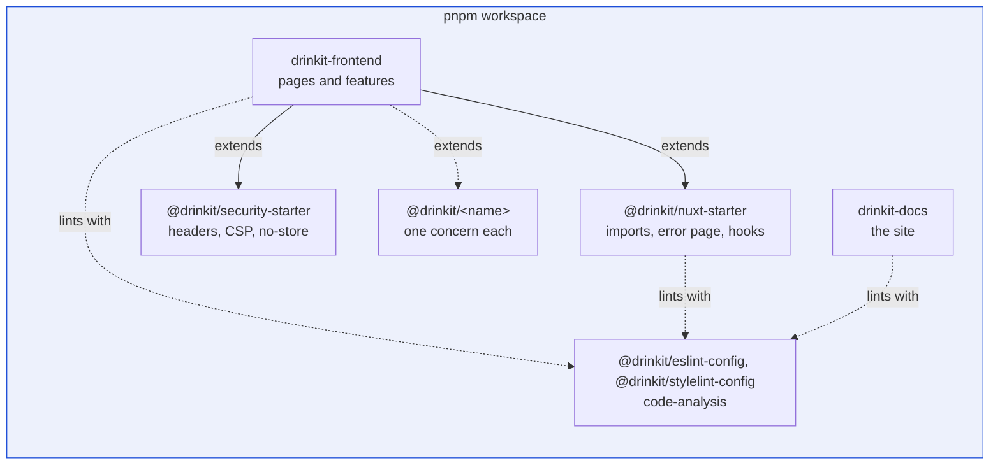
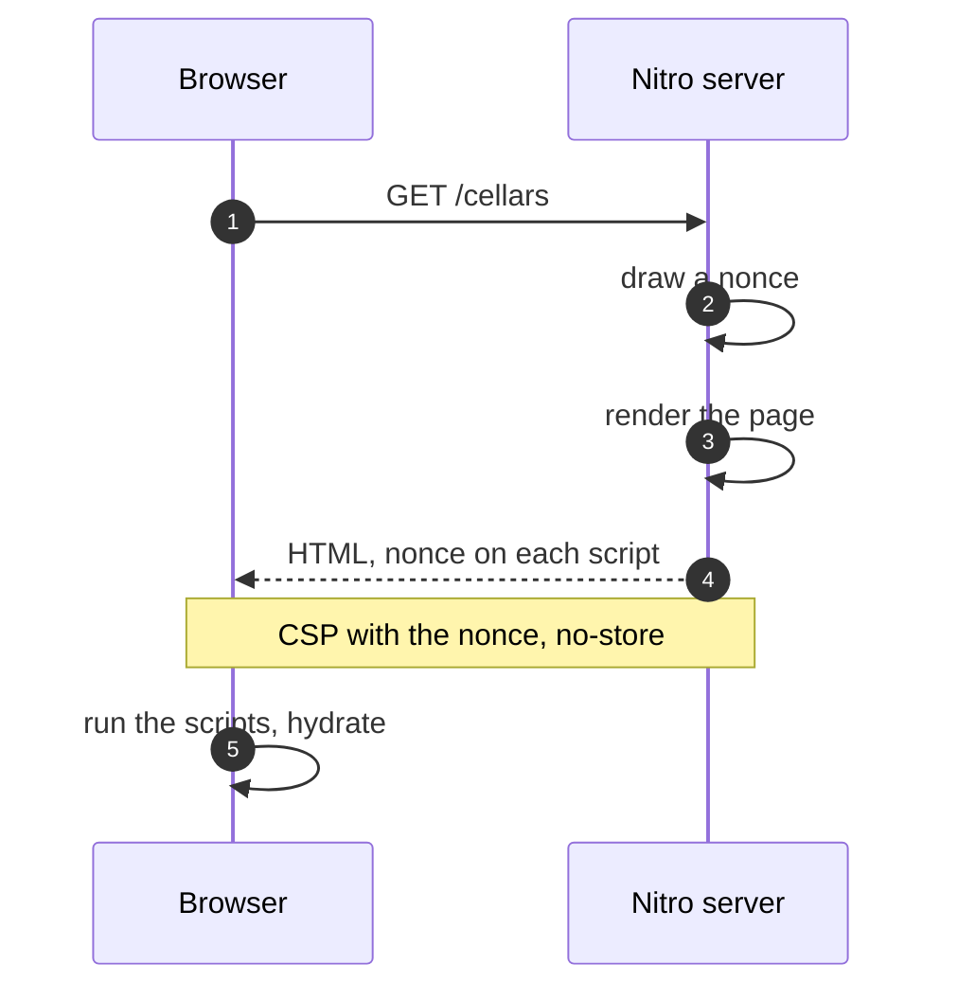

Server-side rendering runs the components of a page on a server for each request, sends the HTML, and lets the
browser take over the same components, a step called hydration. The user sees the page before its JavaScript has
loaded, and the server holds what the browser must not: cookies set http-only, a relay to the backend, a secret per
response. DrinkIt's frontend is a Nuxt app rendered that way, on Nuxt's Nitro server. Its pages hold the features,
and every technical concern comes from a frontend [tech starter](./6.tech-starters.md) it extends.
[ADR 023](../../2.decisions/023-render-the-frontend-with-nuxt-on-tech-starters-in-a-pnpm-workspace.md) records why.
Read this page before you add a page, a starter or a package to the frontend.

## 🧱 The app and its starters

A frontend tech starter is a Nuxt layer: a folder with a `nuxt.config.ts` and an `app/` folder, which Nuxt merges
into the app that extends it. The app wins over the layer, file by file and setting by setting.

Each starter is a package of the workspace, `@drinkit/<name>`, under `tech-starters/frontend/`. The app depends on it
as `workspace:*`, names it in the `extends` of its `nuxt.config.ts`, and imports what it exposes through the
`exports` of its `package.json`, such as `@drinkit/nuxt-starter/problem-detail`: they are its public API, the rest
stays internal. A starter holds runtime code only, knows no business word and never
imports from the app.

`nuxt-starter` holds what every app and starter relies on:

- **Explicit imports.** It turns auto-imports and the component scan off, so each file says where each name
  comes from.
- **The error page**, which shows the title and the detail of a ProblemDetail, and only the status otherwise, so
  that an internal message never reaches the user.
- **The browsers it builds for**, those of `.browserslistrc`, which the lint checks the code against.
- **The hooks other starters share**, typed: a ProblemDetail the API answered, a sign-in, a sign-out.

Its [README](https://github.com/mboisnard/drinkit/blob/master/tech-starters/frontend/nuxt-starter/README.md) gives
each setting.

`security-starter` secures every page, as its backend namesake secures every endpoint: the security headers of
`nuxt-security`, a Content Security Policy that holds a nonce, and `Cache-Control: no-store`. The sign-in and the
session join it with #677. Its
[README](https://github.com/mboisnard/drinkit/blob/master/tech-starters/frontend/security-starter/README.md) gives
each setting.

## 🌐 A request

A nonce is a random value the server draws for one response. It writes it in the Content Security Policy header and
on each script tag of the page, and the browser runs only the scripts that carry it. An attacker who injects a
script into the page cannot guess it.

`Cache-Control: no-store` keeps a page out of every cache: it may hold the data of a signed-in user, and its nonce
must change on each response. The scripts and styles under `/_nuxt/` carry a hash in their name, so they are cached
for a year.

## 📦 One pnpm workspace

The Nuxt apps, the frontend starters, the [documentation site](../5.writing-code/1.best-practices/5.living-documentation.md)
and the bats suites of the [hooks](../6.coding-assistants/2.hooks.md) are packages of one pnpm workspace, declared in
`pnpm-workspace.yaml` at the root. One `pnpm install` sets them all up, from one `pnpm-lock.yaml`.

- **A version lives once**, in the catalog of `pnpm-workspace.yaml`, and each `package.json` names it `catalog:`.
  Renovate bumps it in one place.
- **A package sees only what it declares.** pnpm links each package's own dependencies, so a package that imports
  what it never declared fails at once.
- **A release waits seven days** before pnpm installs it, as Renovate waits before it proposes it, so that a
  compromised release has time to be found.
- **An install script runs only when the workspace allows it**, under `allowBuilds`: a dependency that would run
  code at install is reviewed first.

The [`dependency-change` skill](https://github.com/mboisnard/drinkit/blob/master/.claude/skills/dependency-change/SKILL.md)
gives the steps to add or bump a package.

## ✅ What checks the frontend

ESLint, Stylelint and the type check run on every change to the app, a starter or the site: the pre-commit hook
fixes what the linters can fix, a Claude Code hook lints each file an agent edits, and the Frontend and Docs lanes of the
[CI](../7.delivery/1.ci-cd.md) run the lint, the type check, the tests and the build.

## Sources

- [Rendering modes](https://nuxt.com/docs/guide/concepts/rendering), Nuxt
- [Layers](https://nuxt.com/docs/guide/going-further/layers), Nuxt
- [Workspace](https://pnpm.io/workspaces), pnpm
