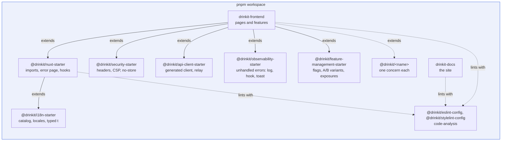
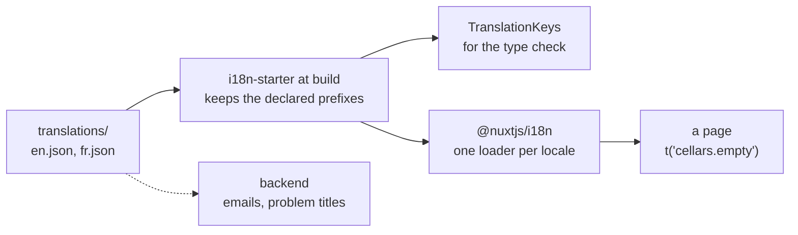
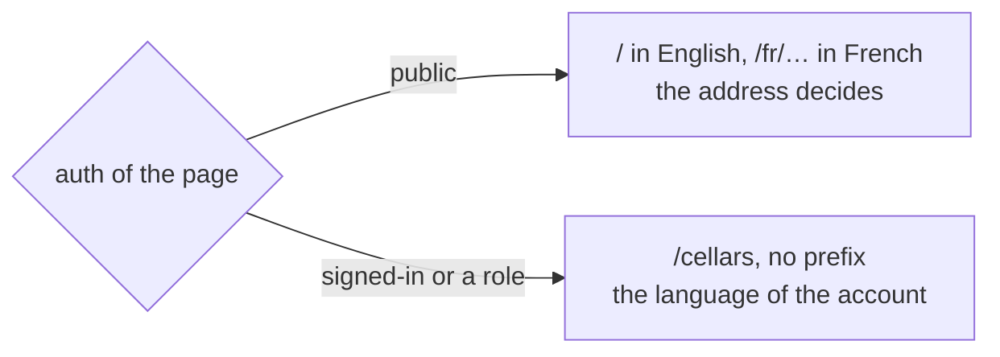
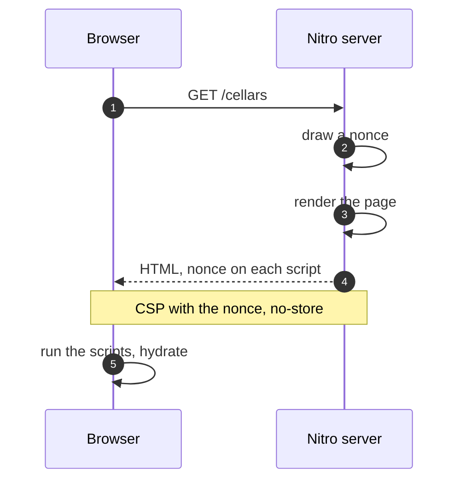
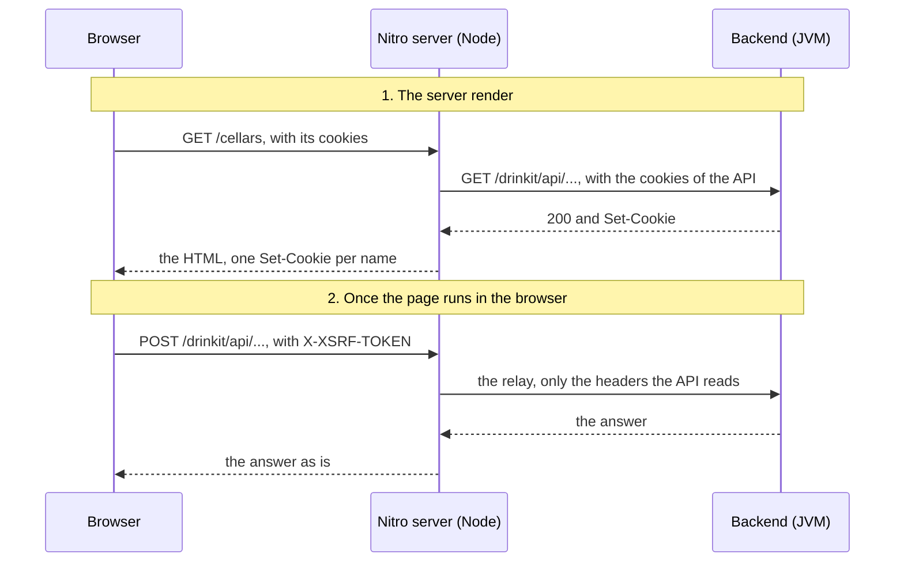

Server-side rendering runs the components of a page on a server for each request, sends the HTML, and lets the
browser take over the same components, a step called hydration. The user sees the page before its JavaScript has
loaded, and the server holds what the browser must not: cookies set http-only, a relay to the backend, a secret per
response. DrinkIt's frontend is a Nuxt app rendered that way, on Nuxt's Nitro server. Its pages hold the features,
and every technical concern comes from a frontend [tech starter](./6.tech-starters.md) it extends.
[ADR 023](../../2.decisions/023-render-the-frontend-with-nuxt-on-tech-starters-in-a-pnpm-workspace.md) records why.
Read this page before you add a page, a starter or a package to the frontend.

## 🧱 The app and its starters

A frontend tech starter is a Nuxt layer: a folder with a `nuxt.config.ts` and the folders of a Nuxt app, which Nuxt
merges into the app that extends it. The app wins over the layer, file by file and setting by setting.

Each starter is a package of the workspace, `@drinkit/<name>`, under `tech-starters/frontend/`. The app depends on it
as `workspace:*`, names it in the `extends` of its `nuxt.config.ts`, and imports what it exposes through the
`exports` of its `package.json`, such as `@drinkit/nuxt-starter/problem-detail`: they are its public API, the rest
stays internal. A starter holds runtime code only, knows no business word and never
imports from the app.

`nuxt-starter` holds what every app and starter relies on:

- **Translations.** It extends `i18n-starter`, so every starter and app translates its texts, as
  [the translations](#translations) below describe.
- **Explicit imports.** It turns auto-imports and the component scan off, so each file says where each name
  comes from.
- **The error page**, translated, which shows the title and the detail of a ProblemDetail, and only the status otherwise, so
  that an internal message never reaches the user. An app with a design system replaces it with its own
  `app/error.vue`, built on the same ProblemDetail.
- **The browsers it builds for**, those of `.browserslistrc`, which the lint checks the code against.
- **The hooks other starters share**, typed: a ProblemDetail the API answered, an error nobody handled, a sign-in,
  a sign-out.

Its [README](https://github.com/mboisnard/drinkit/blob/master/tech-starters/frontend/nuxt-starter/README.md) gives
each setting.

`security-starter` secures every page, as its backend namesake secures every endpoint: the security headers of
`nuxt-security`, a Content Security Policy that holds a nonce, and `Cache-Control: no-store`. It also follows the
backend's session: the current user, the sign-in and the sign-out, and the access each page declares, as
[Calling the API](../../3.reference/2.security/2.calling-the-api.md#signed-in-from-the-nuxt-app) shows. Its
[README](https://github.com/mboisnard/drinkit/blob/master/tech-starters/frontend/security-starter/README.md) gives
each setting.

`api-client-starter` calls the backend: a client that Hey API generates from the app's OpenAPI contract at each
prepare and build, imported as `#api`, the cookies of the page relayed during a server render, and a relay of
the API's path on the app's origin for the calls of the browser. The app names its contract, that path and its
backend in its `nuxt.config.ts`.
[Calling the API](../../3.reference/2.security/2.calling-the-api.md) shows how, and its
[README](https://github.com/mboisnard/drinkit/blob/master/tech-starters/frontend/api-client-starter/README.md) gives
each setting.

`observability-starter` catches, in the browser, every error the app leaves unhandled: it logs it once with the
backend's `traceId`, calls the `drinkit:error` hook for an alerting tool, and shows the user a toast of Nuxt UI, whose
message the calling code or the app chooses. [Logging](../4.build-and-data/3.logging.md#the-nuxt-app) gives the
detail, and its
[README](https://github.com/mboisnard/drinkit/blob/master/tech-starters/frontend/observability-starter/README.md)
each setting.

`feature-management-starter` reads the feature flags and the A/B test variants of every key the app declares, in one
OFREP request of the server render that the payload hands to the browser, and again on each sign-in and sign-out.
`useFlag` and `useVariant` read them, and `useVariant` reports the exposure of a variant once its component mounts.
[ADR 017](../../2.decisions/017-feature-flags-through-openfeature.md) records why, and its
[README](https://github.com/mboisnard/drinkit/blob/master/tech-starters/frontend/feature-management-starter/README.md)
gives each setting.

## 🗣️ Translations

Every text a user reads lives in one catalog at the root of the repository, `translations/en.json` and
`translations/fr.json`, which the backend reads too.
[ADR 026](../../2.decisions/026-translate-from-one-icu-catalog-the-frontend-and-the-backend-share.md) records why. A
message is ICU MessageFormat, such as `{count, plural, one {# bottle} other {# bottles}}`, and a key starts with a
prefix, such as `cellars.` for `cellars.empty`.

- **A prefix per owner.** The app and each starter declare in their `nuxt.config.ts` the prefixes they show, such as
  `auth` for `security-starter`: only those reach the browser, so a page ships no text it never shows,
  and the backend keeps its own, such as `mail.`.
- **A typed `t`.** `useTranslate()` gives `t`, which takes only a key of the catalog the app loads, with the values
  its message places, and `d` and `n`, which format a date or a number in the language of the page, in the time zone
  or the currency the caller gives. A page calls it in its `<script setup>` and writes `{{ t('cellars.empty') }}` in its template. The lint refuses a text
  written in a template and the `$t` of vue-i18n, which takes any string.
- **The address or the account decides the language.** A public page sits at `/` in English and under `/fr` in
  French, and names its language and its other versions in its `<head>`. A page for signed-in users has no prefix,
  such as `/cellars`, and shows in the language of the account, which `GET /api/user/me` answers. A redirect stays
  in the current language, and each call to the backend names it in `Accept-Language`.

The [frontend coding conventions](../5.writing-code/1.best-practices/6.frontend-coding-conventions.md#translations)
give the rules of a key and a message, and the
[README](https://github.com/mboisnard/drinkit/blob/master/tech-starters/frontend/i18n-starter/README.md) of
`i18n-starter` each setting.

## 🗂️ The folders of a starter

Nuxt sorts the code of an app by where it runs, and a starter keeps the same folders, so that its code sits where
Nuxt and a reader look for it.

| Folder | Runs | Holds | Never imports |
|---|---|---|---|
| `app/` | In the Vue app: on the server for the render, then in the browser | Composables, components, plugins, what the `exports` expose | The code of the server, which the browser reaches through HTTP |
| `server/` | In Nitro alone | Routes and handlers, such as the relay of `api-client-starter` | The Vue app, which Nitro does not run |
| `shared/` | In both | Plain TypeScript that both need, such as the cookies a server render keeps between its calls to the backend | The Vue app, Nitro's aliases or Vue, which one of its two sides runs without |
| `modules/` | At build time | The Nuxt modules that read the app's options, then generate or register code | Any runtime alias: the build runs before the app exists |

Nuxt fails the build on an import of the last column in the folders of the app, but not in those of a layer: the
[lint config](https://github.com/mboisnard/drinkit/blob/master/code-analysis/eslint/README.md) refuses it in both.
A test sits under the folder of its level, such as `test/unit`, at the path of the file it tests, as the
[frontend tests](../5.writing-code/2.testing/5.frontend-tests.md) say.

`test-starter` is no layer: its code runs in Vitest and Playwright, not in Nuxt, so it sits under `src/`, one folder
for each entry of its `exports`, such as `src/playwright/`.

## 🌐 A request

A nonce is a random value the server draws for one response. It writes it in the Content Security Policy header and
on each script tag of the page, and the browser runs only the scripts that carry it. An attacker who injects a
script into the page cannot guess it.

`Cache-Control: no-store` keeps a page out of every cache: it may hold the data of a signed-in user, and its nonce
must change on each response. The scripts and styles under `/_nuxt/` carry a hash in their name, so they are cached
for a year.

## 🔌 Calling the backend

The same components call the backend twice in a page's life: on the Nitro server while it renders, then in the
browser once they have hydrated. Neither path keeps anything between two requests: the session, the CSRF token, the
remember-me cookie and the limits per address all belong to the backend.

The browser only ever talks to the app's origin, so the cookies stay first-party and no CORS is needed.
[Calling the API](../../3.reference/2.security/2.calling-the-api.md) details the headers and the cookies of each path.

## 📦 One pnpm workspace

The Nuxt apps, the frontend starters, the [documentation site](../5.writing-code/1.best-practices/5.living-documentation.md)
and the bats suites of the [hooks](../6.coding-assistants/2.hooks.md) are packages of one pnpm workspace, declared in
`pnpm-workspace.yaml` at the root. One `pnpm install` sets them all up, from one `pnpm-lock.yaml`.

- **A version lives once**, in the catalog of `pnpm-workspace.yaml`, and each `package.json` names it `catalog:`.
  Renovate bumps it in one place.
- **A package sees only what it declares.** pnpm links each package's own dependencies, so a package that imports
  what it never declared fails at once.
- **A release waits seven days** before pnpm installs it, as Renovate waits before it proposes it, so that a
  compromised release has time to be found.
- **An install script runs only when the workspace allows it**, under `allowBuilds`: a dependency that would run
  code at install is reviewed first.

The [`dependency-change` skill](https://github.com/mboisnard/drinkit/blob/master/.claude/skills/dependency-change/SKILL.md)
gives the steps to add or bump a package.

## ✅ What checks the frontend

ESLint, Stylelint and the type check run on every change to the app, a starter or the site: the pre-commit hook
fixes what the linters can fix, a Claude Code hook lints each file an agent edits, and the Frontend and Docs lanes of the
[CI](../7.delivery/1.ci-cd.md) run the lint, the type check, the tests and the build. The Frontend lane also runs the
UI tests in a headless browser, the last level the [frontend tests](../5.writing-code/2.testing/5.frontend-tests.md)
describe.

## Sources

- [Rendering modes](https://nuxt.com/docs/guide/concepts/rendering), Nuxt
- [Layers](https://nuxt.com/docs/guide/going-further/layers), Nuxt
- [Workspace](https://pnpm.io/workspaces), pnpm
