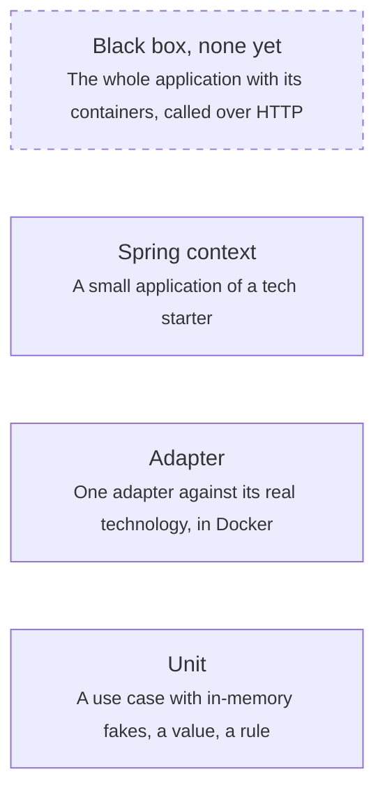
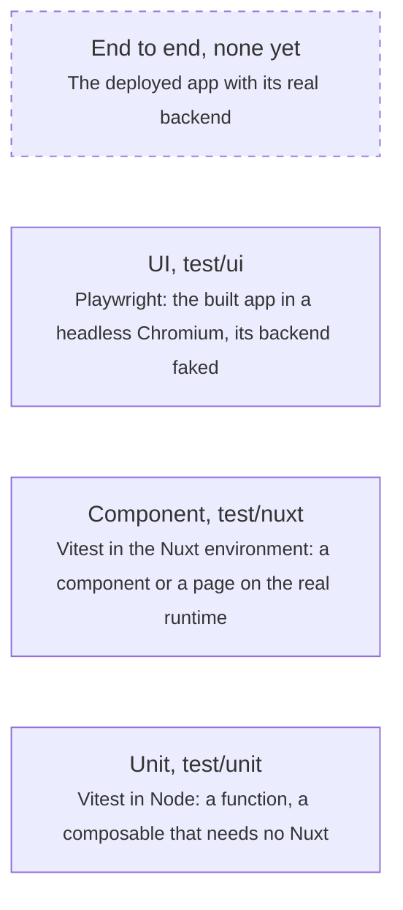

The test pyramid sorts tests by how much of the system each one runs. At the base, many unit tests check one piece in
memory, in milliseconds, and point straight at what broke. Higher up, fewer tests start a framework, a database or a
browser: they prove that the pieces fit, but run slower and fail for more reasons. At the top, a few end-to-end tests
drive the whole application with all its services. A behavior is tested at the lowest level that can see it. Read
this page to know where a new test goes: each level links the page that says how to write it.

The architecture keeps the base wide. A use case knows only its ports, as the
[hexagonal architecture](../../2.architecture/3.hexagonal-architecture.md) has it, and a page knows only the
[OpenAPI contract](../../2.architecture/5.contract-first.md) of the backend, so most behavior is checked with the
rest replaced at a boundary. The top stays empty for now: it would start every container and fill the database, for
tests that fail far from the change, and nothing is deployed to run them against.

## ⚙️ Backend

| Level | Runs | Proves |
|---|---|---|
| Unit | JUnit, in memory, no Spring | A use case with in-memory [test doubles](./1.testdouble.md) of its ports, a value or a rule of the domain, a class of a starter |
| Adapter | [Testcontainers](./2.testcontainers.md): PostgreSQL, Meilisearch, Mailpit | An adapter against the real technology, and the test contract of its port, which its fake passes too |
| Spring context | `ApplicationContextRunner`, or a `@SpringBootTest` of a starter's own beans | What only Spring shows: an auto-configuration, its conditions and properties, a filter or an endpoint of a [tech starter](../../2.architecture/6.tech-starters.md) |
| Black box | Nothing yet | The application started whole, with its containers |

A starter starts a small application rather than the whole one: its own beans, a few properties, sometimes a web
server. That keeps a test of the framework's behavior close to the starter that relies on it, and fast enough to run
on each build.

What no test covers is the wiring of the application itself: no test starts its Spring context, so a missing bean
shows only when `bootRun` starts it. The [architecture tests](./4.architecture-tests.md) sit beside the pyramid: they
check the structure of the code, not a behavior.

## 🖥️ Frontend

The [frontend tests](./5.frontend-tests.md) page says what each level proves and where a composable, a component or
a page goes. A UI test is no end-to-end test: its backend is a fake that the client generated from the contract keeps
in step, where an end-to-end test drives the deployed app and all its services.

## 📚 Sources

- [Test Pyramid](https://martinfowler.com/bliki/TestPyramid.html), Martin Fowler
- [The Practical Test Pyramid](https://martinfowler.com/articles/practical-test-pyramid.html), Ham Vocke
- [Just Say No to More End-to-End Tests](https://testing.googleblog.com/2015/04/just-say-no-to-more-end-to-end-tests.html), Google Testing Blog
- [Test Sizes](https://testing.googleblog.com/2010/12/test-sizes.html), Google Testing Blog
