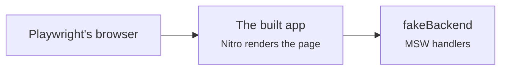

A frontend test works from what the user sees and does: it renders a page or a component, clicks and types as a
person would, and checks what appears. It finds an element by its role, its label or its text, never by a CSS class,
so that a test breaks when the user's page changes and not when its markup is reshuffled. Read this page before you
write the first test of a page, a component or a starter.

The frontend shows what the backend decides, so its tests check that a page shows the right outcome of a call, not
the business rule behind it, which the backend tests cover.

## 🧪 From a function to the built app

Each level runs the code closer to production than the one before, and costs more. A behavior is tested at the
lowest level that can see it, which runs faster and points closer to the failure. The [test starter](https://github.com/mboisnard/drinkit/blob/master/tech-starters/frontend/test-starter/README.md)
gives every app and starter the same setup for each, and the [test pyramid](./0.test-pyramid.md) places them next to
the backend's.

| Level | Runs | Proves | Lives in |
|---|---|---|---|
| Unit | Vitest, in Node | A function, a mapping, a composable that needs no Nuxt | `test/unit` |
| Component | Vitest, in its Nuxt environment, which boots the app in happy-dom | A component or a page with the real Nuxt runtime: its router, its head, its cookies | `test/nuxt` |
| UI | Playwright, in a headless Chromium, on the app built and served as in production, its backend faked | The page rendered on the server then hydrated, with no console error, accessible to WCAG 2.2 AA with a level one heading, with an LCP and a CLS under Google's thresholds, and with no state left behind by the previous request | `test/ui` |

| To test | Level |
|---|---|
| A composable that only uses `ref` and `computed` | Unit: the test calls it and changes its refs |
| A composable that reads Nuxt, such as `useRoute`, `useCookie` or `useRuntimeConfig` | Component: the real composable runs, and the test sets the route or the cookie it reads |
| A component, such as a button or a form | Component: `renderSuspended`, then a click or a key as the user does |
| A page and the answers of the backend it shows | Component, with `registerEndpoint` |
| What only the built app shows: the server render, the hydration, the console, the accessibility, the Web Vitals | UI |

Vitest picks the environment by folder, never by a comment in the file: a comment skips the plugins of Nuxt. In its
folder, a unit or component test takes the path of the file it tests, as a Kotlin test takes its package:
`test/nuxt/components/CellarCard.test.ts` tests `app/components/CellarCard.vue`. The source root, `app/` or `src/`,
drops from the path, and any other folder stays: `test/unit/shared/cookie-jar.test.ts` tests `shared/cookie-jar.ts`.
A UI test is named after the page it drives. CI runs every level on each pull request, and the
[frontend lane](../../7.delivery/1.ci-cd.md) uploads the reports.

A UI test is no end-to-end test: its backend is a fake, and the generated client keeps the fake in step with the
[OpenAPI contract](../../2.architecture/5.contract-first.md). An end-to-end test drives the deployed app with all its
services, which waits for a deployed environment.

The UI tests measure the Web Vitals in a lab, a desktop browser on the same machine as the app: they catch a
page that shifts or shows late, not a slow network. The speed real users get, the Web Vitals of the field, belongs to
observability.

## 🔌 Replace a boundary, not a module

A test runs the real code and replaces only what crosses a boundary of the app: the network, the browser, a
third-party service. A module mock, `vi.mock`, `mockNuxtImport` or `mockComponent`, replaces the code under test
itself: the test then checks how the page is wired, breaks when it is refactored, and passes when the real module
would fail. The [lint](../1.best-practices/6.frontend-coding-conventions.md) refuses all three. The composables of
Nuxt are no boundary: they run for real in the Nuxt environment, and the test sets what they read.

| The test controls | Through |
|---|---|
| The route | The `route` option of `renderSuspended`, on the real router |
| A cookie | `document.cookie` before the render |
| The time | Vitest's fake timers |
| A call to the backend, in a component test | `registerEndpoint` of `@nuxt/test-utils`, which answers the same-origin call the page makes |
| A call to the backend, in a UI test | The `fakeBackend` fixture of the test starter, [MSW](https://mswjs.io/) handlers on a real port that the built app calls as its backend, added by `fakeBackend.use` for one test |
| A third-party SDK | The fake that the starter wrapping it exports from `./testing`, given to the page through `provide`, as its [test contract](./1.testdouble.md) proves |

A UI test needs a fake backend on a real port because the page is rendered on the server first, and Nitro,
the server of Nuxt, calls the backend from there, where no mock in the browser reaches:

A page that writes then reads can also receive a hand-written fake of the client generated from the
[OpenAPI contract](../../2.architecture/5.contract-first.md), holding its data in memory. The page then gets its
client through `provide`, which the test fills: a page that builds its client inline is reshaped first.

## Sources

- [Guiding principles](https://testing-library.com/docs/guiding-principles), Testing Library
- [Test doubles](https://abseil.io/resources/swe-book/html/ch13.html), Software Engineering at Google
- [Stop mocking fetch](https://kentcdodds.com/blog/stop-mocking-fetch), Kent C. Dodds
- [Testing](https://vuejs.org/guide/scaling-up/testing.html), Vue
- [Testing](https://nuxt.com/docs/4.x/getting-started/testing), Nuxt
- [Lab and field data](https://web.dev/articles/lab-and-field-data-differences), web.dev
