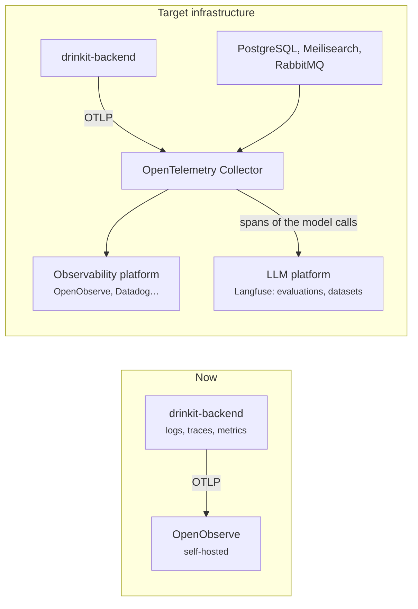

DrinkIt observes itself with what Spring Boot already ships: Actuator for health, Micrometer for metrics and traces,
its structured logging for JSON lines. An environment exports over OpenTelemetry when it switches it on, and
nothing leaves the application before. The code depends on no vendor. Until the target infrastructure brings an
OpenTelemetry Collector, the application pushes its logs, traces and metrics straight to OpenObserve, an open
source platform that stores and shows them, which we host ourselves.

## Context

The `observability-starter`, called `monitoring-starter` before, only exposed the health and the info of Actuator.
A few starters reported the health of their third party, such as Meilisearch, but no rule said which. Nothing linked
a log to the request that wrote it, and a stack trace became one event per line on a log platform such as Datadog. DrinkIt has no production yet,
and its future platform is not chosen.

Spring Boot 4.1.2 brings each piece: health indicators that each starter contributes, the Observation API of
Micrometer that gives a timer and a span in one call, an OpenTelemetry starter that pushes them over OTLP, and JSON
logs behind one property. Its OTLP export of metrics is on by default, towards `localhost:4318`.

## Decision

- **Health.** Each starter that talks to a third party brings its `HealthIndicator`, as the search engine starter
  does. Readiness waits for the database alone. Every Actuator endpoint is read-only and, except the health status,
  reserved to admins.
- **Metrics and traces.** The code measures through Micrometer, an `ObservationRegistry` or a `MeterRegistry`, never
  through the OpenTelemetry API or a wrapper of our own. The starter exports over OTLP once
  `starters.observability.opentelemetry.enabled` is true, through the JDK HTTP client, and never while
  `starters.observability.enabled` is false. Until then, tracing still gives
  each request its `traceId`, which reaches no collector. A trace starts in the application: the `traceparent` that a
  caller sends is ignored, so that no one on the internet chooses a `traceId` or forces a trace into the samples.
- **Logs.** Plain text on a developer's machine, one JSON line per event in the Logstash format elsewhere. Each line
  carries `traceId`, `spanId` and, once signed in, `user.id`. Logs go to the console and, once the export is on and
  `management.opentelemetry.logging.export.otlp.endpoint` is set, over OTLP too, with their trace and span, through
  the Logback appender of OpenTelemetry, which Spring Boot does not install. The console stays, for a developer's
  machine and for a platform that reads it.
- **Errors.** Every error of the API, 4xx or 5xx, answers a problem detail of RFC 9457 that carries the `traceId` of
  the request, so that a client reads every error the same way and support finds its logs. An unexpected failure
  answers a 500 without its message, which only the logs hold, as OWASP's Error Handling Cheat Sheet advises. One
  exception handler of the starter answers them all: a filter hands its refusal to Spring MVC rather than writing a
  body.
- **A platform without a collector, for now.** The application pushes its logs, traces and metrics straight to
  OpenObserve, which also reads the attributes OpenTelemetry defines for calls to AI models, the GenAI conventions
  that `ai-starter` follows ([ADR 021](./021-serve-ai-models-outside-the-application-and-reach-them-through-ai-starter.md)).
  A developer starts it on their machine. The services around the application, PostgreSQL, Meilisearch and
  RabbitMQ, push nothing yet.
- **A collector in the target infrastructure.** An OpenTelemetry Collector receives the logs, traces and metrics of
  the application and of the services around it. It sends them to an observability platform for the dashboards and
  the alerts, OpenObserve, Datadog or another, and the spans of the model calls to an LLM platform too, such as
  Langfuse, which replays them, scores them and compares models on them. The application then changes its OTLP
  endpoint, not its code.

The [logging page](../1.engineering/4.build-and-data/3.logging.md) and the README of the starter give the settings.

## Consequences

- A metric, a span or a health check of a new starter is a few lines, with no module of our own to learn.
- Changing platform, Datadog, Grafana or another, means setting an OTLP endpoint, not changing code.
- A user who reports an error gives a `traceId`, and one search finds the logs of that request.
- The OpenTelemetry SDK, about twenty jars, is in every application, even where nothing is exported.
- Spring Boot creates a span for every request, sampled or not: a cost in memory that a measure may one day question.
- The `traceId` and `user.id` live in the MDC of the request's thread: a platform event handled on another thread
  logs without them.
- The Logback appender of OpenTelemetry is still an alpha: a release may rename the attributes of a log.
- A log sent over OTLP while the platform is down is lost once the queue of the exporter fills. The console keeps it.
- Until a collector runs, the services around the application send nothing to the platform.
- Scoring the model calls waits for the collector and an LLM platform: OpenObserve keeps it for its paid Enterprise
  edition, and a second platform now would mean a second exporter in the application.

## Alternatives

- **A metrics service of our own** over Micrometer. Rejected because Micrometer already hides the vendor, and the
  wrapper would be one more API to keep up. It offered one place to name and tag every metric.
- **The OpenTelemetry Java agent.** Rejected because it instruments the bytecode at start-up, which a native image
  cannot do, and duplicates what Spring Boot observes. It offered spans for libraries that Micrometer does not cover.
- **The Datadog agent and its tracer**, as many companies run. Rejected because it ties the code and the deployment
  to one vendor before one is chosen. It offered a complete platform at once.
- **An OpenTelemetry Collector now**, in front of OpenObserve and Langfuse. Deferred: one application with no
  deployment does not pay for one more service to run and configure. It offers the signals of the services around
  the application, and the model calls in a platform made for them.
- **Health and info only, as before.** Rejected because a failing request could not be traced back to its logs. It
  added no dependency.

## Sources

- [OpenTelemetry with Spring Boot](https://spring.io/blog/2025/11/18/opentelemetry-with-spring-boot/), Spring
- [Observability](https://docs.spring.io/spring-boot/reference/actuator/observability.html), Spring Boot reference
- [Kubernetes probes](https://docs.spring.io/spring-boot/reference/actuator/endpoints.html#actuator.endpoints.kubernetes-probes), Spring Boot reference, on keeping external checks out of liveness
- [RFC 9457: Problem Details for HTTP APIs](https://www.rfc-editor.org/rfc/rfc9457.html), IETF
- [Error Handling Cheat Sheet](https://cheatsheetseries.owasp.org/cheatsheets/Error_Handling_Cheat_Sheet.html), OWASP, on a generic message for an unexpected error
