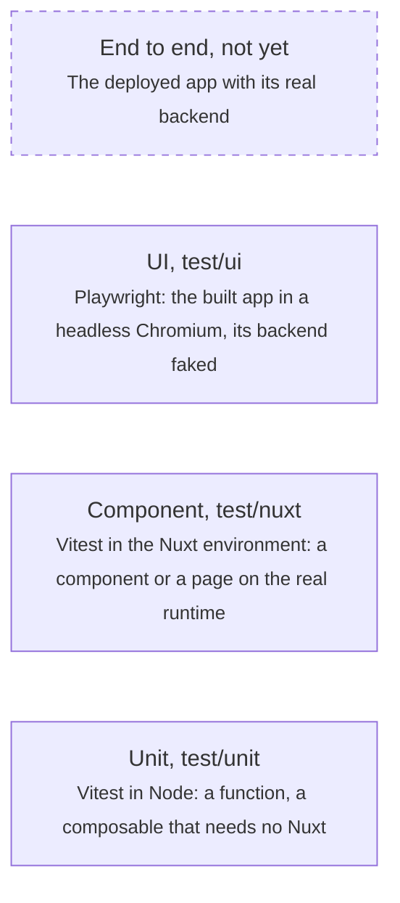

The frontend is a Nuxt 4 app rendered on the server, which extends frontend
[tech starters](../1.engineering/2.architecture/6.tech-starters.md), Nuxt layers that each hold one technical concern.
The app, the starters, the documentation site and the hooks' tests install from one pnpm workspace. Each product
feature ships back and front together, so the frontend gets the same shape as the backend: a thin app over
starters that own the technology.

## Context

The Nuxt 3 app reached its end of life on 2026-07-31, on PrimeVue 3. It called the backend cross-origin without
cookies, CSRF header or idempotency key, so none of its calls could pass the `security-starter`. Its lock had fallen
behind ten Renovate pull requests, and a fresh one brought advisories with no fix on the Nuxt 3 line.

Three Node projects lived side by side, the app, the site and the hooks' tests, each with its own `package-lock.json`
and its own install step in CI. The coming starters, an API client, sign-in, translations, a design system, each
need a place, a way to be installed and a way to be imported.

## Decision

**A new Nuxt 4 app, rendered on the server.** The Nuxt 3 app is deleted, and `drinkit-frontend` is created again by
the official command. Every page renders on the server first. The server is where the session cookie, the relay to
the backend and a nonce per response live.

**Frontend tech starters are Nuxt layers.** Each starter lives in `tech-starters/frontend/<name>/`, its sources
under `app/` as in the app, and is a package named `@drinkit/<name>`. The app lists it as `workspace:*`, extends it
by that name, and imports what it exposes through the `exports` of its `package.json`, its public API. A starter
holds runtime code only. The first one, `nuxt-starter`, holds what every app and starter relies on: explicit imports,
the error page and the shared hooks.

**One pnpm workspace.** A version lives once, in the strict catalog of `pnpm-workspace.yaml`, and one
`pnpm-lock.yaml` covers every package. A release waits seven days before it can be installed, as Renovate waits, and
a dependency runs its install script only when the workspace allows it.

**The lint rules are tooling, apart from the starters.** `@drinkit/eslint-config`, in `code-analysis/eslint` next to
the configuration of detekt, builds on Nuxt's own ESLint config and adds the strict type-checked rules of
typescript-eslint and our rules for server-side rendering. `@drinkit/stylelint-config`, in `code-analysis/stylelint`,
formats the CSS with Stylelint Stylistic, in `.css` files and in the `<style>` blocks that ESLint does not read. Each
package lists both as dev dependencies, so no lint plugin reaches a production dependency tree.

**Tests on Vitest and Playwright, set up by a test starter.** Every package with unit tests runs them on Vitest,
the tests of the lint rules included, so the lint knows one test runner. `@drinkit/test-starter`, a dev package with
no runtime code, gives each app and starter the same levels, fewer and slower towards the top:

The UI tests also fail a page that breaks WCAG 2.2 AA or passes Google's thresholds of LCP and CLS. They are no
end-to-end tests: their backend is a fake, and the end-to-end level waits for a deployed environment. A test runs the
real code and replaces only a boundary, the call to the backend above all, through MSW handlers on a real port that
the server render reaches. No module mock, not even of a Nuxt composable: the test sets the route, the cookies and
the answers of the backend, and the real runtime does the rest.

**Explicit imports.** `nuxt-starter` turns auto-imports and the component scan off. Every name a file uses comes
from an import, which the lint and the type check enforce.

**Security headers through `nuxt-security`, in `security-starter`.** Like the backend starter of the same name, it
secures every response, and the sign-in joins it later. The module sends a Content Security Policy with a new nonce
on each response, and the other security headers, such as HSTS and `X-Content-Type-Options`. Its rate limiter, XSS
validator and CORS handler stay off: the backend rate limits and checks its input, and the app answers its own origin
only.

## Consequences

- One `pnpm install` sets up every Node project, and Renovate bumps a version in one place.
- pnpm installs each package's own dependencies only, so a package that imports what it never declared fails to
  resolve, where npm would have found it hoisted.
- Each page carries the security headers and its nonce without a line of app code.
- A contributor installs pnpm on top of Node: Node 26, the version of `.nvmrc`, ships without Corepack.
- Every file lists its imports, which takes more lines than auto-imports did.
- The documentation site extends Docus, which needs auto-imports: it keeps them, and only the lint checks its
  imports, for components.
- A page with a nonce is rendered for each request and sent with `Cache-Control: no-store`, so no shared cache keeps
  it.
- A test of a page needs no list of mocks kept in step with Nuxt, but runs in the Nuxt environment, slower than in
  Node.
- Each pull request runs a browser, a few minutes of CI more.

## Alternatives

- **Upgrading the Nuxt 3 app.** Rejected because its calls, its UI library and its tooling all had to change: little
  of it would have survived. It offered a working page list from day one.
- **A single-page app, served as static files.** Rejected because the session relay to the backend and a nonce per
  response need a server. It offered hosting on any static server.
- **npm workspaces.** Rejected because npm has no catalog, no release age and no allow-list of install scripts. It
  offered no new tool to install.
- **Layers reached by a relative path.** Rejected because each import would climb out of the app with `../../`, and
  a starter's dependencies would be declared nowhere. It offered no package to declare.
- **The security headers in `nuxt-starter`.** Rejected because a starter holds one concern, and the backend keeps
  its headers in its `security-starter`. It offered one package fewer.
- **A Nitro plugin of our own for the headers.** Rejected because adding the nonce to every script Nuxt renders is
  the hard part, and `nuxt-security` does it. It offered no dependency.
- **The lint rules inside `nuxt-starter`.** Rejected because the app then listed the lint plugins among its
  production dependencies, and the site installed a whole layer for its rules. It offered one package fewer.
- **Mocks of the Nuxt composables, shared by every test.** Rejected because each test then checks how the page is
  wired, and the mocks must follow every change of Nuxt. It offered tests that run in Node, faster.
- **A mock of the backend in the browser.** Rejected because the server render calls the backend from Nitro, which a
  mock in the browser never sees. It offered no server to start.
- **The UI tests named end to end, as Playwright and Nuxt name them.** Rejected because no real backend runs behind
  them, where an end-to-end test drives the deployed app and all its services. It offered the words of the tools.
- **A nightly run of the UI tests against the real backend.** Rejected because it starts every container and fills
  the database, while the client generated from the OpenAPI contract already follows the backend. It offered a check
  that the fakes answer as the backend does.
- **A Lighthouse CI budget on the built app.** Rejected because Lighthouse drives Chrome through Puppeteer, whose
  dependencies carry advisories with no fixed release and a release of `chromium-bidi` that the trust policy of pnpm
  refuses. It offered scores for SEO and best practices, measured on a throttled phone.
- **Components found with the selectors of `@vue/test-utils` alone.** Rejected because a test then finds an element
  by its markup rather than by its role, label or text. It offered one dependency fewer than Testing Library.
- **Node's own test runner until the test starter.** Rejected because the lint then needed an option to pick the test
  rules of one runner or the other, and every test would move to Vitest later. It offered no dependency.
- **A rule set written from the presets alone.** Rejected because Nuxt's config already knows the folders of pages
  and layouts and brings the Nuxt rules. It offered a lighter lock, by some sixty packages.
- **Keeping auto-imports.** Rejected because an import shows where a name comes from and what a starter exposes.
  Nuxt's documentation argues the other way, for less boilerplate.

## Sources

- [Layers](https://nuxt.com/docs/guide/going-further/layers), Nuxt
- [Auto-imports](https://nuxt.com/docs/guide/concepts/auto-imports), Nuxt, the case for them
- [Catalogs](https://pnpm.io/catalogs), pnpm
- [ESLint config](https://eslint.nuxt.com/packages/config), Nuxt
- [Test doubles](https://abseil.io/resources/swe-book/html/ch13.html), Software Engineering at Google
- [Testing](https://nuxt.com/docs/4.x/getting-started/testing), Nuxt
- [Mitigate cross-site scripting with a strict Content Security Policy](https://web.dev/articles/strict-csp), web.dev
