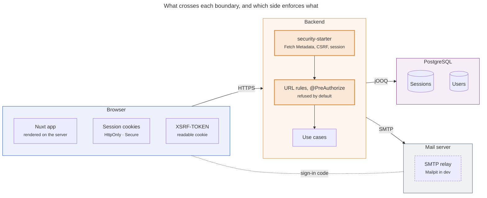
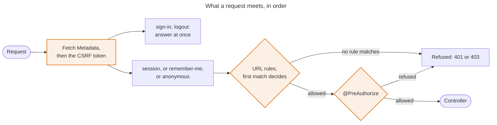
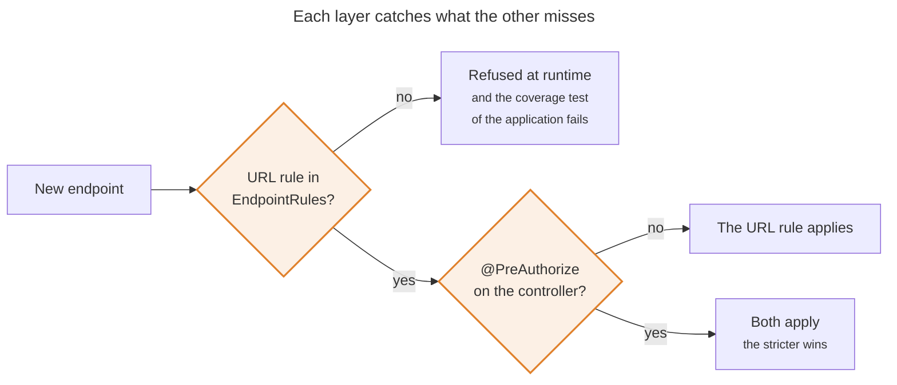
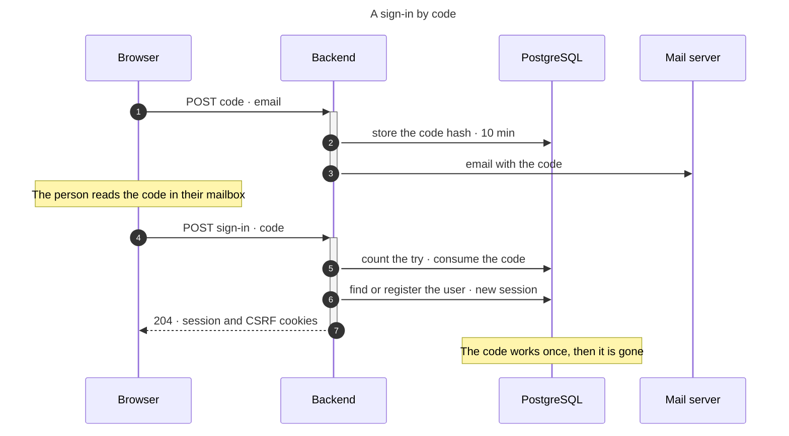
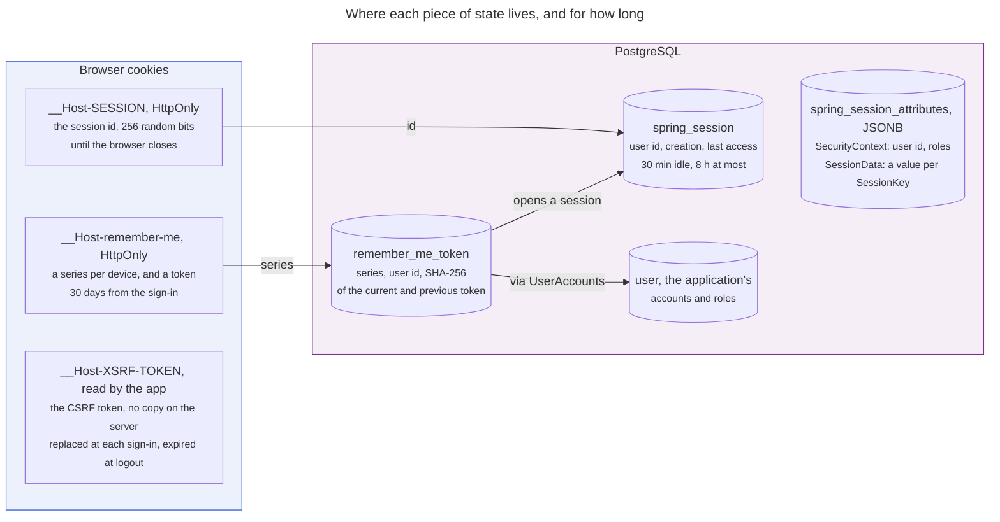
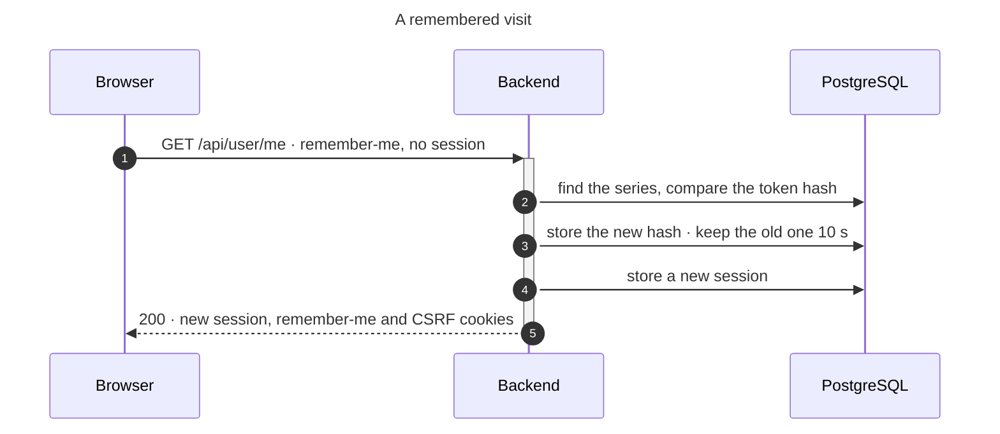
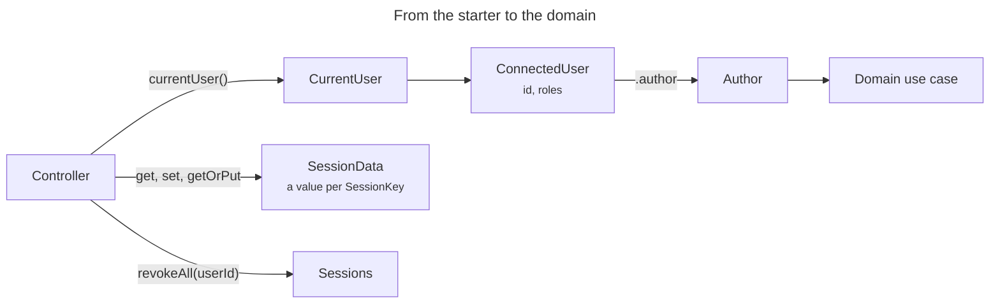

The API of DrinkIt has one client: the browser that runs the Nuxt frontend, on the same origin. The session lives
on the server, in PostgreSQL, and the browser holds only its id, in a cookie that no script can read and no other
site can use. The backend refuses by default: an endpoint answers only once a rule says who may call it, so that a
forgotten rule closes an endpoint instead of opening it. Read this page before you add an endpoint, or change a
cookie, a header or the way users sign in.

The [tech starter](../../1.engineering/2.architecture/6.tech-starters.md) `security-starter` builds all of this from Spring Security and
Spring Session. The backend application that uses it gives it its users and its rules, and
[calling the API](./2.calling-the-api.md) shows what a client sends in return. A call to a language model goes through
the [LLM guardrails](./3.llm-guardrails.md).

## 🗺️ The whole picture

The browser holds random ids and the CSRF token, and what they grant lives in PostgreSQL. The browser's defenses keep
other sites away from a user, but hold only in a browser: curl sends any cookie and any header. The backend's checks
hold for every client, so none of them relies on the browser alone.

## 🎯 Threats and their defenses

Each threat meets the defenses that stop it, enforced by the browser or checked by the backend:

| Threat | Enforced by the browser | Checked by the backend | Decision |
|---|---|---|---|
| Forged request from another site | `SameSite=Lax` | The CSRF token in `X-XSRF-TOKEN`, Fetch Metadata | [ADR 014](../../2.decisions/014-protect-against-csrf-with-a-cookie-token-and-fetch-metadata.md) |
| Injected script reads the session | `HttpOnly`, CSP `default-src 'none'` | | |
| Session id planted before the sign-in | `Secure`, HSTS, the `__Host-` prefix | A new session id at sign-in | |
| Session cookie stolen | `Secure`, HSTS, the `__Host-` prefix | 256-bit ids, 30 min idle, 8 h at most, `Sessions.revokeAll` | [ADR 012](../../2.decisions/012-keep-sessions-in-postgresql.md) |
| Remember-me cookie stolen | `HttpOnly` | Token rotated at each use, replay detected, hashes only | [ADR 013](../../2.decisions/013-remember-me-with-a-rotating-hashed-token.md) |
| Sign-in code guessed | | Code used once, 10 min, 3 wrong tries per email and hour. Tries limited per IP address | [ADR 011](../../2.decisions/011-sign-in-without-a-password.md) |
| Sign-in code read in the database | | SHA-256 hash only | |
| Accounts found by their email | | Same 204 for any email, one 401 for every failure | |
| Code emails sent in bulk | | Code requests limited per email and per IP address | [ADR 020](../../2.decisions/020-rate-limit-in-the-application-with-gcra-on-postgresql.md) |
| Another site frames or reads a response | `frame-ancestors 'none'`, `X-Frame-Options`, CORP and COOP `same-origin`, no CORS | | |
| JSON run as a script | `X-Content-Type-Options: nosniff`, CSP `default-src 'none'` | | |
| Endpoint added without a rule | | Refused by default, coverage test in the build | |
| URL rule too broad for one method | | `@PreAuthorize` on the method | |
| Secrets read in the logs | | OWASP event names, user ids only | |
| Script uploaded as a photo | `X-Content-Type-Options: nosniff`, CSP `default-src 'none'; sandbox` | Upload checked by its bytes, limited per user | [ADR 022](../../2.decisions/022-store-uploaded-files-as-temporary-until-a-use-case-keeps-them.md) |

Most threats meet more than one defense, so that one gap leaves another standing.
[Limits on the requests and the tries](#limits-on-the-requests-and-the-tries) gives those of the sign-in by code.

## 🛣️ The path of a request

Forged requests are refused first, before they reach the sign-in or the logout. The URL rules then run from top to
bottom: the starter's code, sign-in, logout and CSRF endpoints, the `EndpointRules` beans by `@Order`, the one of
`/actuator/health` first, and a last rule that refuses anything else. The starter's endpoints come first so that no rule of the
application can lock users out, and health so that no rule hides it from the platform's probes. A broad pattern such
as `/api/**` goes in the last `EndpointRules` bean, since the first match decides. The beans are the application's,
and those of the other tech starters that serve an endpoint, such as the stream of `sse-starter`:
[ADR 015](../../2.decisions/015-push-server-events-over-sse-to-a-user-or-a-session.md) records why that starter brings the rule
of its own stream.

The application adds `@PreAuthorize` to a controller method that needs more than its URL rule, such as a role, and
the stricter of the two wins. A forgotten URL rule refuses the endpoint, and a test of the backend fails the build
when an operation of the API contract has none. A forgotten annotation leaves the URL rule in force.

Every refusal answers a JSON problem detail: 403 for a forged request, and for a rule 401 to an anonymous caller,
403 to a signed-in one. Its `traceId` leads to the [logs](../../1.engineering/4.build-and-data/3.logging.md) of the request. The starter rethrows a refusal from a controller ahead of the application's exception
handlers, so that a catch-all handler cannot turn it into a 500.

## 🔑 Signing in

A user signs in with a code of six digits sent to their email, in two calls: one asks for the code, the other
sends it back. [ADR 011](../../2.decisions/011-sign-in-without-a-password.md) records why DrinkIt signs users in this way.

The starter draws the code at random and keeps only its SHA-256 hash, for 10 minutes. An email gets 3 wrong tries per
hour, whatever code it holds: a new request replaces the earlier code of that email, never its tries. The request never
looks the email up, so it answers the same 204, as fast, whether an account exists or not. The email is trimmed and
lower-cased before anything else.

The code is accepted once. The starter then asks the application for the account, and DrinkIt's backend brings back
a user deleted less than 30 days ago or creates a new one. A user therefore exists only once a code has proven their
email, and a new user completes their profile to get `ROLE_USER`. A wrong, used or expired code, the last try spent,
or an account the application refuses give the same 401.

The sign-in changes the session id, so that an id planted before it is worth nothing after it, and replaces the CSRF
token in its own response. It also grants the factor of a one-time token, with its time, for a later check of a
recent sign-in. The application changes the session id the same way through `CurrentUser`, when it signs in a user
proven another way or reloads their roles.

A code of six digits can be found back from its hash, which is why it lives minutes.

### Limits on the requests and the tries

Limits stop a caller who guesses codes or floods mailboxes with them. Each one counts the calls of a key with the
[rate limit starter](https://github.com/mboisnard/drinkit/blob/master/tech-starters/backend/rate-limit-starter/README.md),
where a limit of `N` per period gives back one call every `period / N`, as
[ADR 020](../../2.decisions/020-rate-limit-in-the-application-with-gcra-on-postgresql.md) records. A call past a limit
answers 429 with `Retry-After`, the same for any email, and does nothing else: a limited code request sends no email,
and the code already sent to its email still signs in until it expires.

| Counted | Key | Limits | Stops |
|---|---|---|---|
| Code requests | The email | 5 an hour | A mailbox flooded with codes |
| Code requests | The IP address | 50 a day | A script that sends codes to any email |
| Code tries | The IP address | 50 a day | Guesses across emails, and a user locked out by wrong codes sent in their name |

The IP address counts first, so that a caller past its limit spends neither the requests nor the tries of the email it
names. A try counts before its code is checked, so that guesses sent at the same time all count, and a right code counts
too: a user signs in with one request and one try, which the requests of their IP address already bound. An IPv6 address
counts by its network of 64 bits, which one host often gets whole, so that a host cannot pass a limit by taking a new
address of its network for each call. The IP address is the client's: behind a proxy of a private network,
`drinkit-backend` reads it in `X-Forwarded-For`, through `server.forward-headers-strategy`. The limits live in the code
of `security-starter`, as ADR 020 wants of every rule, and `starters.rate-limit.enabled=false` turns them off.

> [!WARNING]
> **Accepted: anyone can spend the requests of an email.** The owner of that email then waits up to the `Retry-After` of
> the refusal for a new code, while the code already sent still signs in. Counting per email is what keeps one mailbox
> from being flooded from many IP addresses.

### Where each piece lives

| Piece | Kind | Where |
|---|---|---|
| The code: its draw, hash, expiry and tries | Authentication | `security-starter`, in `drinkit_session.sign_in_code` |
| The limits on the requests and the tries | Authentication | `security-starter`, counted by `rate-limit-starter` in `drinkit_application.rate_limit` |
| The sending of the code | A channel the application picks | `SignInCodeSender`: `drinkit-backend` publishes a [platform event](../../1.engineering/3.domain/2.platform-events.md), whose handler emails the code after the answer |
| The account: its creation, reactivation and roles | Business | The `user` [event stream](../../1.engineering/3.domain/1.event-sourcing.md), which the starter reaches through `UserAccounts` |

`UserAccounts` and `SignInCodeSender` are the ports the application implements, so that the starter reads no table
of the application and sends no email itself.

## 🍪 Sessions and cookies

The cookies hold random values only, and what they grant lives in rows that a revocation deletes. A session ends
after 30 idle minutes or 8 hours, and `Sessions.revokeAll` signs a user out everywhere at once.
[ADR 012](../../2.decisions/012-keep-sessions-in-postgresql.md) records why the session lives in PostgreSQL and how long it
lasts. An anonymous caller gets no row until the application writes its `SessionData`: the CSRF token lives in its
cookie, and the starter keeps no refused request.

Every cookie is `Secure`, `SameSite=Lax` and `Path=/`, and the session and remember-me cookies are `HttpOnly`:

- **`Secure`** keeps the cookie off plain HTTP, where anyone on the network reads it.
- **`HttpOnly`** keeps the session out of reach of a script injected into the page.
- **`SameSite=Lax`** leaves the cookies out of a request another site starts, except a top-level navigation, so a
  link from an email still opens DrinkIt signed in.
- **The `__Host-` prefix** makes the browser refuse a cookie set by a subdomain or a plain HTTP page.
- **`Path=/`** is set by hand: the backend runs under the context path `/drinkit`, and the browser drops a
  `__Host-` cookie with any other path.

The `dev` profile runs over plain HTTP on `localhost`, and drops both the prefix and `Secure`. The starter refuses to
start with a prefix and no `Secure`.

A remember-me cookie opens a new session once the current one has ended. Its token changes at each use and is stored
hashed, so that a stolen copy shows itself the first time both copies are used, and it lasts 30 days from the
sign-in. [ADR 013](../../2.decisions/013-remember-me-with-a-rotating-hashed-token.md) explains the rotation, its grace for
parallel requests and the theft detection.

## 🛡️ Forged requests

A forged request comes from another site, with the victim's cookies. `SameSite=Lax` already keeps them off a
cross-site `POST`, and two checks of the backend stand behind it, on every method but `GET`, `HEAD`, `OPTIONS` and
`TRACE`:

- **CSRF token.** The client copies the `__Host-XSRF-TOKEN` cookie into the `X-XSRF-TOKEN` header, which another
  site cannot read to fill.
- **Fetch Metadata.** The starter refuses a request whose `Sec-Fetch-Site` is neither `same-origin` nor `none`, a URL
  the user typed. A client that sends no such header, such as curl, still needs the token.

The sign-in needs the token too: without it, another site could sign the victim in to the attacker's account.
[ADR 014](../../2.decisions/014-protect-against-csrf-with-a-cookie-token-and-fetch-metadata.md) records why the token lives in
a cookie rather than in the session.

## 📋 Security headers

DrinkIt sends no CORS header: the app and the API share one origin in production, and the Nuxt dev server forwards
the API calls in development. The browser then keeps any other origin from reading a response. Each response also
carries these headers, which cost nothing to a JSON API:

| Header | Value | Protects against |
|---|---|---|
| `Content-Security-Policy` | `default-src 'none'; frame-ancestors 'none'` | A response rendered as a page that loads scripts, or framed by another site |
| `Strict-Transport-Security` | `max-age=31536000; includeSubDomains` | A first request in plain HTTP, sent even when TLS ends at a proxy |
| `X-Content-Type-Options` | `nosniff` | A JSON response that the browser guesses to be a script |
| `X-Frame-Options` | `DENY` | Framing, for browsers that ignore `frame-ancestors` |
| `Referrer-Policy` | `strict-origin-when-cross-origin` | A URL and its parameters sent to another site |
| `Permissions-Policy` | Camera, microphone and location turned off | A page of DrinkIt that uses them |
| `Cross-Origin-Opener-Policy` | `same-origin` | A window of another site that keeps a handle on DrinkIt's |
| `Cross-Origin-Resource-Policy` | `same-origin` | Another site that embeds a response of the API |
| `Cache-Control` | `no-cache, no-store, max-age=0, must-revalidate` | Personal data left in a shared or browser cache |
| `Clear-Site-Data` | `"cache", "storage"`, at logout, over HTTPS | What the app stored in the browser, kept after logout |

`Clear-Site-Data` leaves out `"cookies"`, which Chrome applies to every subdomain. The logout expires DrinkIt's
cookies one by one instead.

## 🖥️ In the Nuxt app

The pages of the Nuxt app go through the same backend: the app holds no session of its own, and the access a page
declares only decides what it shows, as
[ADR 025](../../2.decisions/025-follow-the-backend-session-in-the-nuxt-app-and-declare-the-access-of-every-page.md)
records. What the app adds, against the requirements of the OWASP ASVS 5.0:

| Threat | Defense in the app | ASVS 5.0 |
|---|---|---|
| A script injected through the data of a page | Vue escapes every interpolation, the lint refuses `v-html`, and the CSP of each page holds a nonce | V1.2.1, V3.4.3 |
| A change forged from another site | The CSRF cookie copied into `X-XSRF-TOKEN`, fetched when missing, and `Sec-Fetch-Site` passed on by the relay | V3.5.1 |
| A sign-in that ends on another site | The return URL kept only when it stays on the app's origin | V3.7.2 |
| A script that reads the session | No code of the app reads it: the HttpOnly cookie goes through the relay, and the user comes from the backend | V3.3.4, V7.2.1 |
| A page shown to someone it is not for | Every page declares its access and is closed when it forgets, the backend checks every call | V8.2.1, V8.3.1 |
| The data of a user left after the sign-out | The session ended on the backend, the state, the data of the pages and the payload the server rendered into the page cleared, the pages never cached | V7.4.1, V14.3.1, V14.3.2 |
| A page framed, sniffed or reached in plain HTTP | `nuxt-security`: `frame-ancestors 'self'`, `nosniff`, `Referrer-Policy: no-referrer`, COOP `same-origin`, HSTS for a year | V3.4.1, V3.4.4 to V3.4.6, V3.4.8 |
| An internal error shown to the user | The error page shows the title and the detail of a ProblemDetail, the status alone otherwise | V16.5.1 |

The CSP of the pages still names no `default-src` nor `connect-src`, and allows inline styles: V3.4.3 is met for the
scripts, not yet for the other kinds of sources.

## 📎 Uploaded files

A file uploaded by a user is the classic way to store an attack, such as a script disguised as an image. The
[file storage starter](https://github.com/mboisnard/drinkit/blob/master/tech-starters/backend/file-storage-starter/README.md)
takes uploads on one route only, and refuses a file before anything is stored when:

- its user passed 20 uploads in 10 minutes or 200 in a day, answered 429
- its usage is not one the application declares, or it is larger than its usage allows, answered 400 or 413
- the type read from its bytes is not one of its usage's, or its extension or declared type does not match its
  bytes, answered 415.

A usage cannot allow a type able to carry a script, such as SVG or HTML: the application refuses to start. A private
file is read only by its uploader, an admin, or whom the business allows on the object it is kept on, and deleted
only by its uploader or whom that object allows, else 404. It is served through a signed URL that expires within 5
minutes, with the type read from its bytes, a `Content-Disposition` that names a sanitized file, `X-Content-Type-Options: nosniff` and
`Content-Security-Policy: default-src 'none'; sandbox`. Images are not decoded yet, so a pixel bomb or a payload
hidden in the metadata is not caught.
[ADR 022](../../2.decisions/022-store-uploaded-files-as-temporary-until-a-use-case-keeps-them.md) records why files go
through the application rather than straight to a bucket.

## 📝 Security events in the logs

The starter logs each security event under a name of OWASP's
[logging vocabulary](https://cheatsheetseries.owasp.org/cheatsheets/Logging_Vocabulary_Cheat_Sheet.html), such as
`authn_login_success`, `authn_login_fail`, `authn_token_reuse`, `authz_fail` or `session_revoked`, so that an alert
can match on them. A success names its method, such as `authn_login_success:<id>,method=email_code` or
`method=remember_me`. A user appears by their id only, and no email, sign-in code, token, cookie or session id
reaches the [logs](../../1.engineering/4.build-and-data/3.logging.md): a log is read by more people than the database. An anonymous
caller refused is the normal start of every visit, and is not logged.

## 🧩 What the business code uses

A controller reads the connected user from `CurrentUser`, and turns it into the `Author` that the use cases of the
domain take, so that the domain never depends on the starter. `SessionData` keeps values in the session of a user or
a visitor, and `Sessions.revokeAll` signs a user out everywhere, after a role change or a deletion. The
[README of `security-starter`](https://github.com/mboisnard/drinkit/blob/master/tech-starters/backend/security-starter/README.md)
shows how an application plugs it in.

## 📚 Sources

- [Application Security Verification Standard 5.0](https://github.com/OWASP/ASVS/tree/v5.0.0), OWASP
- [File Upload Cheat Sheet](https://cheatsheetseries.owasp.org/cheatsheets/File_Upload_Cheat_Sheet.html), OWASP
- [Session Management Cheat Sheet](https://cheatsheetseries.owasp.org/cheatsheets/Session_Management_Cheat_Sheet.html), OWASP
- [HTTP Security Response Headers Cheat Sheet](https://cheatsheetseries.owasp.org/cheatsheets/HTTP_Headers_Cheat_Sheet.html), OWASP
- [Unvalidated Redirects and Forwards Cheat Sheet](https://cheatsheetseries.owasp.org/cheatsheets/Unvalidated_Redirects_and_Forwards_Cheat_Sheet.html), OWASP
- [Spring Security reference](https://docs.spring.io/spring-security/reference/), Spring
