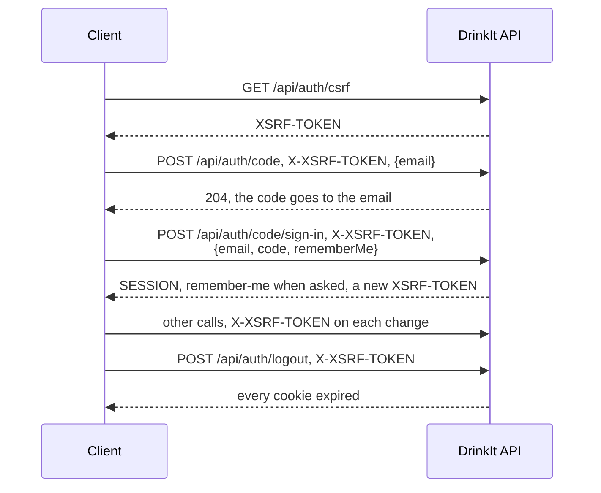
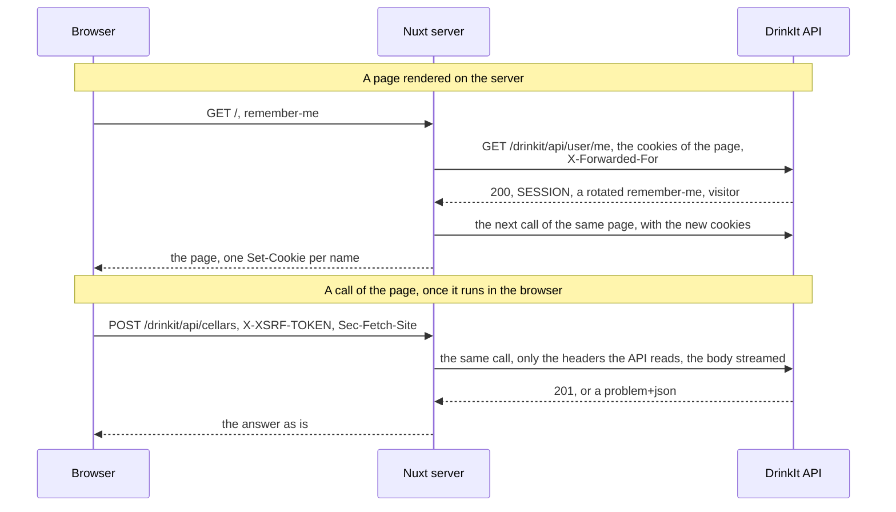
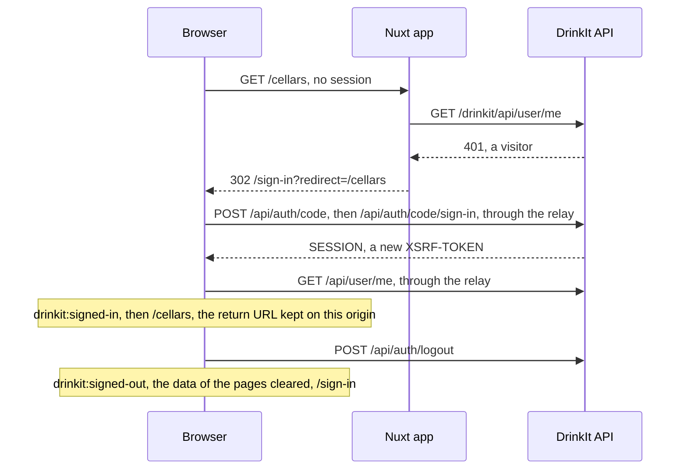

The API recognizes a signed-in user by a session cookie, and refuses a request that changes state without the CSRF
token. A client keeps the cookies the API sets, and copies the CSRF cookie into the `X-XSRF-TOKEN` header of every
request but `GET`, `HEAD` and `OPTIONS`. The [security principles](./1.principles.md) explain why.

## Cookies by profile

Every path starts with the context path `/drinkit`: `http://localhost:8080/drinkit` under
`./gradlew :drinkit-backend:bootRun`.

| Cookie | `dev` profile, plain HTTP | Other profiles, HTTPS |
|---|---|---|
| Session | `SESSION` | `__Host-SESSION` |
| CSRF token | `XSRF-TOKEN` | `__Host-XSRF-TOKEN` |
| Remember-me | `remember-me` | `__Host-remember-me` |
| Visitor | `visitor` | `__Host-visitor` |

A browser accepts a `__Host-` cookie only from a secure origin, so the `dev` profile drops the prefix and the
`Secure` flag.

## A session, call by call



A sign-in, by code or by the remember-me cookie, sets a new CSRF token in its response, which the next request
sends. A logout expires it, so the client calls `GET /api/auth/csrf` again before its next change.

## From the Nuxt app

The browser never calls the backend's origin. It calls `/drinkit/**` on the app's own origin, the path the app sets in
`apiClient.path`, which the server of the app relays to the backend, so the cookies stay first-party and no CORS is
needed. A page rendered on the server calls the backend itself, with the cookies of the request, and hands the browser
the cookies the backend sets.
The `api-client-starter` does both, and
[ADR 024](../../2.decisions/024-generate-the-frontend-api-client-with-hey-api-at-each-build.md) records why its client
is generated with Hey API.



- **One `Set-Cookie` per name.** A page may call the backend several times while it renders, and each call carries
  the cookies the earlier ones set. A rotated remember-me cookie rotates once, and the browser gets one value of
  each cookie, the last.
- **Only the cookies of the API.** Both paths send the backend `SESSION`, `XSRF-TOKEN`, `remember-me` and
  `visitor`, with or without their `__Host-` prefix, and none of the other cookies of the browser. A cookie the
  backend expires leaves the later calls of the render.
- **Where the client is.** The backend limits sign-in codes by IP address, so both paths set `X-Forwarded-For` and
  `X-Forwarded-Proto` from the browser's connection and drop the ones the browser sends. Behind an ingress, that
  connection becomes the ingress's, and the ingress's headers must be trusted instead.
- **Fetch Metadata.** The relay passes `Sec-Fetch-Site` on, so the backend still refuses a change sent from another
  site. A call of the server render sends none, since it is not the browser's.
- **The CSRF token.** Every call but `GET`, `HEAD`, `OPTIONS` and `TRACE` copies the CSRF cookie into
  `X-XSRF-TOKEN`, reading `__Host-XSRF-TOKEN` before `XSRF-TOKEN`: a cookie without the prefix may come from
  another site of the domain. A change that finds no CSRF cookie, the first of a visitor or the first after a
  sign-out, calls `GET /api/auth/csrf` once before it leaves, the path the app sets in `apiClient.csrfPath`.

A page calls a function of the generated client with the options of `useApi()`, in a `useAsyncData`:

```ts
import { useAsyncData } from '#app'
import { getConnectedUserInfo } from '#api'
import { useApi } from '@drinkit/api-client-starter/use-api'

const api = useApi()
const { data: user } = useAsyncData('user', async () => (await getConnectedUserInfo(api)).data)
```

A refused call throws a `ProblemError`, which carries the problem the backend sent and tells the
`drinkit:api:problem` hook. A refusal the page does not catch reaches the `observability-starter`, which shows the user
a toast with the backend's `traceId`, never the `detail` of the problem. A call made without `useApi()` fails at once rather than leave without the cookies of
its user. The README of the starter lists its configuration.

## Signed in, from the Nuxt app

`security-starter` follows the backend's session: it reads the current user from the path the app sets in
`auth.currentUserPath`, once on the server for the first page, whose payload hands it to the browser, then again
only when the session changes. [ADR 025](../../2.decisions/025-follow-the-backend-session-in-the-nuxt-app-and-declare-the-access-of-every-page.md)
records why the app keeps no session of its own.



- **Who may open a page.** Each page declares it, `definePageMeta({ auth: 'public' })`, `'signed-in'` or a role such
  as `'ROLE_USER'`. A visitor goes to sign in with the page as return URL, a signed-in user without the role gets a
  403, or the page `auth.forbiddenRedirects` gives one of their roles. A page that declares nothing fails the type
  check, and is closed to visitors at run time.
- **The return URL.** Kept only when it stays on the app's origin: `//other.site`, a backslash or a scheme send the
  user home.
- **An ended session.** A 401 to a signed-in user, after an idle timeout or a sign-out on another device, forgets
  them and sends them to sign in, back to the page after.
- **The sign-out.** It ends the session on the backend, puts every state back to the value it starts with, and
  clears the data the pages read and the payload the server rendered into the page, so that the back button shows
  nothing of the user and a module that watches its own state, such as the Nuxt DevTools, keeps working.

```ts
import { useCurrentUser } from '@drinkit/security-starter/use-current-user'

const { user, signedIn, hasRole, signOut } = useCurrentUser()
```

The README of the starter lists its configuration, and its double of the protocol for the tests.

## From Postman

Postman keeps the cookies in its cookie jar, and a pre-request script of the collection copies the CSRF cookie into
the header:

1. In the cookie jar settings, add `localhost` to the domains that scripts may read.
2. Add this script to the collection, under "Pre-request".
3. Send `GET {{baseUrl}}/api/auth/csrf`, then `POST {{baseUrl}}/api/auth/code` with `{"email": "demo@drinkit.test"}`.
4. Read the code in the email, which the `dev` profile sends to Mailpit, on `http://localhost:8025`.
5. Send `POST {{baseUrl}}/api/auth/code/sign-in` with `{"email": "demo@drinkit.test", "code": "<the code>"}`.

```js
const url = pm.variables.replaceIn(pm.request.url.toString())
pm.cookies.jar().get(url, 'XSRF-TOKEN', (error, token) => {
  if (token) pm.request.headers.upsert({ key: 'X-XSRF-TOKEN', value: token })
})
```

## Sources

- [Cross Site Request Forgery, single-page applications](https://docs.spring.io/spring-security/reference/servlet/exploits/csrf.html#csrf-integration-javascript-spa), Spring Security
- [Passing cookies from server-side API calls](https://nuxt.com/docs/4.x/getting-started/data-fetching#passing-cookies-from-server-side-api-calls-on-ssr-response), Nuxt
- [Script with cookies](https://learning.postman.com/docs/tests-and-scripts/write-scripts/postman-sandbox-reference/pm-cookies/), Postman
