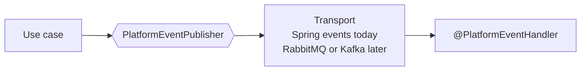

# 0006. Carry platform events through an abstraction

- Status: accepted
- Date: 2026-10-30

The asynchronous messages between the parts of DrinkIt, its platform events, go through an abstraction of
`messaging-starter`: a publisher, and handlers that declare in an annotation what they need from a transport. Spring
application events carry them today, inside the process, and RabbitMQ or Kafka can replace them without a change to
the code that publishes or handles.

## Context

A use case often triggers work that does not have to happen before it returns: the creation of a user sends a
verification email, a new bottle updates the search index, another bounded context reacts to a fact. Done inline,
that work slows the use case down and makes it fail when an email server or a search engine is down.

DrinkIt runs as one process today, where Spring application events are enough. Once it runs as several instances, an
event will have to survive a restart and reach every instance that needs it, which takes a broker. Which broker is not
decided yet, and a broker is one more server to run in every environment.

## Decision

Code publishes through `PlatformEventPublisher` and handles in a method annotated `@PlatformEventHandler`, as the
[platform events page](../architecture/platform-events.md) describes. Neither names the transport.

- **What a handler needs, declared once.** The annotation names the handler's queue, its exchange, a queue per
  instance when every instance must get the event, a first delay and a number of attempts. The starter turns that
  into what its transport understands, and ignores what the transport cannot honor.
- **The same behavior on any transport.** An event leaves once the publishing transaction commits, never on a
  rollback, and a failed handler gets it again after a growing wait.
- **Tests without a transport.** A use case is tested with `SpyPlatformEventPublisher`, which records what it
  published.

The events are not yet described by a contract. Once a broker carries them, an AsyncAPI file would describe them,
shared from the repository as [ADR 0000](0000-keep-every-project-in-one-repository.md) records.

## Consequences

- Moving to a broker changes the starter, not the use cases nor the handlers.
- A new reaction to a fact is a new handler, with no change to the code that publishes it.
- The work after a use case is eventually consistent: the email leaves some time after the creation, and a failed
  handler leaves the user created.
- Today an event still waiting, for its delay or its retry, is lost when the application stops, and an event whose
  handler fails every attempt is dropped after a log line.
- Every handler sets attributes that only a broker reads, such as its queue, so that the move changes no handler.

## Alternatives

- **Spring application events used directly.** Rejected because every handler would change with the move to a broker.
  It offered nothing to write.
- **A broker from the start.** Rejected because it adds a server to every environment, the local start included, while
  one instance runs. It offered events that survive a restart.
- **Spring Cloud Stream.** Rejected because its bindings live in configuration, apart from the handler, and it brings
  a model of its own to learn. It offered an abstraction over brokers already written.

## Sources

- [What do you mean by "Event-Driven"?](https://martinfowler.com/articles/201701-event-driven.html), Martin Fowler
- [Transactional outbox](https://microservices.io/patterns/data/transactional-outbox.html), Chris Richardson, what an
  event lost at a restart would need
- [Spring application events](https://docs.spring.io/spring-framework/reference/core/beans/context-introduction.html#context-functionality-events), Spring
