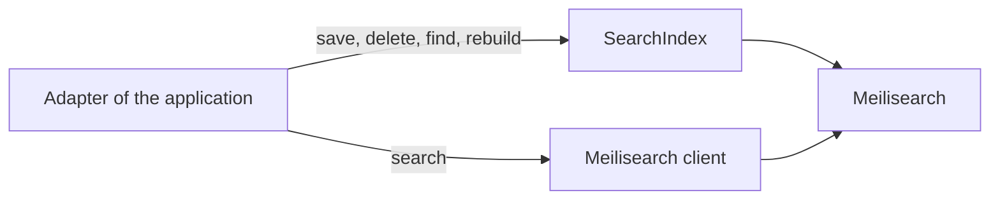

# 0008. Index through an abstraction, search with Meilisearch

- Status: accepted
- Date: 2026-11-03

DrinkIt searches its catalog with Meilisearch, behind an abstraction that lets it move to Elasticsearch or another
engine if the need comes. The abstraction covers what every engine shares, writing, reading by id and rebuilding an
index, and a search goes through the engine's own client, since each engine searches its own way.

## Context

The catalog of bottles, wines, beers and spirits, will be searched by its words, and maybe later by meaning, through
vectors. The data lives in PostgreSQL, and a search index holds a copy of it built for search.

Meilisearch fits DrinkIt today: one small server, typo tolerance and facets out of the box, and little to tune.
Elasticsearch does more, at the cost of a heavier server to run and tune, and may be needed later. Both engines write,
delete and swap indexes in the same way, but their queries, filters, ranking and vectors differ. A query language
common to both would keep only what both can do.

## Decision

The application declares each index with the engine's own settings file, and gets a typed `SearchIndex` from
`search-engine-starter`, which saves, deletes and finds a document by its id, and rebuilds the index as
[ADR 0009](0009-rebuild-search-indexes-in-batches-tracked-in-postgresql.md) records. A write returns once the engine
has applied it, so a read that follows sees it.

A search, and an operation only one engine offers, go through the engine's client, which the starter configures. The
Meilisearch code lives in one package of the starter, so another engine comes as a sibling package that implements the
same interfaces, and passes the same contract tests. The starter's README shows the usage.

## Consequences

- Changing engines rewrites the queries and the settings files, not the writes nor the rebuilds.
- A search can use every feature of its engine, with no layer of the project to learn or to extend.
- A behavior on every write, such as a metric, goes in one place.
- Nothing stops an adapter from writing through the client, and such a write skips the starter.

## Alternatives

- **Elasticsearch now.** Rejected because it is a heavier server to run, for a search that Meilisearch covers. It
  offered more features.
- **The engine's client only.** Rejected because changing engines would rewrite every caller, and nothing would control
  the writes. It offered the least code.
- **A query language common to every engine, as Spring Data or Spring AI offer.** Rejected because a query reaches
  only what every engine can do, and the language grows with each need. It offered one way to query any engine.

## Sources

- [Comparison to alternatives](https://www.meilisearch.com/docs/learn/resources/comparison_to_alternatives), Meilisearch
- [Full text search](https://www.postgresql.org/docs/current/textsearch.html), PostgreSQL, the option of no search
  engine at all
