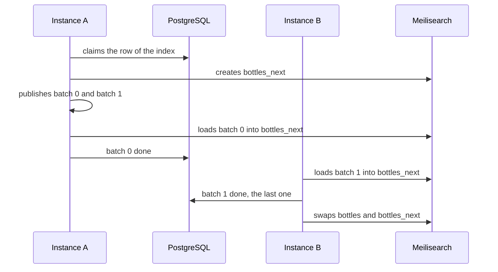

# 0009. Rebuild search indexes in batches tracked in PostgreSQL

- Status: accepted
- Date: 2026-11-04

A rebuild of a search index fills a second index from the database, then swaps it with the live one. Its work is
split into batches that any instance can load, and one PostgreSQL row counts the batches done. A rebuild that never
reaches its end starts over from scratch: one rule that covers every failure.

## Context

The search index follows the database document by document, from the handlers of the application's events, as
[ADR 0008](0008-index-through-an-abstraction-search-with-meilisearch.md) records. It still has to be rebuilt in full
when its settings change, and on a schedule, to catch a document that a lost event left behind. A document is built
from several tables, and the catalog can hold many of them.

The application will run as several instances on Kubernetes, which redeploys them at any time, so a rebuild cannot
rely on one instance living until the end. The [platform events](../architecture/platform-events.md) travel in memory
today, so an event can be lost when its instance stops.

## Decision

A rebuild claims one row for its index, creates `<index>_next`, and publishes one platform event per batch of ids.
Any instance loads a batch into `<index>_next` and records it in the row. The instance that records the last batch
swaps the two indexes, in one transaction that only one instance wins.

A batch delivered twice counts once, and a batch of an older rebuild counts for nothing. A write made during a
rebuild goes to both indexes, so the swap keeps it. Once the row is older than a set delay, the next rebuild deletes it
and starts over, which covers a lost event and a stopped instance alike. The starter runs no scheduler of its own:
a scheduled job or an admin triggers the rebuilds. Elasticsearch fits the same split, with an alias moved in place of
the swap.

## Consequences

- A rebuild brings the latest version of each document, and none of the deleted ones.
- The state of a rebuild is one row, and its progress the number of batches done.
- A rebuild stuck on a lost event waits for the next call past the delay, then loads every batch again.
- A batch can write a copy older than a change made at the same time, and the index serves it until the next event
  of that document.
- Every application that uses the search starter needs PostgreSQL, even one that never rebuilds.

## Alternatives

- **Copying the live index into the new one.** Rejected because it keeps the stale and deleted documents that a rebuild
  exists to remove. It offered speed.
- **One worker reading the source from a cursor.** Rejected because one instance does all the work while the others
  wait. It offered the simplest exact rebuild.
- **One row per batch, with states and retries of the lost batches.** Rejected because it needs a second table and
  races between instances to reason about. It offered to redo only what was lost.
- **Spring Batch with remote partitioning.** Rejected because it brings tables and a framework of its own for one kind
  of job. It offered the same model ready made.

## Sources

- [Zero-downtime index deployment](https://www.meilisearch.com/blog/zero-downtime-index-deployment), Meilisearch
- [Aliases](https://www.elastic.co/guide/en/elasticsearch/reference/current/aliases.html), Elastic, the same swap in
  Elasticsearch
