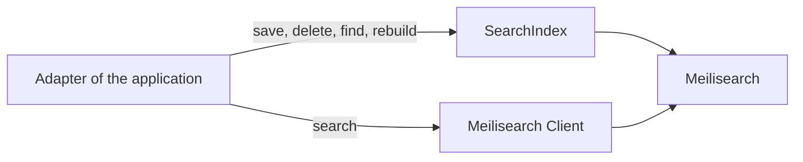

# 0009. Search index writes through the starter, searches through the engine's SDK

- Status: accepted
- Date: 2026-11-03
- Issue: [#390](https://github.com/mboisnard/drinkit/issues/390)

DrinkIt keeps its bottles in PostgreSQL and copies them into a search index. The application writes to that index,
reads a document back by its id and rebuilds the index through the `SearchIndex` interface of the tech starter
`search-engine-starter`, and searches it through the engine's SDK, the Meilisearch `Client` today. The writes are what
every engine shares and what the starter must control, the queries are what each engine does its own way.

## Context

The catalog of bottles, the epic [#372](https://github.com/mboisnard/drinkit/issues/372), will search bottles by
their words, and maybe by their meaning later, through vectors. Meilisearch is the engine today, and Elasticsearch
may replace it. Comparing the two:

| | Meilisearch | Elasticsearch |
|---|---|---|
| Write, replace, delete a document by id | `addDocuments`, `deleteDocument` | `index`, `_bulk`, `delete` |
| Rebuild an index without downtime | `swapIndexes`, atomic | an alias switched in one `_aliases` call |
| A write visible once it returns | a task to wait for | `refresh=wait_for` |
| Query, filter, facets, synonyms, ranking | search parameters, settings | Query DSL, analyzers |
| Vectors | `_vectors` and `hybrid` | `dense_vector` and `knn`, or `semantic_text` |

The first three rows mean the same thing in both engines, the last two do not. A query language common to both
would keep only what both can do.

Exposing only the `Client` was considered first, and turned down by the maintainer: when the application writes
through the SDK, the starter can add nothing to a write, such as waiting for the engine, counting the progress of a
rebuild or measuring the writes.

## Decision

The application declares each index with a settings file, the engine's own settings in JSON on the classpath, and
gets a typed `SearchIndex` that saves, deletes and finds a document by its id, and rebuilds the index, as
[ADR 0010](0010-search-index-rebuilds-in-batches-tracked-in-postgresql.md) describes. A write returns once the engine
has applied it, so a read that follows sees it, and fails with the engine's error, so the event that triggered it is
retried. A `SearchEngine` gives the version of the engine and its indexes with their number of documents, for an
admin page. The README of the starter shows the usage.

A search goes through the SDK, which the starter configures and exposes as a bean, and so does an operation that
only one engine offers, such as a partial update or a deletion by filter. A vector is a field of the document, saved
by `save` like any other. The starter computes no vector: computing one needs a model, a provider and a cost of its
own, a concern for another starter, and the adapter puts the vector it gets in the document.

The Meilisearch code lives under one package of the starter, so another engine comes as a sibling package that
implements the same interfaces.

## How it is checked

`SearchIndexTestContract` and `SearchEngineTestContract` run against the in-memory double of the test fixtures and
against Meilisearch, so a second engine passes the same tests.

Not checked: an adapter that writes a document through the `Client`, when `SearchIndex` offers the same write, fails
no build yet. [#562](https://github.com/mboisnard/drinkit/issues/562) adds the architecture rule that refuses it.

## Consequences

- A behavior on every write, such as a metric, goes in one place, the implementation of `SearchIndex`.
- Changing engines rewrites the queries and the settings files of the application, not its writes nor its rebuilds.
- A search uses every feature of its engine, with no layer of the project to learn or to extend.
- An operation the interface lacks is written against the `Client`, beside the interface, and moves into it once
  both engines offer it.

## Alternatives

- Expose the SDK only: the least code, but the starter controls none of the writes.
- A query language common to both SDKs, as Spring Data or Spring AI offer: a query reaches only the features of both
  engines, and the language grows with each new need. Spring AI's `VectorStore` shows it, with a filter that some
  stores do not support in full and a `getNativeClient()` to reach the engine.

## Sources

- [Vector databases](https://docs.spring.io/spring-ai/reference/api/vectordbs.html), Spring AI
- [Swap indexes](https://www.meilisearch.com/docs/reference/api/indexes/swap-indexes), Meilisearch
- [Aliases](https://www.elastic.co/docs/manage-data/data-store/aliases), Elastic
