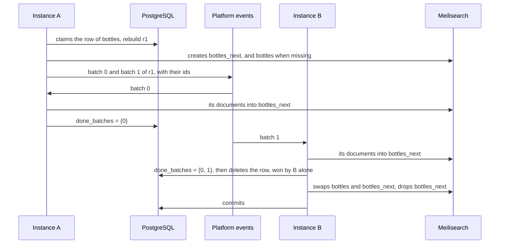

# 0010. Search index rebuilds in batches tracked in PostgreSQL

- Status: accepted
- Date: 2026-11-04
- Issue: [#390](https://github.com/mboisnard/drinkit/issues/390)

A rebuild of a search index fills a second index, `<index>_next`, from the database, then swaps it with the live
one. It publishes one platform event per batch of ids, which any instance loads, and counts the batches done in one
PostgreSQL row. A rebuild that reaches no end starts over from scratch, the one rule that covers every failure.

## Context

The `SearchIndex` of [ADR 0009](0009-search-index-writes-through-the-starter-searches-through-the-engine-sdk.md)
follows the database document by document, from the handlers of the application's events. An index is rebuilt in
full when its settings change, and on a schedule, to catch a document that a lost event left behind. The application
reads the ids and the documents through a `SearchDocumentSource` it implements over its tables. A document is an
aggregate, built from several tables.

The application will run as several instances on Kubernetes, which redeploys them at any time. The
[platform events](../architecture/platform-events.md) travel in memory today, so an event still waiting when its
instance stops is lost. RabbitMQ or Kafka will carry them soon, and a broker also gives up on a message after its
last attempt.

## Decision

`rebuild()` first claims one row for the index, with a new rebuild id. It claims it before it touches `<index>_next`,
so that two instances that rebuild at once never drop the next index of the other. It then creates `<index>_next`, and
the live index when the engine lost it, with the settings of the index, and pages the ids of the source by
`starters.search-engine.rebuild.batch-size`. It stores the number of batches in the row, and publishes one event per
batch, with the rebuild id and the ids of the batch.

The handler of a batch, on any instance, loads nothing once the row belongs to another rebuild or is gone, so a batch
delivered again after the swap recreates no `<index>_next`. Otherwise it reads the documents of its ids from the
source and writes them into `<index>_next`. It then adds its batch to the `done_batches` array of the row, unless the
array holds it already or the row belongs to another rebuild. An event delivered twice counts once, and a batch of a
previous rebuild counts for nothing.

The instance whose batch completes the array deletes the row with
`DELETE … WHERE cardinality(done_batches) = total_batches`, which one transaction only wins. It swaps the two indexes,
waits for the swap, drops `<index>_next`, which holds the old content, then commits. Until that commit, a write
through `SearchIndex` still finds the row and goes to both indexes, so the swap keeps it.

A call to `rebuild()` while a rebuild runs returns its progress. Once the row is older than
`starters.search-engine.rebuild.restart-after`, the call deletes it and starts over. This one rule covers a lost
event, a stopped instance and a swap sent by an instance that stopped before its commit. Starting over is always
safe: once the swap has passed, `<index>_next` holds the old content only, and before it, the new rebuild fills it
again. The scheduled job or the admin that triggers rebuilds repairs them this way, and the starter runs no scheduler
of its own.

The starter owns the table `search_index_rebuild` and depends on `postgresql-starter` and `messaging-starter`.

Elasticsearch fits the same split: `<index>_next` becomes `<index>_<timestamp>`, and the swap moves the alias of the
index in one `_aliases` call.

## How it is checked

`MeilisearchRebuildTest` runs two applications on the same database and engine, which keep the events they publish
for the test to deliver. It covers batches loaded by different instances, a batch delivered twice, a batch of a
previous rebuild, a rebuild started over after `restart-after`, even after its swap, a live index the engine lost, and
a write or a delete made during a rebuild.

## Consequences

- A rebuild brings the latest version of each document, and none of the deleted ones.
- The state of a rebuild is one row, and its progress the length of an array.
- A rebuild stuck on a lost event waits for the first `rebuild()` past `restart-after`, then loads every batch again,
  even the ones done.
- An event carries the ids of its batch, a thousand ids by default.
- The instance that swaps keeps its transaction open for the swap, up to `task-timeout`, and a `rebuild()` of the
  same index waits for it.
- A batch can read a document just before it changes, then write that older copy into `<index>_next` after the write
  of the change. The index serves the older copy until the next event of that document.
- Every application of the starter needs PostgreSQL and the changelog of its table, even one that never rebuilds.
- Meilisearch applies the tasks of one index one after the other, so spreading the batches spares the instances,
  not the engine.

## Alternatives

- Copy the live index into the new one, with the new settings: fast, but it keeps the stale and deleted documents a
  rebuild exists to remove.
- One row per batch with its ids, a rebuild that moves through states, publishes again the batches left waiting and
  keeps the task of its swap: it redoes only the lost batches, at the cost of a second table, three states and
  races between instances to reason about.
- One worker reading the source from a cursor stored in the database: simple and exact, but one instance does all
  the work.
- One event per document, with a counter of the documents indexed: the work is spread, but the counter drifts. A
  duplicate counts twice and swaps too early, a lost message never counts and the rebuild never ends.
- Spring Batch with remote partitioning: the same model, ready made, with the tables of its job repository and a
  framework to learn, too much for one kind of job.

## Sources

- [Zero-downtime index deployment](https://www.meilisearch.com/blog/zero-downtime-index-deployment), Meilisearch
- [Swap indexes](https://www.meilisearch.com/docs/reference/api/indexes/swap-indexes), Meilisearch
- [Aliases](https://www.elastic.co/docs/manage-data/data-store/aliases), Elastic
