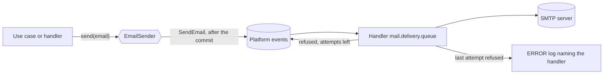

# 0010. Send emails over SMTP to a server chosen per environment

- Status: accepted
- Date: 2026-11-06

The application sends its emails over plain SMTP, to a server that each environment sets: Mailpit on a local start
and in the tests, Brevo's free plan in production to begin with. Changing provider then means changing settings, not
code, and a local start never spends the production quota or sends a real email. A caller never waits for that
server: each email is queued, then delivered and retried on its own.

## Context

DrinkIt sends few emails, all transactional, such as the code that signs a user in, and has no budget for them. A
local start used to write each email to the logs, the sign-in code included, and never ran the path that talks to a
mail server. The emails are plain text today, and will become HTML built from templates of our own.

A mail server can be slow, up to the 5 second timeouts of the starter, or refuse an email for a while, with a 4xx
code. Sent on the caller's thread, an email made a request wait for the server, and an email refused once was lost.

## Decision

The [mail starter](https://github.com/mboisnard/drinkit/blob/master/tech-starters/backend/mail-starter/README.md)
speaks SMTP through `spring.mail.*`, with no provider's SDK or API. The templates stay in the code: plain text now,
then HTML compiled from MJML. A provider's own templates are not used.

- **Local start and tests.** [Mailpit](https://mailpit.axllent.org/), an SMTP server that keeps every email and
  shows it in a web interface, runs in the local compose file and through Testcontainers, from the same image. It
  delivers nothing and needs no account or key.
- **Production.** Brevo's free plan, which allows 300 emails a day as of November 2026, from an address on DrinkIt's
  domain, with SPF, DKIM and DMARC set on that domain.
- **Delivery.** `EmailSender.send` publishes the command `SendEmail` of the mail starter as a
  [platform event](https://github.com/mboisnard/drinkit/blob/master/docs/src/engineering/architecture/platform-events.md),
  after the commit of the caller's transaction, and returns. The starter's own handler talks to
  the SMTP server, so a refused email is retried with the waits of the messaging starter, apart from the others.

A business reaction stays a handler of its own: on a fact such as a user created, a handler in `drinkit-backend`
decides which email to send and calls `send`, which returns once the email is queued.

## Consequences

- A provider is replaced through `spring.mail.*` alone, and the defaults of the starter, port 587 with STARTTLS and
  authentication, suit any of them.
- Production sends 300 emails a day at most. Past that, a paid plan or another provider is needed.
- Without a provider's API, DrinkIt gets no open tracking and no bounce webhook.
- Rendering the HTML of an email is DrinkIt's work, not the provider's.
- Mailpit adds a container to the local start.
- Without a mail server, the starter drops each email with a warning rather than failing: the application starts,
  and the logs name each email it did not send, never its content.
- The mail starter depends on the messaging starter, and gets its retries, and later its broker and its
  persistence, with no code of its own.
- An email waiting for its delivery lives in memory, as every platform event until
  [#549](https://github.com/mboisnard/drinkit/issues/549): a restart loses it.
- Delivery is at least once: a server that takes an email but answers after the timeout fails the attempt, and the
  next one sends the email again, until [#619](https://github.com/mboisnard/drinkit/issues/619) records what was already sent.
- A broker would carry the content of each email, a sign-in code included.

## Alternatives

- **A personal Gmail account.** Rejected because it sends from a `gmail.com` address only: an email from DrinkIt's
  domain fails DMARC and lands in spam or is refused. It offered 500 emails a day for free.
- **Google Workspace.** Rejected because it is paid per user, for a volume that Brevo's free plan covers. It offered
  Gmail's SMTP on DrinkIt's domain.
- **A provider's API and templates**, such as Mailjet, Resend or Postmark. Rejected because changing provider would
  mean rewriting the sending and the templates. It offered templates edited outside the code, tracking and webhooks.
- **A platform event for each business reason to email**, with an `EmailSender` that sends on the caller's thread.
  Rejected because every use case would publish an event of its own just to avoid the wait, as the sign-in code
  did. It kept the mail starter free of the messaging starter.
- **An outbox table of the mail starter, drained by a scheduled job.** Rejected because
  [#549](https://github.com/mboisnard/drinkit/issues/549) brings the same persistence to every platform event. It
  survived a restart at once, and sent several emails per SMTP connection.
- **A virtual thread of the mail starter, with retries of its own.** Rejected because its retries would duplicate the
  messaging starter's, and no broker could take it over. It needed no other starter.
- **Emails in the logs on a local start.** Rejected because the codes and the personal data of each email reach the
  logs, and the SMTP path never runs before production. It offered a local start with no other container.

## Sources

- [Brevo pricing](https://www.brevo.com/pricing/), Brevo
- [Email sender guidelines](https://support.google.com/a/answer/81126), Google
- [Mailpit](https://mailpit.axllent.org/docs/), Axllent
