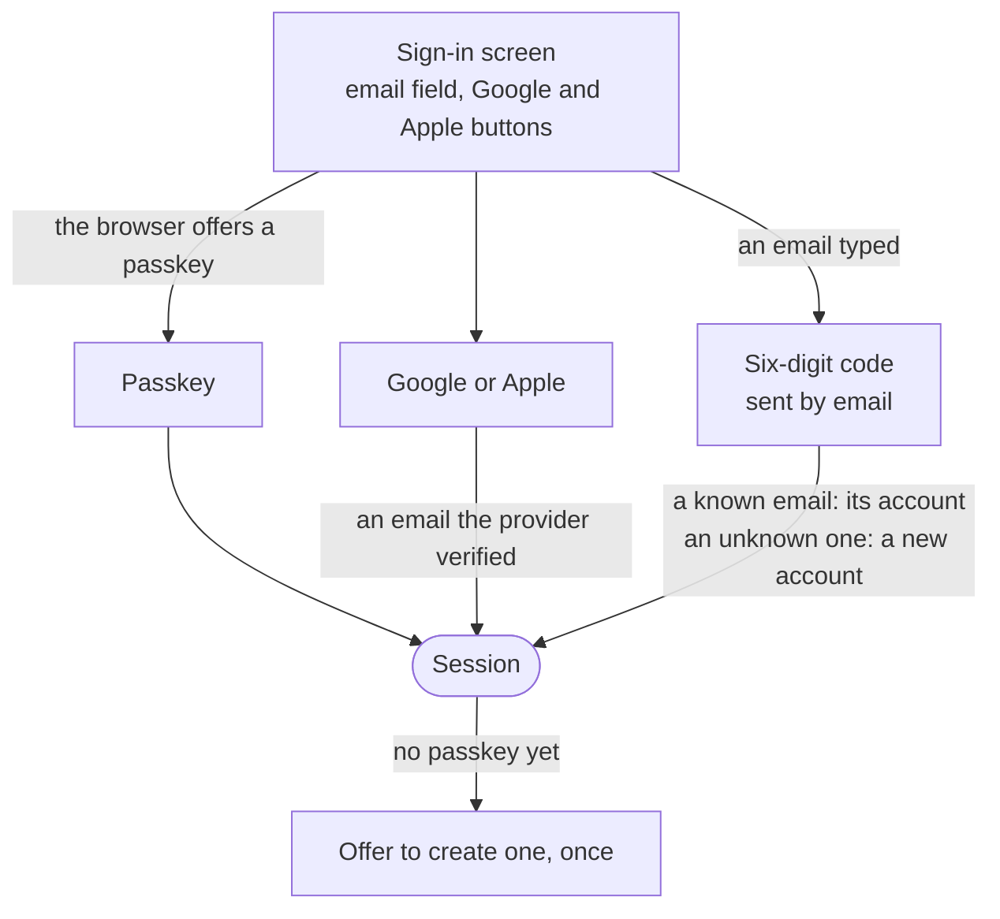

# 0011. Sign in without a password

- Status: accepted
- Date: 2026-11-06

A user signs in with a passkey, with Google or Apple, or with a one-time code sent to their email, and DrinkIt stores
no password. A password reset already makes an account only as safe as its mailbox: a password adds a way in without
raising that ceiling, and it asks users for the most effort.

## Context

DrinkIt serves very different people. Most are everyday drinkers, on their phone at home or in a supermarket aisle,
who scan a bottle of wine, beer or spirits to keep it, rate it or count what they have. They give up when signing up
asks for a password and an email confirmation first, or when the app signs them out often. Others are professionals,
such as a wine shop or a bar, who manage long lists of bottles, sometimes as a team, on a computer as much as on a
phone. They expect a sign-in that their whole team can use every day, and that keeps their data safe.

A password brings its own threats and its own work: users reuse passwords, so a leak elsewhere opens DrinkIt, a leak
of DrinkIt's hashes exposes the weak ones, and it needs a policy, a breached-password check, a reset by email and a
limit on failed tries. A passkey is the only common method that resists phishing, since the browser signs a challenge
only for the site the passkey was created on, and it is used when the sign-in offers it by default.

## Decision

One screen serves both sign-up and sign-in, with no choice to make between them:

- **Passkey first.** A returning user signs in with a fingerprint or a face, and a browser without passkeys shows the
  rest of the screen unchanged.
- **Google and Apple.** An account is found by the provider's id, then by an email the provider marks as verified.
- **A code sent by email.** Six digits, single use, valid for minutes, refused after a few wrong tries and stored as
  a hash. The same answer comes back for any email, so the screen reveals no account.
- **The mailbox is the root of trust.** A code recovers an account whose passkey or provider is lost, and a sensitive
  change, such as a new email, asks for a passkey or a fresh code.

DrinkIt offers no SMS code, which SIM swapping and costs rule out, and no authenticator app code, which a phishing
page relays like any code. The password sign-in built first goes away. The session that follows any method is the one
of [ADR 0012](0012-keep-sessions-in-postgresql.md).

## Consequences

- No secret of a user is stored, so a leak of the database exposes no credential.
- Sign-up, sign-in and recovery are one flow, with no password policy, reset or hashing to maintain.
- A sign-in without a passkey, Google or Apple waits for an email: a deployment needs an email provider that delivers
  within seconds, and a mail outage stops those sign-ins.
- A code can be phished in real time like a password. Only a passkey resists phishing, which is why it comes first.
- The code endpoint is public and sends emails, so it needs limits per email and per address, and a captcha.
- Apple needs a public domain over HTTPS and a developer account.
- A professional used to a password kept in a password manager loses that habit. Their demand would reopen the
  decision.

## Alternatives

- **Email and password.** Rejected because it adds the threats above, and its reset already hands the account to the
  mailbox. It offered a familiar sign-in, fast with a password manager.
- **A password and a code at each sign-in.** Rejected because it asks the most effort at every sign-in, and a phishing
  page relays both. It offered two factors.
- **Passkeys alone.** Rejected because an old browser or a lost device still needs the email, so the code exists
  anyway. It offered phishing resistance at every sign-in.
- **A link sent by email instead of a code.** Rejected because the mail app opens it in another browser than the one
  that asked. It offered one click.

## Sources

- [Authentication Cheat Sheet](https://cheatsheetseries.owasp.org/cheatsheets/Authentication_Cheat_Sheet.html), OWASP
- [Passkeys](https://fidoalliance.org/passkeys/), FIDO Alliance
- [Passkeys: A Shattered Dream](https://fy.blackhats.net.au/blog/2024-04-26-passkeys-a-shattered-dream/), William
  Brown, on what passkeys still get wrong
