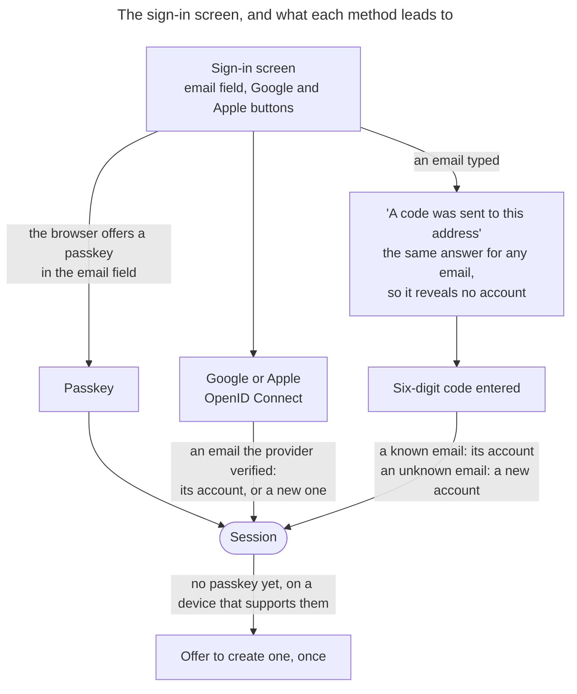

# 0012. Sign-in without a password

- Status: accepted
- Date: 2026-11-06
- Issue: [#601](https://github.com/mboisnard/drinkit/issues/601)

A user signs in with a passkey, with Google or Apple, or with a one-time code sent to their email, and DrinkIt stores
no password: the password login built in #590 goes. A password reset already makes an account only as safe as its
mailbox. A password adds a way in without raising that ceiling, and it asks users for the most effort.

## Context

DrinkIt competes with wine apps such as Vivino. Most of its users are wine buyers on their phone, often in a shop, who
want to keep a bottle or count their cellar without effort. Others are professionals who manage large lists of wines
and spirits, sometimes as a team. Both give up when signing up asks for a password and an email confirmation first,
or when the app signs them out often.

[#590](https://github.com/mboisnard/drinkit/issues/590) built a sign-in by email and password, with Argon2id hashes.
Nothing is deployed: the only stored hash is the one of the demo user that the local data creates. A password brings its own threats and its own work:

- users reuse passwords, so a leak elsewhere opens DrinkIt to credential stuffing
- a leak of DrinkIt's hashes exposes the weak passwords, which their owners use on other sites
- it needs a policy, a breached-password check, a reset by email and a limit on failed logins
- the reset by email means that whoever reads the mailbox takes the account anyway

A passkey is the only common method that resists phishing: the browser signs a challenge only for the domain the
passkey was created on. Across the services of the FIDO Alliance's Passkey Index 2026, 36% of sign-ins used a passkey, and 93% of passkey sign-ins
succeeded, against 78% for passwords with a second factor. Passkeys get used when the sign-in offers them by
default.

## Decision

One screen serves both sign-up and sign-in, with no choice between "create an account" and "sign in":

- **Passkey first.** The email field asks the browser for passkeys (WebAuthn conditional mediation), so a returning
  user signs in with a fingerprint or a face. A browser without passkeys shows the rest of the screen unchanged.
- **Google and Apple.** An account is found by the provider's subject, then by an email the provider marks verified,
  so that an address nobody proved to own cannot open someone else's account.
- **A code sent by email.** Six digits, single use and valid for minutes. It is refused after a few wrong tries, so
  that it cannot be guessed, and stored as a hash, so that a leaked database gives no usable code. The email carries
  the code and no link that signs in, so the user stays in the browser tab that asked.
- **The mailbox is the root of trust.** An email code recovers an account whose passkey or provider is lost. A user
  confirms a sensitive change, such as a new email or a removed passkey, with a passkey or a fresh code, so that a
  stolen or forgotten-open session cannot take the account over ([#592](https://github.com/mboisnard/drinkit/issues/592)).
- **No password.** DrinkIt takes, checks and stores none: no hash, no policy, no reset.
  [#603](https://github.com/mboisnard/drinkit/issues/603) removes the password login of #590, Argon2id and BouncyCastle.

DrinkIt offers no SMS code, which SIM swapping and costs rule out, and no TOTP, which a phishing page relays like a
code and which needs recovery codes. Facebook is left out: Google and Apple already cover the phones of the users. The sessions and
remember-me that follow a sign-in are those of [ADR 0013](0013-stateful-sessions-in-postgresql-serialized-as-jsonb.md)
and [ADR 0014](0014-remember-me-by-a-rotating-hashed-token.md), whatever the method.

## How it is checked

Not checked yet. [#586](https://github.com/mboisnard/drinkit/issues/586),
[#591](https://github.com/mboisnard/drinkit/issues/591) and [#602](https://github.com/mboisnard/drinkit/issues/602)
bring the three methods with their tests, and [#603](https://github.com/mboisnard/drinkit/issues/603) removes every
operation of the OpenAPI contract that takes a password.

## Consequences

- No secret of a user is stored, so a leak of the database exposes no credential, and credential stuffing has
  nothing to try.
- Sign-up, sign-in and recovery are one flow. The password policy, its reset and its hashing cost go away.
- A sign-in without a passkey, Google or Apple waits for an email. A deployment needs an email provider whose mail
  arrives within seconds, with SPF, DKIM and DMARC, and a mail outage stops those sign-ins.
- A code is as easy to phish in real time as a password. Only a passkey resists phishing, which is why it comes first.
- The code endpoint is public and sends emails, so it needs limits per email and per IP address
  ([#587](https://github.com/mboisnard/drinkit/issues/587)) and a captcha
  ([#582](https://github.com/mboisnard/drinkit/issues/582)).
- Apple needs a public domain over HTTPS and an Apple Developer account. Until DrinkIt has that domain, Google and
  Apple sign-ins run against a local OpenID Connect server ([#602](https://github.com/mboisnard/drinkit/issues/602)).
- Apple's "Hide My Email" gives an address that matches no account, so a user may end up with two accounts until
  they link Apple from a signed-in session.
- A professional used to a password kept in a password manager cannot sign in that way. Their demand would reopen
  the decision.

## Alternatives

- Email and password, as #590 built it: familiar and fast with a password manager, but it adds the threats and the
  work above, and its reset already hands the account to the mailbox.
- A password and a code by email at each sign-in: two factors, but the most friction at every sign-in, and a phishing
  page relays both.
- An optional password, with a code on an unknown device: keeps those who want one, but all the password work stays
  for a few users.
- Passkeys alone: phishing-resistant for every sign-in, but an old browser or a lost device would still need the email
  to get in, so the code exists anyway.
- A link sent by email instead of a code: one click, but a mail app opens it in another browser than the one that
  asked, and a link read on a phone cannot sign in a computer.

## Sources

- [Authentication Cheat Sheet](https://cheatsheetseries.owasp.org/cheatsheets/Authentication_Cheat_Sheet.html), OWASP
- [Digital Identity Guidelines: Authentication and Authenticator Management, SP 800-63B-4](https://pages.nist.gov/800-63-4/sp800-63b.html), NIST
- [Passkey Index 2026](https://fidoalliance.org/passkey-index-2026/), FIDO Alliance
- [Web Authentication: Level 3](https://www.w3.org/TR/webauthn-3/), W3C
- [One-Time Token Login](https://docs.spring.io/spring-security/reference/servlet/authentication/onetimetoken.html), Spring Security
- [Passkeys](https://docs.spring.io/spring-security/reference/servlet/authentication/passkeys.html), Spring Security
