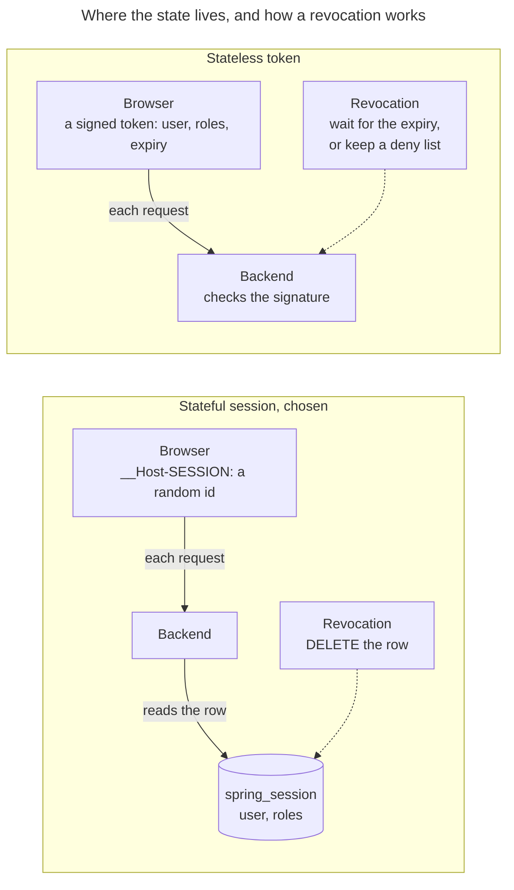
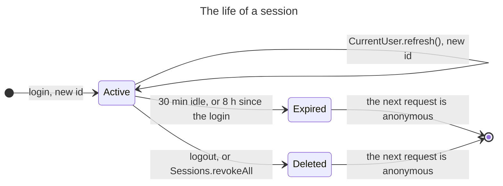

# 0012. Stateful sessions in PostgreSQL, serialized as JSONB

- Status: accepted
- Date: 2026-11-05
- Issue: [#590](https://github.com/mboisnard/drinkit/issues/590)

A signed-in browser holds a random session id in a cookie, and the session itself lives in PostgreSQL through Spring
Session JDBC, serialized as JSONB. A session ends the moment its row is deleted, and no token readable by a script
ever reaches the browser.

## Context

The browser running the Nuxt app is the only client of the API, on the same origin. Before #590, Spring Session JDBC
stored sessions with JDK serialization, under 122-bit UUID ids, with an idle timeout and no absolute lifetime.

ASVS 5.0 asks for the idle timeout and the absolute lifetime of a session to be documented, with the reasons for any
gap with NIST SP 800-63B-4 (requirements 7.1.1 and 7.3). Signing a user out everywhere must take effect at once, after
a role change, a deletion or a theft. DrinkIt runs no Redis yet.

## Decision

The [security starter](../security/principles.md) keeps one row per session in `drinkit_session.spring_session`.
The cookie `__Host-SESSION` carries only its id.

- **Session id.** 256 random bits in base64url, 43 characters, instead of Spring Session's UUID.
- **Serialization.** Jackson 3 writes the attributes as JSONB, with Spring Security's Jackson modules and an allowlist
  of types. A row that can no longer be read signs the user out and logs `session_deserialization_fail`, instead of
  answering 500.
- **Concurrent sessions.** A user may sign in on any number of devices. `Sessions.revokeAll(userId)` signs them out
  everywhere, sessions and remember-me tokens alike.

| Duration | Value | Why |
|---|---|---|
| Idle timeout | 30 minutes | A device left unattended stops being signed in. NIST SP 800-63B-4 allows 1 hour at AAL2 |
| Absolute lifetime | 8 hours since the login | A stolen session id stops working the same day, even when it is kept busy. NIST allows 24 hours at AAL2 |
| Remember-me | 30 days since the password login, never extended | NIST asks a password-only session (AAL1) to authenticate again at least every 30 days |

A session whose 8 hours have run out can start again from the remember-me cookie, as
[ADR 0013](0013-remember-me-by-a-rotating-hashed-token.md) records.

Without a session, a caller reaches only the starter's login, logout and CSRF endpoints, and `/actuator/health`: an orchestrator probes health without signing in, and the details of health, disk path and
database included, are shown to admins only.

## How it is checked

`SessionsInPostgresTest`, `JsonSessionConverterTest` and `JdbcSessionCustomizerTest` of `security-starter`: a round trip through JSONB of each Spring Security token, an unreadable row
that signs the user out without a 500, a 43-character id, a session older than 8 hours refused, no row for an
anonymous caller, and `revokeAll` deleting every session of a user. `LoginTest` checks that the id changes, and `AccessTest` that health answers
without a session.

## Consequences

- A revocation takes effect at the next request, on every instance.
- A row reads as plain JSON in `psql`, and a field added to a class does not break the sessions already stored.
- Each request reads its session from PostgreSQL, and writes it back when an attribute or its last access changes.
- The starter owns a Jackson converter and the SQL queries that read and write JSONB, which a Spring Session upgrade
  can break.
- Switching the serialization signed every user out once.
- A password alone protects an account until passkeys or a second factor exist
  ([#591](https://github.com/mboisnard/drinkit/issues/591), [#585](https://github.com/mboisnard/drinkit/issues/585)),
  below what ASVS level 2 asks.

## Alternatives

- Stateless signed token, such as a JWT: no lookup per request, but a revocation waits for the expiry or needs a deny
  list, which is state again. Kept in browser storage, any script injected into the page can steal it.
- Spring Session's JDK serialization: no code to write, but rows are unreadable, a changed class breaks them, and
  reading them deserializes bytes with the JDK's known gadget chains.
- Redis: fast, with expiry built in, but one more server in every environment for one table's worth of data.

## Sources

- [Application Security Verification Standard 5.0](https://github.com/OWASP/ASVS/tree/v5.0.0), OWASP
- [Session Management Cheat Sheet](https://cheatsheetseries.owasp.org/cheatsheets/Session_Management_Cheat_Sheet.html), OWASP
- [Digital Identity Guidelines: Authentication and Authenticator Management, SP 800-63B-4](https://pages.nist.gov/800-63-4/sp800-63b.html), NIST
- [Spring Session JDBC](https://docs.spring.io/spring-session/reference/configuration/jdbc.html), Spring
