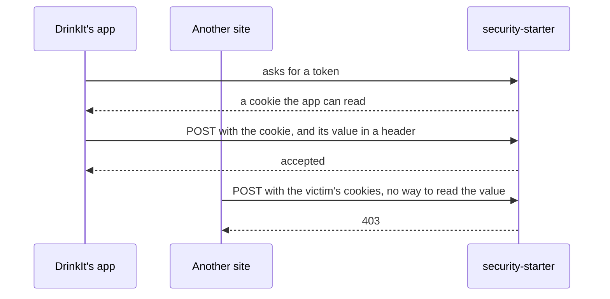

# 0013. Protect against CSRF with a token in a cookie and Fetch Metadata

- Status: accepted
- Date: 2026-11-06

A request that changes state, the sign-in included, carries in a header the value of a token cookie that only
DrinkIt's own pages can read, and the security starter also refuses it when the browser marks it as coming from
another site. The token needs no copy on the server, so a visitor who has not signed in gets no session row.

## Context

A cross-site request forgery makes the victim's browser send a request to DrinkIt from another site, with the
victim's cookies. `SameSite` cookies already stop most of them, but "same site" includes every subdomain, so OWASP
counts it as a second line only.

The Nuxt app runs on the same origin as the API. The sign-in changes state before the visitor has a session, so it
needs protection too: otherwise another site could sign the victim in to the attacker's account, and what the victim
then saves would land there.

## Decision

- **Token in a cookie.** The app copies the cookie's value into a header of each request that changes state. Another
  site can make the browser send the cookie, but cannot read it.
- **A cookie no subdomain can set.** Its `__Host-` prefix keeps a subdomain from planting a token it knows.
- **Renewed at each sign-in.** A token read before a sign-in is worth nothing after it.
- **Fetch Metadata.** A request the browser marks as cross-site is refused even with a valid token, a second line in
  case a token leaks. A request without that header, from an older browser or a script, still needs the token.

[Calling the API](../security/calling-the-api.md) shows what a client sends.

## Consequences

- A client fetches the token before its first request that changes state, and copies it into a header each time.
- A script injected into the page can read the token, as in any single-page app: the content security policy is the
  defense against that.
- A future native app or third-party client sends no cookies, and needs an authentication of its own.

## Alternatives

- **A token kept in the session, Spring's default.** Rejected because every visitor would need a session row before
  signing in. It offered a comparison with a copy on the server.
- **`SameSite` alone.** Rejected because sibling subdomains count as the same site. It offered nothing to handle.
- **Fetch Metadata alone.** Rejected because a request without the header, from an older browser or a client that is
  not a browser, would have to pass. It offered no token.

## Sources

- [Cross-Site Request Forgery Prevention Cheat Sheet](https://cheatsheetseries.owasp.org/cheatsheets/Cross-Site_Request_Forgery_Prevention_Cheat_Sheet.html), OWASP
- [Protect your resources from web attacks with Fetch Metadata](https://web.dev/articles/fetch-metadata), web.dev
- [Cross-Site Request Forgery](https://words.filippo.io/csrf/), Filippo Valsorda, who argues that Fetch Metadata
  alone is enough
