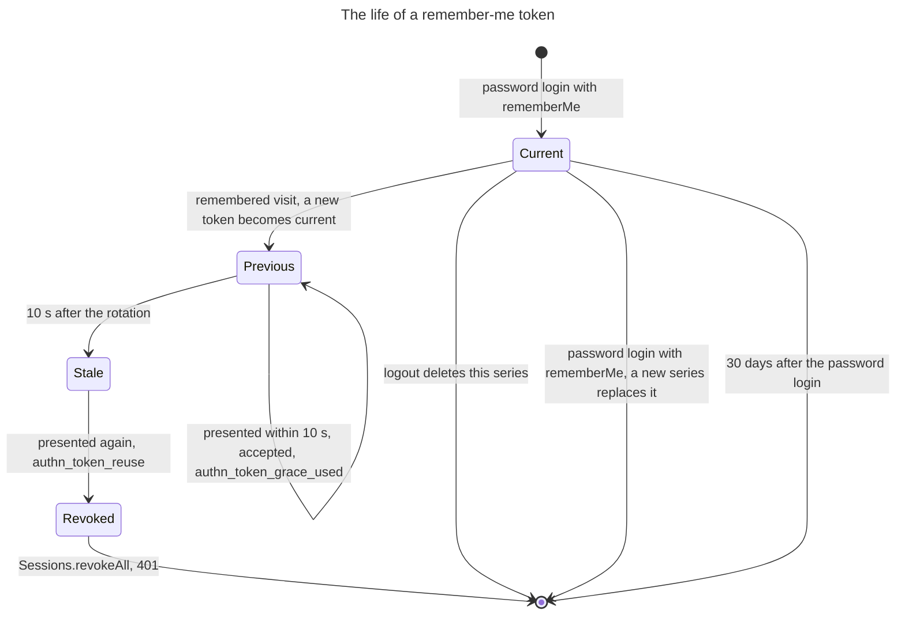

# 0013. Remember-me by a rotating, hashed token

- Status: accepted
- Date: 2026-11-05
- Issue: [#590](https://github.com/mboisnard/drinkit/issues/590)

A user who ticks "remember me" gets a cookie that opens a new session once the current one has ended. Its token
changes at each use and is stored hashed, so that a stolen copy shows itself the first time both copies are used.

## Context

Sessions are short, 30 minutes idle and 8 hours at most, as
[ADR 0012](0012-stateful-sessions-in-postgresql-serialized-as-jsonb.md) records. A user still expects to stay signed
in on their own device for weeks.

The remember-me services of Spring Security and Spring Session do not fit as they are. Spring Session's
`SpringSessionRememberMeServices` keeps the session itself alive for 30 days. `PersistentTokenBasedRememberMeServices`
rotates a token, but stores it in clear text, extends its life at each use, and answers a theft with an exception
that ends in a 500. `TokenBasedRememberMeServices` signs a cookie that cannot be revoked for one device.

## Decision

The starter's `RotatingRememberMeServices`, built on Spring's `AbstractRememberMeServices`, sets the cookie
`__Host-remember-me` when the login body holds `rememberMe: true`. The cookie carries a series and a token, each of
256 random bits. The table `drinkit_session.remember_me_token` keeps one row per series: the user, the SHA-256 of the
current and of the previous token, and when the series was created and last rotated.

- **Rotation.** A request without a session but with the cookie is a remembered visit. The token is compared in
  constant time, replaced, and a new session opens.
- **Grace.** For 10 seconds after a rotation, the previous token is still accepted. The single-page app sends
  several requests at once, all carrying the old cookie, and only the first one rotates it.
- **Theft.** A known series with a token that matches neither hash, or the previous one after its 10 seconds, means
  that two browsers hold the cookie. The starter then revokes every session and every series of the user, and
  answers 401.
- **Lifetime.** 30 days from the password login, never extended by a remembered visit.
- **Logout.** It deletes this device's series only. The expired series go when a new one is created.
- **Login again.** A password login with `rememberMe` deletes the series of the cookie the browser still presents,
  so that a copy of that cookie does not stay valid next to the new series.
- **Not fully authenticated.** A remembered session answers false to `isFullyAuthenticated()`, so a sensitive action
  can ask for the password again.

## How it is checked

`RememberMeTest` and `RememberMeTokensTest` of `security-starter`: a remembered visit opens a new session and rotates the token, the
session is not fully authenticated, a replay within the grace passes, a replay after it revokes every series and
session and answers 401, and a series expires 30 days after its creation. `RememberMeTest` checks that only the
cookie's series is deleted, at logout as at a new login.

## Consequences

- A stolen cookie works until the victim's browser next uses its own copy, then signs the user out everywhere.
- A database dump gives no usable cookie, since only hashes are stored. SHA-256 is enough: a 256-bit random token
  cannot be guessed from its hash.
- A replay within the 10 seconds after a rotation goes unnoticed.
- A response lost right after a rotation, such as on a dropped connection, makes the next visit look like a theft,
  and the user signs in again on every device.
- The starter owns a table, read through jOOQ. A servlet filter runs outside any use case, so each write opens its
  own transaction.

## Alternatives

- Extending the Spring session to 30 days with `SpringSessionRememberMeServices`: no table, but no theft detection,
  no difference between a fresh login and an old session, and the 8-hour lifetime is gone.
- Spring's `PersistentTokenBasedRememberMeServices`: rotation built in, but tokens in clear text, a sliding lifetime,
  a 500 on theft, and no grace for parallel requests.

## Sources

- [Session Management Cheat Sheet](https://cheatsheetseries.owasp.org/cheatsheets/Session_Management_Cheat_Sheet.html), OWASP
- [Improved Persistent Login Cookie Best Practice](https://web.archive.org/web/20180819014446/http://jaspan.com/improved_persistent_login_cookie_best_practice), Barry Jaspan
- [Remember-Me Authentication](https://docs.spring.io/spring-security/reference/servlet/authentication/rememberme.html), Spring Security
