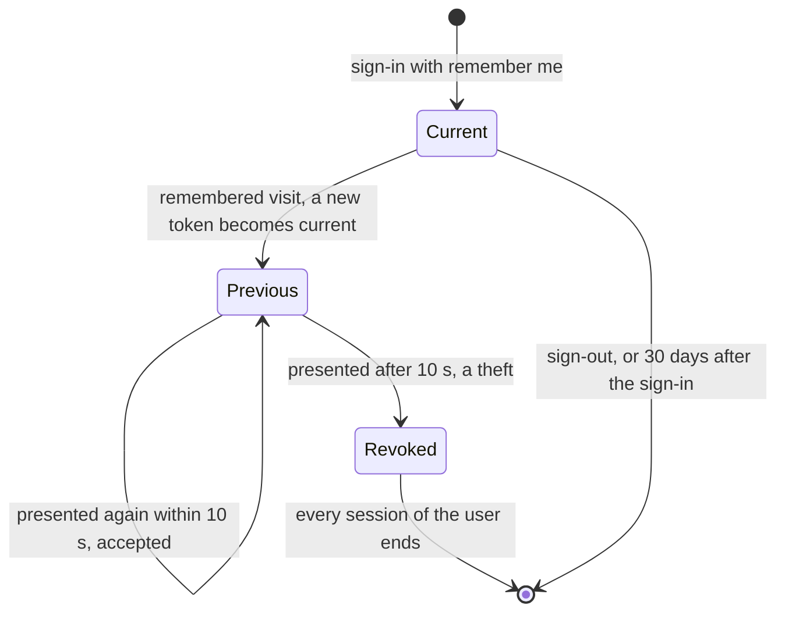

# 0013. Remember me with a rotating, hashed token

- Status: accepted
- Date: 2026-11-06

A user who ticks "remember me" gets a cookie that opens a new session once the current one has ended. Its token
changes at each use and is stored hashed, so that a database dump gives no usable cookie and a stolen copy shows
itself the first time both copies are used.

## Context

Sessions are short, 30 minutes idle and 8 hours at most, as
[ADR 0012](0012-keep-sessions-in-postgresql.md) records. A user still expects to stay signed in on their own phone for
weeks, especially one who scans a bottle in a shop and does not want to sign in again first.

The remember-me services that Spring ships do not fit as they are: one keeps the session itself alive for weeks, one
rotates a token but stores it in clear and extends its life at each use, and one signs a cookie that cannot be revoked
for a single device.

## Decision

The security starter's own remember-me service sets a cookie that carries a series and a token, both random. The
database keeps, per series, the user and the hash of the current and previous tokens.

- **Rotation.** A visit without a session but with the cookie opens a new session and replaces the token.
- **Grace.** For 10 seconds, the previous token is still accepted, since the app sends several requests at once with
  the old cookie.
- **Theft.** A known series with an old token means two browsers hold the cookie: every session of the user ends.
- **Lifetime.** 30 days from the sign-in, never extended by a visit.
- **Not fully signed in.** A remembered session can be asked to confirm a sensitive action with a passkey or a code.

## Consequences

- A stolen cookie works until the victim's browser next uses its own copy, then signs the user out everywhere.
- A dump of the database gives no usable cookie, since only hashes of random tokens are stored.
- A replay within the 10 seconds after a rotation goes unnoticed.
- A response lost right after a rotation makes the next visit look like a theft, and the user signs in again.
- The starter owns one more table.

## Alternatives

- **The session itself kept for 30 days.** Rejected because a stolen session id would work for 30 days with nothing
  to detect it, and the 8-hour lifetime of a session would be gone. It offered no table.
- **Spring's `PersistentTokenBasedRememberMeServices`.** Rejected because it stores each token in clear, so a
  database dump gives working cookies, it extends the 30 days at each visit, so a stolen cookie never expires, and the
  parallel requests of the single-page app would look like a theft without a grace period. It offered the rotation
  without code of our own.

## Sources

- [Improved Persistent Login Cookie Best Practice](https://web.archive.org/web/20180819014446/http://jaspan.com/improved_persistent_login_cookie_best_practice), Barry Jaspan
- [Remember-Me Authentication](https://docs.spring.io/spring-security/reference/servlet/authentication/rememberme.html), Spring Security, the services this ADR does not use
- [Session Management Cheat Sheet](https://cheatsheetseries.owasp.org/cheatsheets/Session_Management_Cheat_Sheet.html), OWASP
