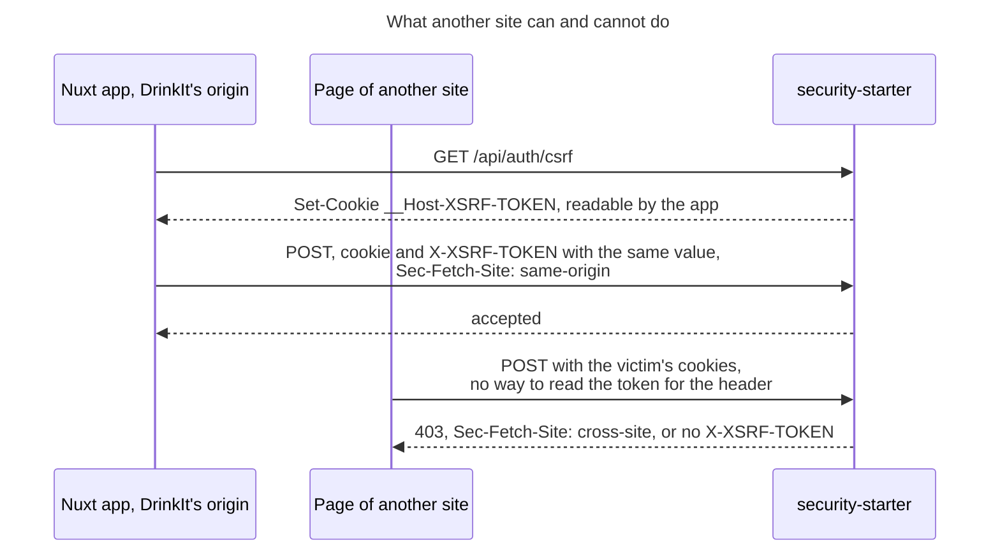

# 0015. CSRF token in a cookie, with Fetch Metadata

- Status: accepted
- Date: 2026-11-05
- Issue: [#590](https://github.com/mboisnard/drinkit/issues/590)

A request that changes state, the sign-in included, carries the value of a `__Host-XSRF-TOKEN` cookie in its
`X-XSRF-TOKEN` header, a double-submit cookie, and the security starter refuses it when the browser marks it as coming
from another site. The token needs no copy on the server, so a visitor who has not signed in gets no session row.

## Context

Before #590, the [security starter](../security/principles.md), which secures the browser session of DrinkIt, turned
the CSRF check off, and CodeQL flagged it. `SameSite=Lax` cookies already stay off a cross-site `POST`, but OWASP counts
`SameSite` as a defense in depth only: "same site" includes every subdomain of the registrable domain. A session is a
row in PostgreSQL, as [ADR 0013](0013-stateful-sessions-in-postgresql-serialized-as-jsonb.md) records.

The Nuxt app is a single-page app on the same origin as the API. The sign-in changes state before the visitor has a
session, so it needs protection too: without it, another site could sign the victim in to the attacker's account, and
what the victim saves would land there.

## Decision

- **Token in a cookie.** `GET /api/auth/csrf` sets `__Host-XSRF-TOKEN`, the one cookie a script may read. The app
  copies its value into the `X-XSRF-TOKEN` header of each `POST`, `PUT`, `PATCH` and `DELETE`. Another site can send
  the cookie but cannot read it.
- **The `__Host-` prefix.** A subdomain cannot set or overwrite the cookie. Without it, a subdomain could plant a
  cookie with a token it knows, then send that token in the header.
- **Raw value.** The header carries the cookie's value as it is, without Spring's masking against BREACH, since the
  token never appears in a response body.
- **Renewed at each sign-in.** A sign-in and a visit restored by remember-me
  ([ADR 0014](0014-remember-me-by-a-rotating-hashed-token.md)) replace the token in their own response, and the logout
  expires it, so that a token read before a sign-in is worth nothing after it.
- **Fetch Metadata.** The starter refuses a state-changing request whose `Sec-Fetch-Site` is neither `same-origin` nor
  `none`, a URL the user typed, even with a valid token: a second line in case a token leaks. A request without the
  header, from an older browser or curl, still needs the token.

## How it is checked

`CsrfTest` of `security-starter`: a `POST` without a token is refused, the raw value of the cookie in the header is
accepted, and a `POST` the browser marks as cross-site is refused even with a token. `LoginTest` checks that the token
changes at sign-in, and `CookiesAndHeadersTest` that the cookie covers the whole site.

## Consequences

- A client calls `GET /api/auth/csrf` before its first unsafe request, and copies the cookie into a header at each one.
  [Calling the API](../security/calling-the-api.md) shows how.
- A script injected into the page can read the token, as it could in any single-page app. The content security
  policy is the defense against it.
- A future native app or a third-party client sends no cookies, and needs an authentication of its own that this
  check does not cover.

## Alternatives

- A token kept in the session, Spring's default: compared with a server-side copy, but every anonymous visitor would
  need a session row before signing in.
- A token signed with an HMAC of the session: resists a cookie planted by a subdomain without relying on the
  `__Host-` prefix, but a visitor who has not signed in has no session to bind it to.
- `SameSite` alone: no token to handle, but sibling subdomains count as the same site, and OWASP keeps it as a second
  line.
- Fetch Metadata alone: no token, but a request without the header would have to pass, and older browsers send none.

## Sources

- [Cross-Site Request Forgery Prevention Cheat Sheet](https://cheatsheetseries.owasp.org/cheatsheets/Cross-Site_Request_Forgery_Prevention_Cheat_Sheet.html), OWASP
- [Fetch metadata request header](https://developer.mozilla.org/en-US/docs/Glossary/Fetch_metadata_request_header), MDN
- [Cross Site Request Forgery](https://docs.spring.io/spring-security/reference/servlet/exploits/csrf.html), Spring Security
