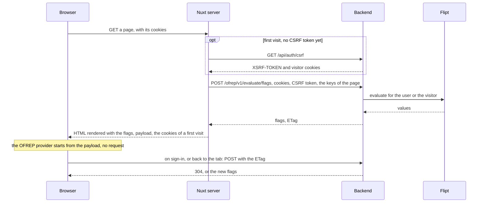

# 0017. Feature flags through OpenFeature, with Flipt as provider

- Status: accepted
- Date: 2026-11-08

DrinkIt reads its feature flags through OpenFeature, the vendor-neutral standard of the CNCF, and Flipt v2 is the
provider behind it today. The code reads a flag by its key, and a flag the provider lacks gives the default of the
call. The backend serves flags to its clients over OFREP, the remote evaluation protocol of OpenFeature, so a web or
mobile client, server rendering included, reads them from one endpoint and never talks to the provider.

## Context

No feature reads a flag yet. DrinkIt needs to hide a feature until it is ready, open it to some users, and run A/B
tests ([ADR 0018](0018-ab-tests-behind-a-flag-with-posthog.md)). A product manager switches a flag from a web UI, in
each environment, without a deployment. A developer works without an account at a vendor, and merges the code that
reads a flag before anyone creates it. Flags are read in a request, in the handlers of platform events
([ADR 0006](0006-carry-platform-events-through-an-abstraction.md)), and by the Nuxt app, whose pages may render on the
server.

Flag tools come and go, and each one ships its own SDK. OpenFeature gives them one API: the code evaluates a flag for
an evaluation context, and a provider answers for one tool. Its SDKs exist for Java, the browser, Android and iOS, and
OFREP lets any of them read flags over HTTP from a server that speaks it.

## Decision

- **OpenFeature first.** The code reads a flag through the feature management
  [tech starter](../architecture/tech-starters.md), which evaluates it through OpenFeature. Nothing outside the starter
  knows the provider, so changing tools changes the starter, not the code that reads flags.
- **Flipt as provider.** Flipt v2 runs as one container, so a developer's machine needs no account, and its web UI
  switches flags per environment. Each switch is a commit in a git repository kept for flags, apart from the code,
  whose master only changes through a pull request.
- **Read by key.** The code reads a flag by its key, where it needs it, with the default it wants. A flag Flipt does
  not know, or a Flipt that does not answer, gives that default, never an error, so a flag can be created after the
  merge. Switched off, the starter answers every flag with its default, so that the code and the clients keep working.
- **The subject of the request.** A flag is evaluated for a subject: the user id once signed in, with their roles
  and the attributes the application adds, such as a plan, or the visitor id before. In a request, the starter takes
  it from the session, so the code that reads a flag never carries it. A platform event handler, outside any request,
  names its subject from the user id the event carries. The security starter gives every request its visitor, a
  random id in an `HttpOnly` cookie kept 30 days after the last visit.
- **Clients read over OFREP.** The backend answers the OFREP bulk endpoint, `/ofrep/v1/evaluate/flags`, for the keys
  the client names in the context of its request, and ignores the rest of that context, which anyone can forge. It
  evaluates for the subject of the request. The browser reads the answer with the OpenFeature web SDK and its OFREP
  provider. `/ofrep/**` sits outside `/api/**`, which only signed-in users reach, and asks for the CSRF token like any
  POST ([ADR 0014](0014-protect-against-csrf-with-a-cookie-token-and-fetch-metadata.md)).
- **Flags in the server render.** When Nuxt renders a page on the server, it fetches the flags before rendering, so
  the HTML already holds the blocks they open and nothing flickers. The flags travel in the Nuxt payload, and the
  browser's provider starts from them without a request.

The OpenFeature web SDK never runs on the Nuxt server, where its global state would mix the flags of two users: the
server calls the endpoint itself, and relays to the browser the cookies of a first visit.

## Consequences

- Another flag tool, PostHog's flags included, replaces Flipt by changing the starter, and no code that reads flags.
- A missing flag or a stopped Flipt shows the old behavior.
- A flag targets what the session knows, roles and the attributes the application adds, never what a client sends.
- A client may ask for any key, and learns no more than whether that flag is on.
- A page rendered with flags belongs to one user or visitor, so no shared cache may keep it.
- A server render calls the backend for the flags before it fetches its data, and once more on a first visit, for the
  CSRF token.
- OFREP is a 0.x specification. A breaking version goes through expand and contract
  ([ADR 0005](0005-change-the-api-contract-by-expand-and-contract.md)), with `/ofrep/v1` kept until clients move.
- Neither Flipt nor the code lists the flags in use: finding a dead one takes a search of the code for its key.
- A flag has to be created in each Flipt environment where it should be switched on.
- The visitor cookie is set before DrinkIt manages consent.

## Alternatives

- **Unleash.** Rejected because its OpenFeature Java provider is an alpha on an outdated client, and its open-source
  edition has two environments. It offered the best help with dead flags: lifetimes per type of flag, stale flags,
  and the flags the code reads but the server lacks.
- **GO Feature Flag.** Rejected because it has no released web UI, so a product manager would edit YAML. It offered
  flags as files in git and a mature Java provider.
- **PostHog for flags too.** Rejected because hosting it takes ClickHouse, Kafka and more, and its cloud needs an
  account on every machine. It offered flags, experiments and analytics in one tool.
- **FF4J**, which many Spring applications use. Rejected because it is barely maintained and supports neither
  OpenFeature nor variants. It offered flags declared in an XML file and stored in our own database.
- **A subject passed to every evaluation.** Rejected because each feature would carry it from the controller down
  to the domain. It offered the same call in a request and in an event handler.
- **A catalog of the flags in the code.** Rejected because each flag would need a declaration apart from where it is
  read. It offered defaults in one place, an expiry the build checks, and the list served to clients.
- **An endpoint of our own**, such as `GET /api/feature-flags`. Rejected because no standard client reads it. It
  offered a shape of our own, free of a 0.x specification.

## Sources

- [OpenFeature specification](https://openfeature.dev/specification/), OpenFeature
- [OFREP OpenAPI](https://openfeature.dev/docs/reference/other-technologies/ofrep/openapi), OpenFeature
- [Data fetching](https://nuxt.com/docs/getting-started/data-fetching), Nuxt, on passing cookies to and from
  server-side calls
- [Front-end API](https://docs.getunleash.io/reference/front-end-api), Unleash, the case for the browser asking the
  flag server itself
