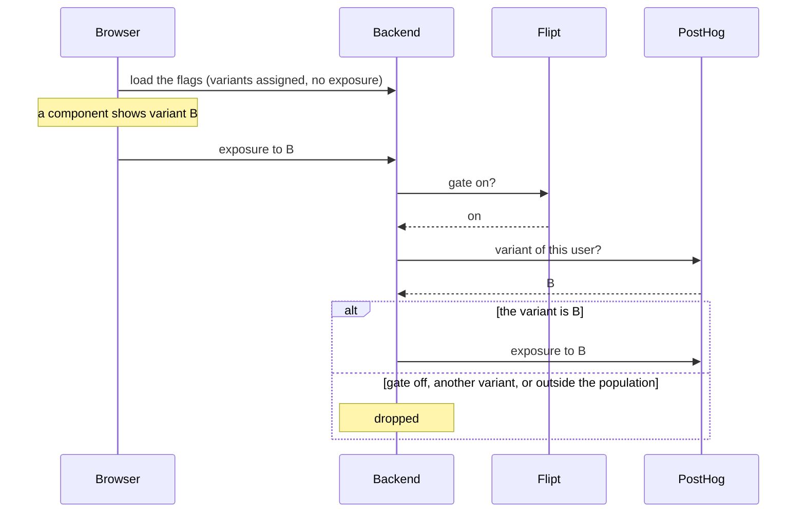

# 0018. A/B tests behind a flag, with PostHog choosing the variant

- Status: accepted
- Date: 2026-11-08

An A/B test runs behind a flag, the gate a product manager switches like any other. Behind the gate, a PostHog
experiment assigns each user a variant, since PostHog targets on what users did and measures the results. The code
assigns variants freely, but reports an exposure, through the backend, only where a variant reaches the user. Until
PostHog is wired, every user gets the current behavior.

## Context

An A/B test shows variants of a feature to users drawn at random, then compares what each group does. The `control`
variant is the current behavior, and the others carry free names, `B`, `C` or `new-checkout`. A test keeps assignment
and exposure apart:

- **Assignment** computes a user's variant. It can happen long before the user sees anything, as when the frontend
  loads its flags ([ADR 0017](0017-feature-flags-through-openfeature.md)).
- **Exposure** records that the variant reached the user. The results count a user from their first exposure only.

A user counted in a group without having been assigned to it, or before being exposed, makes the groups unequal, a
sample ratio mismatch, and the results wrong. PostHog, the planned tool, targets on what users did, splits them between
variants, and counts its `$feature_flag_called` event as the exposure. It is not wired yet, and a developer's machine
works without it.

## Decision

- **Two layers.** An experiment is a gate, the flag of [ADR 0017](0017-feature-flags-through-openfeature.md) of the
  same key, then the PostHog experiment of that key, with a `control` variant. The gate decides whether the experiment
  runs at all. PostHog decides who enters it and in which variant.

  | Gate | PostHog answers | The user gets | Exposure |
  |---|---|---|---|
  | Off | Not asked | `control` | None |
  | On | `control` | `control` | `control` |
  | On | Another variant | That variant | That variant |
  | On | Outside the population it targets, or an error | `control` | None |

  The gate stays on while the experiment runs. Switching it off ends the experiment, since switching it back on would
  mix users who saw two variants.
- **Assign freely, expose once.** Assigning has no side effect. The code reports the exposure explicitly, where the
  variant takes effect, at the same point for every variant, so that no group is counted differently. No OpenFeature
  hook reports it, and PostHog's automatic event stays off: both fire on every evaluation.
- **In the frontend.** The variants come with the flags, in the same call and in the server render, for the experiments
  the client names, with the OFREP reason `SPLIT` when the user was assigned, which tells the browser to report an
  exposure. The browser reports it to the backend when it shows the variant. The server render never does, since bots
  get it too and the browser reports after it. The backend assigns the variant again and forwards the exposure only when
  both match, so a forged or outdated call counts nothing.
- **In the backend.** A request assigns, then reports the exposure where the variant changes the answer. An event
  that leads to something the user sees, such as an email, carries the assignment made when it was published. Its
  handler uses that variant even after a retry, and reports the exposure when it sends the email.
- **Visitors.** Visitors take part, under the visitor id of ADR 0017, which also authors what someone does before
  signing in, such as creating an account. At sign-in, the backend links the visitor to the user in PostHog, so that
  what the visitor did counts for the user.
- **Until PostHog.** Every user gets `control` and no exposure leaves DrinkIt.
- **Open point.** Sending exposures and identities to PostHog waits for the consent management of DrinkIt, which will
  say what happens to a user who refuses.

## Consequences

- The frontend loads every variant with its flags, and a variant it never shows counts nowhere.
- An experiment is set up in two tools.
- Each experiment asks for an exposure call, and a forgotten one leaves it without data.
- A visitor's variant can change at sign-in, unless the experiment turns on PostHog's experience continuity, which
  makes PostHog evaluate every assignment over the network.
- An exposure from the browser is lost when the tab closes before the call.

## Alternatives

- **A flag with variants in Flipt alone.** Rejected because Flipt only knows what each call sends, while PostHog
  targets on what users did and measures the results. It offered one tool and no call to a vendor.
- **Exposures from an OpenFeature hook.** Rejected because a hook runs on every evaluation, so loading the flags of the
  frontend would expose users to variants they never see. It offered no exposure call to write.
- **The PostHog SDK in the browser.** Rejected because clients talk to the backend only (ADR 0017). It offered
  exposures and product analytics without an endpoint of ours.
- **Amplitude Experiment.** Rejected because it has no OpenFeature provider for Java and no self-hosted edition. It
  offered cohorts built from the events it receives.

## Sources

- [Exposures](https://posthog.com/docs/experiments/exposures), PostHog
- [Hooks](https://openfeature.dev/specification/sections/hooks/), OpenFeature specification
- [Troubleshooting experiments](https://docs.growthbook.io/kb/experiments/troubleshooting-experiments), GrowthBook,
  on the causes of a sample ratio mismatch
