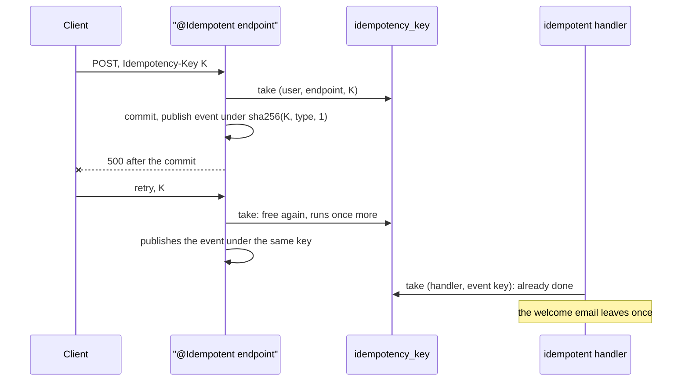

# 0019. Run requests and events once per idempotency key, kept in PostgreSQL

- Status: accepted
- Date: 2026-11-08

An endpoint or an event handler that must not run twice declares it, and a starter of our own runs it once per
idempotency key, kept in PostgreSQL. The key of a request follows into the events it publishes and the providers it
calls. idempotency4j, the closest library, failed a spike on three points that its design could not bend to.

## Context

Three cases repeat an action that must happen once:

- **A client retries a request.** A double click, or a retry after a timeout, creates a second cellar.
- **A broker delivers an event again.** Delivery is at least once, so the mail handler sends a welcome email twice.
- **A request fails after its commit.** The client retries a `5xx` whose transaction committed: the request runs
  again, and its events go out again under new message ids, which no handler recognizes.

The IETF draft *The Idempotency-Key HTTP Header Field* sets the HTTP side: the client sends a key per action, the
server replays the first answer, `409` while it runs, `422` for the key reused with another payload. Stripe
keeps the answer of the first request with the key. A provider that honours the header, such as a payment API,
recognizes our own retries when we send it a key that stays the same.

idempotency4j 0.6.0 offers one `@Idempotent` annotation for controllers and handlers, and a JDBC store. A spike on
DrinkIt found that its method aspect forces class proxies, which Kotlin's final classes refuse, that its table has
no schema while DrinkIt's tables live in `drinkit_application`, and that its HTTP filter keys on the raw header,
with no place to scope a key to its user.

## Decision

- **The entry point declares it.** `@Idempotent` goes on the controller method, the override of the interface
  generated from the contract, and `idempotent = true` on a `@PlatformEventHandler`. The business code never checks a
  key. Other code calls `Idempotency.once(scope, key) { … }`.
- **One table.** `drinkit_application.idempotency_key` holds the scope, the hash of the key, the run that holds it,
  a lease, the fingerprint of the payload and the answer to replay. A key is taken in a transaction of its own
  before the action runs, freed when the action fails, and forgotten after 24 hours. The answer is recorded in the
  transaction open around the action, if any, as idempotency4j's `JOIN_TRANSACTION` mode does.
- **HTTP.** The `Idempotency-Key` header is optional. A key belongs to its user, or else its visitor, and to the
  endpoint. The endpoint runs in one transaction with its key, so its writes and its answer commit together. A replay
  gets the status, `Content-Type`, `Location` and body of the first answer, never its cookies. A `5xx`, a `429`, an
  exception or a transaction marked for rollback roll the writes back and free the key. An answer over 64 KB fails. A
  keyed request over 64 KB gets `413`.
- **The key follows.** While a request or an event is handled, its key is the current one. An event published then
  carries `sha256(current key, event type, rank)`, so a replay publishes it under the same key, and an event
  published outside any key gets a random one. A handler takes the key of its event, or one a SpEL expression reads
  from it.
- **Providers opt in.** A web client group whose API honours `Idempotency-Key` retries its unsafe calls that carry
  one, with a key derived from the current one.

## Consequences

- A retry of a creation is safe for the client as soon as it sends a key, and the frontend has to send one.
- The mail server gets an email once per event, whatever the deliveries, while a delivery held past its lease of 5
  minutes may still run twice.
- A request whose instance crashes before its commit runs again once its lease of 5 minutes ends, since nothing of
  it committed. A request that outlives its lease rolls back once a retry takes its key over.
- An idempotent endpoint holds one transaction for the whole request, and answers under 64 KB.
- Every application with the messaging starter needs PostgreSQL, and a test of an idempotent handler without it
  declares the in-memory double.
- The answer of a request stays in clear in the table for 24 hours.
- The code of the starter is ours to maintain: a library that fits, or a broker with its own deduplication, would
  reopen the decision.

## Alternatives

- **idempotency4j.** Rejected because its aspect proxies classes, which Kotlin's final classes refuse, its table
  ignores the schema, and its filter cannot scope a key to the user. It offered the annotation, the stores, the
  HTTP replay and the joined transaction already written, a design the starter follows.
- **Deduplicate on the message id only.** Rejected because a request replayed after its commit publishes new
  messages, with new ids. It offered no key to carry from a request to its events.
- **Keys in Redis or the cache.** Rejected because a key that an eviction or a restart drops lets the action run
  twice, and DrinkIt runs no Redis. It offered keys that expire by themselves.
- **No answer kept, only the key.** Rejected because a client that retries a creation needs its id back. It offered
  a smaller table.

## Sources

- [The Idempotency-Key HTTP Header Field](https://datatracker.ietf.org/doc/draft-ietf-httpapi-idempotency-key-header/),
  IETF HTTP APIs working group
- [Idempotent requests](https://docs.stripe.com/api/idempotent_requests), Stripe
- [Idempotent Consumer](https://microservices.io/patterns/communication-style/idempotent-consumer.html),
  microservices.io
