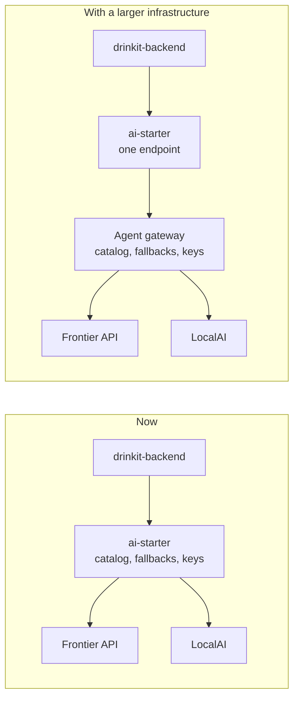

# 0021. Serve AI models outside the application, and reach them through ai-starter

- Status: accepted
- Date: 2026-11-11

DrinkIt embeds no model. Its language, vision and embedding models run behind an HTTP API, a frontier provider's
such as Anthropic or OpenAI, or a LocalAI container, and the code reaches them through one
[tech starter](../architecture/tech-starters.md), `ai-starter`, built on Spring AI. It replaces the Tesseract and
Google Cloud Vision engines of `ocr-starter`: a model in the jar weighs on every build and every instance, while a
model behind an API changes with a line of configuration and falls back to a smaller one when the first is out of
reach.

## Context

Three features need a model:

- **Reading a label** from a photo, to find or import a bottle: a vision language model, VLM, returns its fields
  in one call.
- **Chat**, for recommendations and cocktails: a language model, LLM.
- **Semantic search**: an embedding model turns a bottle or a query into a vector.

A first attempt, `ocr-starter`, read labels with Google Cloud Vision and fell back to Tesseract inside the
application. It was too heavy and read labels poorly, and both engines returned raw text, while the product needs
the producer, the vintage and the appellation of a label.

A developer may hold an API key for a frontier model, or none. A deployment may reach the internet, or not. The
features must still work, with a lesser answer, in each case.

## Decision

**No model in the application.** No model file lives in the jar, in its resources or beside it, and no model runs
in the JVM. A model is served over HTTP, by a frontier provider or by LocalAI, an open source server that runs open
weights behind the OpenAI API, in a container of its own.

**One starter for every model.** `ai-starter` is the only code that talks to a model, through Spring AI. Its
configuration has two levels:

- **Endpoints**: where to connect, with the provider's protocol, its URL, its key, a timeout and a number of
  retries.
- **Models**: a catalog of technical ids, such as `qwen3-vl-4b`, each on an endpoint.

The code asks for a model by its id, never by a feature name, so that a gateway can later resolve the same ids. A
call lists the models it accepts, in order. The starter skips a model without a key and moves on when a call fails,
and when none answers, the feature reports itself unavailable. An embedding never changes model, since the vectors
of two models do not compare.

**Configuration.** The properties live under `starters.ai.*`. A key comes from an environment variable, never from
a committed file. A model whose key is missing is unavailable, so that a developer without a key still starts the
application, and `starters.ai.enabled=false` makes every model unavailable, for a deployment that offers no AI
feature.

**Security, carried by the starter.**

- A key never reaches a log, an observation or an error message.
- The observations follow [ADR 0016](0016-observe-through-micrometer-and-export-over-opentelemetry-on-demand.md)
  and record the model, the tokens and the duration, never the content of a prompt or an answer, which can hold
  personal data.
- Prompt security goes through Spring AI advisors, hooks the starter puts around each call: one checks the prompt
  for injection before the call, another validates the answer after it, such as a structured answer against its
  type.
- A photo leaves the infrastructure only when a frontier endpoint is configured. LocalAI listens on the internal
  network alone, since only the application calls it.
- Every call has a timeout, so that a hung model hands over to the next one, and the calls of a user are limited
  in tokens, as [ADR 0020](0020-rate-limit-in-the-application-with-gcra-on-postgresql.md) plans.

**A gateway later.** When several services call models, or the keys, quotas and costs need one place, the catalog,
the fallbacks and the keys move into a dedicated agent gateway, such as agentgateway. The starter then keeps one
OpenAI endpoint, the gateway's, and the ids the code names do not change.

## Consequences

- The boot jar loses the Tesseract and Google Cloud Vision libraries, and the native image the backend builds
  carries no model weights.
- A better model, or another provider speaking the OpenAI or Anthropic protocol, comes with a line of
  configuration and no release.
- A feature keeps working without a frontier key, with the answer of a smaller model.
- A local run needs one more container, and LocalAI downloads its backends and models at first start: it needs the
  network once, and a few gigabytes of disk.
- A small VLM on a CPU answers in seconds, not in the tenth of a second of a frontier model, and reads a worn label
  less well.
- A photo sent to a frontier provider leaves our infrastructure: its terms of use become ours to check.
- The catalog and the fallbacks are ours to maintain until a gateway takes them.

## Alternatives

- **Tesseract as the fallback.** Rejected because it was tried, weighed on the application and read labels poorly.
  It offered a reader with no network and no container.
- **A small VLM loaded in the JVM.** Rejected because its weights, a few gigabytes, would load in every instance,
  and the Java runtimes, such as Jlama or the bindings of llama.cpp, run fewer vision models than LocalAI. It
  offered a single process to deploy.
- **An agent gateway now.** Deferred: one application and two endpoints do not pay for a service more to run and
  configure. It offers failover with health checks, keys in one place and observations of every call.
- **Ollama in place of LocalAI.** Not chosen because LocalAI also serves embeddings and audio from one image. Ollama
  offered the simplest model management, and stays one URL away, since both speak the OpenAI API.

## Sources

- [Spring AI chat client](https://docs.spring.io/spring-ai/reference/api/chatclient.html), Spring
- [LocalAI](https://localai.io/), LocalAI
- [agentgateway](https://agentgateway.dev/), Linux Foundation
- [Jlama](https://github.com/tjake/Jlama), Jake Luciani, the case for a model in the JVM
