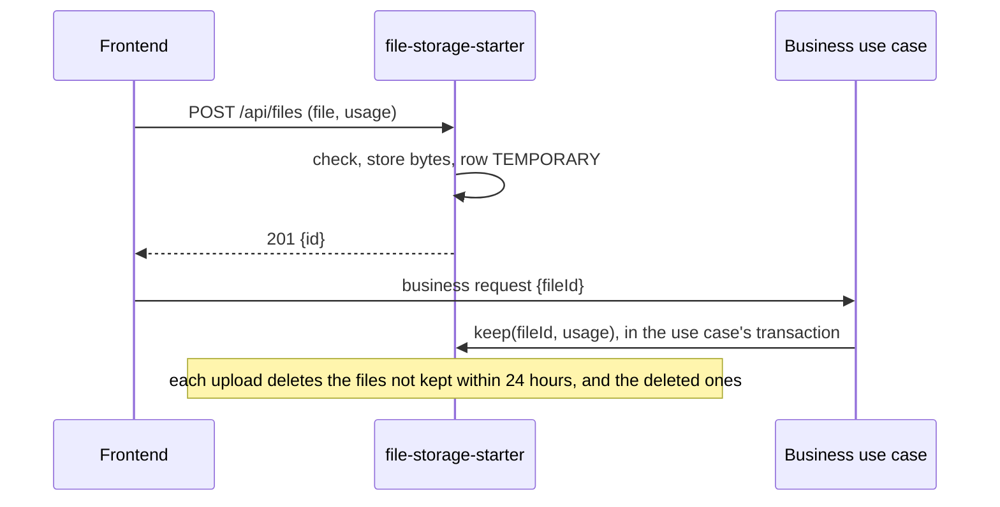

# 0022. Store uploaded files as temporary until a use case keeps them

- Status: accepted
- Date: 2026-11-13

A file goes through one upload route of `file-storage-starter`, which checks it and stores it as temporary. The
business use case keeps it in its own transaction, through a row in PostgreSQL, and a file not kept within 24 hours
is deleted. The row makes keeping a file atomic with the use case and limited to its uploader, which no storage
service offers. It also records the business object the file is kept on, whose readers are the file's readers.

## Context

Bottles, cocktails and tastings need photos, and the label scan reads them. The files must live on a local
directory for a demo and in a bucket in production, with the bucket's provider still open. An upload is the classic
door of a stored attack, a script disguised as an image (OWASP, CWE-434), so each file must be checked before it is
stored and served so that a browser never runs it.

A form sends the photo before or with the business request, and that request can fail: a file whose use case
failed must not stay. A bucket cannot take part in a database transaction.

## Decision

- **One upload route**, `POST /api/files`, the only way in. Its usage, declared in the application's configuration,
  sets the accepted types and size. The route limits uploads per user, checks the size, the type read from the
  bytes with Apache Tika, the extension and the declared type, then answers the file's id.
- **A status in a table.** `stored_file` holds each file's owner, usage, type, size, name and status, `TEMPORARY`,
  `KEPT` or `DELETED`. The bytes never move: `keep` is one `UPDATE` in the caller's transaction, for the uploader
  and the usage the file was checked for only, and `delete` marks the row.
- **A cleanup on upload** deletes the objects, then the rows, of files not kept in time or deleted, taken with
  `FOR UPDATE SKIP LOCKED` so that instances share the work.
- **Reads follow the business object.** `keep` records the object a file belongs to, such as event 42. `urlOf`
  answers its uploader, a read-all role (`ROLE_ADMIN` by default), or whom the `FileAccess` bean of that type of
  object allows, asked at each call: sharing an event shares its photos, and no right is copied onto files. The
  same bean says who deletes, beside the uploader, and asks the rule the object's use cases ask. A type with no
  `FileAccess` has no other reader nor deleter. With no user and outside a request, the backend acts on any file.
- **Reads through a signed URL** of a kept file, valid 5 minutes. The bucket signs its own. On a directory, the
  starter signs one with HMAC-SHA256 and serves it. A usage declared public is read by anyone through a stable URL
  of the starter, the same for both providers.
- **The backend stores files too.** An importer's `store` runs the checks of an upload and commits a temporary
  file, which the importer keeps in its own transaction.
- **Two providers.** A directory, and any S3-compatible bucket through the AWS SDK v2 S3 client: AWS, Cloudflare R2,
  Google Cloud Storage through its S3 interoperability, Garage or RustFS. Azure Blob Storage would be a third.
- **No idempotency on the upload.** A doubled upload only adds a temporary file that expires. The business route
  that receives the id is the one to make idempotent, and `keep` already is.

## Consequences

- A use case keeps a file like it saves a row: a rollback leaves the file temporary, then deleted.
- A file whose bytes do not match an allowed type is refused before anything is stored, and the type served is the
  one read from the bytes.
- A leaked URL serves its file until it expires, and a removed reader keeps a URL already issued as long.
- Each `urlOf` of a private file shared through its object asks the business once.
- Images are not decoded, so a pixel bomb or a hidden payload in the metadata is not caught yet.
- Files not kept are deleted only when someone uploads, until a scheduler runs the cleanup.
- The directory provider fits one instance, or instances that share the directory and the signing key.
- The table and the bucket can drift if one is changed by hand.

## Alternatives

- **A temporary area promoted by a platform event.** Rejected because a lost event lets the bucket's expiry delete a
  file already kept. It offered bucket lifecycle rules in place of a cleanup.
- **Object metadata only, no table.** Rejected because no storage service updates an object atomically with the
  business transaction, nor checks its owner. It offered one store fewer.
- **An upload straight to the bucket through a presigned URL.** Rejected because the bytes would be checked only
  after they are stored, and a directory has no such URL. It offered no bytes through the application.
- **An access list on each file.** Rejected because every sharing of an event or a cellar would be copied onto each
  of its files, and drift on a missed update. It offered a starter that never asks the business.
- **Rights checked by the use case only.** Rejected because a use case that forgets the check leaks a file. It
  offered no extension point.
- **Apache OpenDAL.** Rejected because its Java binding is not mature enough yet, before 1.0 with presigning in its
  async API only and no known JVM production user, and heavy as a dependency, a native Rust library of about 28 MB
  per platform loaded through JNI (as of November 2026). It offered one API for a directory, S3, GCS and Azure.
  Apache jclouds is retired and Spring Content archived.

## Sources

- [File Upload Cheat Sheet](https://cheatsheetseries.owasp.org/cheatsheets/File_Upload_Cheat_Sheet.html), OWASP
- [Sharing objects with presigned URLs](https://docs.aws.amazon.com/AmazonS3/latest/userguide/ShareObjectPreSignedURL.html),
  AWS
- [Apache OpenDAL](https://opendal.apache.org/), Apache, one data access layer for every storage, the case for a
  multi-cloud library
