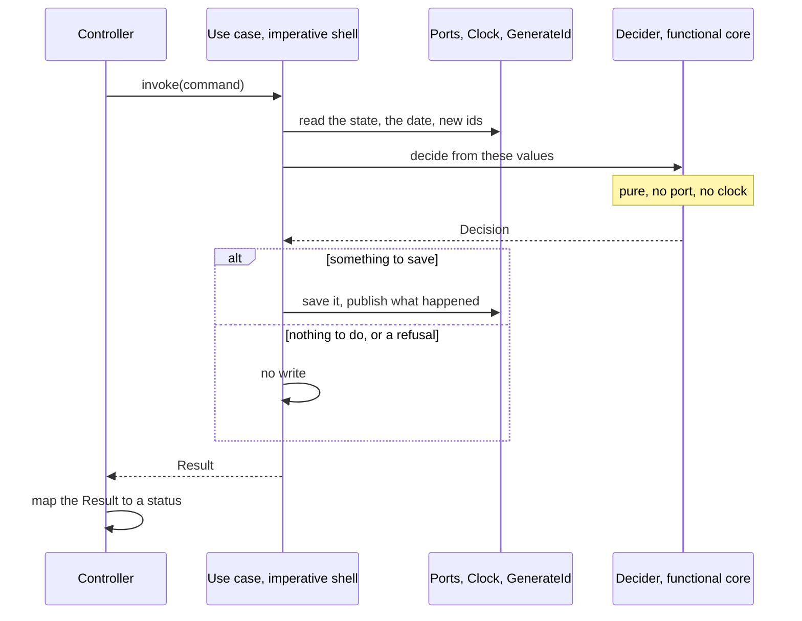

# Clean Architecture

Inside the `drinkit-domain` module, DrinkIt follows Robert C. Martin's Clean Architecture: the entities in the middle,
the use cases around them, and every dependency of the code pointing inward. Each business action is one use case,
which returns its outcomes as a sealed `Result` of its own. Its decisions live in a pure function of its decider,
following Gary Bernhardt's Functional Core / Imperative Shell. The build fails on a dependency that points outward.
The [hexagonal architecture](hexagonal-architecture.md) page covers the ports and adapters around the domain, and
this page what lies inside. Read this page before you add or change a use case.

## 🧭 The pattern

Clean Architecture draws an application as rings. Its dependency rule says that code depends only inward: an inner
ring never names a class, a function or a data format of an outer ring. The business rules then change for business
reasons only, and the database or the web framework is a detail that an outer ring plugs in.

| Ring | What it holds | In DrinkIt |
|---|---|---|
| Entities | The business rules that hold in any application | The entities and values of the `core` packages, such as `User` |
| Use cases | The rules of this application, one action each, which drive the entities | The use cases with their commands and deciders, and the ports of the `spi` packages |
| Interface adapters | The conversion between the use cases and the outside | The controllers and event handlers of `drinkit-backend`, the adapters of `drinkit-infra` |
| Frameworks and drivers | The tools themselves | Spring Boot, PostgreSQL, jOOQ, the [tech starters](tech-starters.md) |

When a use case writes to the database, the call flows outward while the dependency still points inward. The use
case calls a port, an interface of its own ring, and an adapter of an outer ring implements it. Like the hexagonal
architecture, Clean Architecture keeps the business code free of technology. It also splits the inside into entities
and use cases, with the same rule between them.

## 🧱 The rings in the code

A bounded context is a package of `drinkit-domain`, such as `user` or `cellar`. Its use cases sit at its root, beside
their commands and deciders, its entities and values in `core` and its ports in `spi`. The `common` package holds the
types the contexts share. Gradle keeps the outer rings out of the domain: `drinkit-domain` depends on no other module
of the application, so it cannot compile against a controller or an adapter. The
[architecture tests](../writing-code/testing/architecture-tests.md) keep the rule between packages. An entity or a
value never uses a use case, a command, a decider or a port. A port speaks only the types of `core` and `common`. A
dependency that points outward fails the build, with its fix in the message.

DrinkIt leaves out some parts of Martin's article. A use case hands its `Result` back to the controller, with no
presenter behind an output port. The data that crosses the boundary is the domain's own types, with no request and
response models. The controller maps them to the API models generated from the [OpenAPI contract](contract-first.md).
These generated models already keep the HTTP shape out of the domain. The domain also carries a few Spring
annotations, an exception that the [hexagonal architecture](hexagonal-architecture.md) page accepts and explains.

## 🎯 One use case per business action

A use case, also called an interactor, carries one business action and is named after it with a verb:
`CreateNewUser`, `CompleteProfileInformation`, `PromoteAsAdmin`. It takes no pattern suffix such as `UseCase`, so its
name says what it does, never what it is. Each rule below answers a red flag of the use case articles in Sources:

- **One public `invoke`.** It takes a command, an immutable data class such as `PromoteAsAdminCommand`, and the id of
  what it acts on, when that exists. A second action gets a class of its own, so the name of a class says what it does.
- **Domain types only.** The command, the arguments and the `Result` are types of the domain. The controller builds
  the command from the request and an adapter maps the database rows, so a use case never converts either.
- **A sealed `Result`, nested in the use case.** Its cases name business outcomes, such as `Success`, `UserNotFound`
  or `Forbidden`, never an HTTP status or a message, which are the caller's to choose. The controller maps each case
  to a status in an exhaustive `when`, so a new case fails the compilation until the controller answers it.
- **Every decision is a `Result` case.** An exception answers 500, whatever the decision. A few validation failures
  of the `user` context still end that way.
- **A class, with no interface.** A use case has one implementation, and its tests run it with the
  [test doubles](../writing-code/testing/testdouble.md) of its ports.
- **No state.** A use case is a Spring singleton that concurrent requests share: it holds its dependencies and
  nothing else.

A read that decides nothing needs no use case. The controller calls the port in a read-only transaction, as the
hexagonal architecture page says: a use case would only pass the call through. A read with a rule of its own is a
query, such as `FindExchangeRate`, which computes a cross rate through the euro. It is a use case with no command, no
decider and no sealed `Result`, in a read-only transaction.

A use case that changes something and returns no sealed `Result` predates these rules: it is no model to copy.

## 🧮 Functional core, imperative shell

Gary Bernhardt's Functional Core / Imperative Shell splits code into a pure core and a thin shell around it, which
does the input and output. Clean Architecture says nothing of how a use case is written inside, and the
pattern fits there. In DrinkIt, the use case is the imperative shell. Its decider is the functional core, which
returns a sealed `Decision` of what the shell must do. Only the shell talks to the ports:

The date comes from the injected `Clock` and new ids from the `GenerateId` port. The decider is an `internal object`
with no state, which only its use case calls, named after the decision, such as `AdminPromotionDecider`. Its
`Decision` cases, such as `EventToPersist`, `AlreadyAdmin` or `Unauthorized`, say what to do, and the use case maps
each one to a `Result`. What happened may also go out as a [platform event](platform-events.md). On an event-sourced
aggregate, the decider reads the state folded from the events, as [event sourcing](event-sourcing.md) shows.

Each business rule then lives in one place, a function of its arguments. A test calls the decider with plain values,
with no double and no clock to control. The architecture tests keep it pure: a decider uses only the domain's own
types, Kotlin, `java.time` and `java.math`, never a port or a clock.

## 🏷️ The annotations that mark the patterns

`documentation-starter` holds annotations that name the pattern a class follows. They exist in the source only,
which the documentation generator of [living documentation](../writing-code/best-practices/living-documentation.md)
and the architecture tests read, so they cost nothing at runtime:

| Annotation | Package, under `com.drinkit.documentation` | On | What reads it |
|---|---|---|---|
| `@CoreDomain` | `clean.architecture` | An entity or a value of `core` | The documentation generator, which writes a page for it |
| `@Usecase` | `clean.architecture` | A use case | The documentation generator, which lists it on the page of its context's `@CoreDomain`. The architecture tests require it on every `@Service` of the domain, so the pages miss no use case |
| `@ImperativeShell` | `fcis` | A use case with a decider | No tool: it tells the reader the class is the shell |
| `@FunctionalCore` | `fcis` | A decider | The architecture tests, which check that it is pure and an `internal object` |

The generator finds the `@CoreDomain` of a use case through its package, so a use case stays in the parent package
of `core`.

## 📚 Sources

- [The Clean Architecture](https://blog.cleancoder.com/uncle-bob/2012/08/13/the-clean-architecture.html), Robert C. Martin, 2012
- [Functional Core, Imperative Shell](https://www.destroyallsoftware.com/screencasts/catalog/functional-core-imperative-shell), Gary Bernhardt, Destroy All Software
- [Impureim sandwich](https://blog.ploeh.dk/2020/03/02/impureim-sandwich/), Mark Seemann
- [Notre implémentation de la Clean Architecture, zoom sur les Use Cases](https://medium.com/ceetiz/notre-impl%C3%A9mentation-de-la-clean-architecture-zoom-sur-les-use-cases-1da8f2022fc5), Nicolas Poste, Ceetiz
- [UseCase Red Flags and Best Practices in Clean Architecture](https://medium.com/teknasyon-engineering/usecase-red-flags-and-best-practices-in-clean-architecture-76e2f6d921eb), ilyas ipek, Teknasyon Engineering
