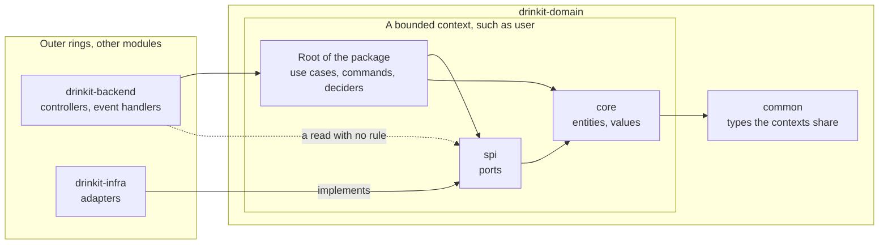
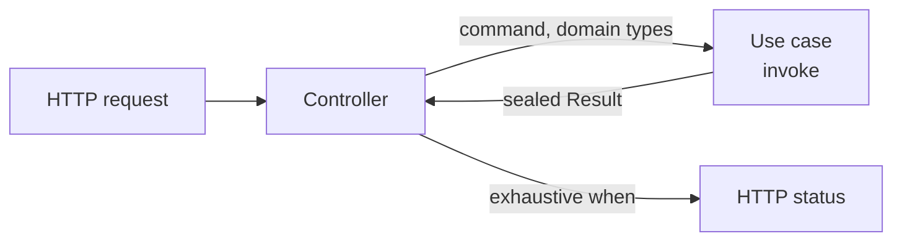
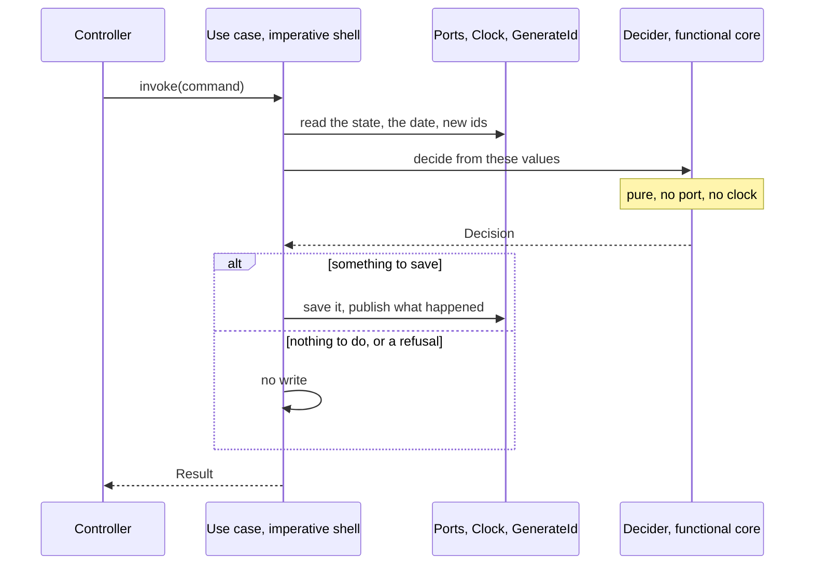

# Clean Architecture

Robert C. Martin's Clean Architecture puts the business rules at the center of an application: the entities in the
middle, the use cases around them, and every dependency of the code pointing inward, so that the database and the web
framework stay details. In DrinkIt, the domain module, `drinkit-domain`, holds these rings, and each business action
is one use case that returns its outcomes as a sealed `Result` of its own. The build fails on a dependency that points
outward. Where a use case takes decisions worth isolating, as on an event-sourced aggregate, it moves them into a pure
function, after Gary Bernhardt's Functional Core / Imperative Shell: a tool taken off the shelf when it pays, not a
rule. The [hexagonal architecture](hexagonal-architecture.md) page covers the ports and adapters around the domain,
and this page what lies inside. Read this page before you add or change a use case.

## 🧭 The pattern

Clean Architecture draws an application as rings. Its dependency rule says that code depends only inward: an inner
ring never names a class, a function or a data format of an outer ring. The business rules then change for business
reasons only, and the database or the web framework is a detail that an outer ring plugs in.

| Ring | What it holds | In DrinkIt |
|---|---|---|
| Entities | The business rules that hold in any application | The entities and values of the `core` packages, such as `User` |
| Use cases | The rules of this application, one action each, which drive the entities | The use cases with their commands, and the ports of the `spi` packages |
| Interface adapters | The conversion between the use cases and the outside | The controllers and event handlers of `drinkit-backend`, the adapters of `drinkit-infra` |
| Frameworks and drivers | The tools themselves | Spring Boot, PostgreSQL, jOOQ, the [tech starters](tech-starters.md) |

When a use case writes to the database, the call flows outward while the dependency still points inward: the use
case calls a port, an interface of its own ring, and an adapter of an outer ring implements it.

## 🧱 The rings in the code

A bounded context is a package of `drinkit-domain`, such as `user` or `cellar`. Each arrow below is a dependency, and
every one points inward:

Gradle keeps the outer rings out: `drinkit-domain` depends on no other module of the application, so it cannot
compile against a controller or an adapter. The [architecture tests](../writing-code/testing/architecture-tests.md)
check the arrows between packages, and a dependency that points outward fails the build with its fix in the message.

DrinkIt leaves out the presenter and the request and response models of Martin's article. A use case hands its
`Result` back to the controller, which maps it to the API models generated from the
[OpenAPI contract](contract-first.md). The domain also carries a few Spring annotations, an exception that the
[hexagonal architecture](hexagonal-architecture.md) page accepts and explains.

## 🎯 One use case per business action

A use case, also called an interactor, carries one business action and is named after it with a verb, such as
`CreateNewUser` or `PromoteAsAdmin`, never with a `UseCase` suffix that says what it is rather than what it does:

Each rule answers a red flag of the use case articles in Sources:

- **One public `invoke`**, taking a command, an immutable data class such as `PromoteAsAdminCommand`, and the id of
  what it acts on. A second action gets a class of its own.
- **Domain types only.** The controller builds the command from the request and an adapter maps the database rows,
  so a use case converts neither.
- **Every decision is a case of the sealed `Result`**, such as `Success`, `UserNotFound` or `Forbidden`, never an HTTP
  status or a message, which are the caller's to choose. A new case fails the compilation of the controller's `when`
  until it answers it. A decision thrown as an exception answers 500, as a few validation failures of `user` still do.
- **No interface and no state.** A use case has one implementation, and it is a Spring singleton that concurrent
  requests share.

A read that decides nothing needs no use case: the controller calls the port in a read-only transaction. A read with
a rule of its own, such as `FindExchangeRate`, which computes a cross rate through the euro, is a use case with no
command and no sealed `Result`. A use case that changes something and returns no sealed `Result` predates these
rules: it is no model to copy.

## 🧮 Functional core, imperative shell, when it pays

Gary Bernhardt's Functional Core / Imperative Shell splits code into a pure core and a thin shell around it, which
does the input and output. Clean Architecture says nothing of how a use case is written inside, and the pattern fits
there: the use case is the shell, and a decider is the core, which returns a sealed `Decision` of what the shell must
do. It pays when the decisions are rich enough to deserve tests of their own, and most of all on an
[event-sourced aggregate](event-sourcing.md), where the decider reads the state folded from the events and returns the
event to append. Today the six deciders of DrinkIt belong to the `User` aggregate, while the cellar and exchange rate
use cases decide in their own body. Add a decider when the decisions of a use case grow, not by default:

A decider is an `internal object` with no state, named after the decision, such as `AdminPromotionDecider`, and the
use case maps each of its `Decision` cases, such as `EventToPersist` or `AlreadyAdmin`, to a `Result`. A test calls it
with plain values, with no double and no clock to control. The architecture tests keep it pure: it uses only the
domain's own types, Kotlin, `java.time` and `java.math`, never a port or a clock.

## 🏷️ The annotations that mark the patterns

`documentation-starter` holds annotations that name the pattern a class follows. They exist in the source only,
which the documentation generator of [living documentation](../writing-code/best-practices/living-documentation.md)
and the architecture tests read, so they cost nothing at runtime:

| Annotation | On | What reads it |
|---|---|---|
| `@CoreDomain` | An entity or a value of `core` | The documentation generator, which writes a page for it |
| `@Usecase` | A use case | The documentation generator, which lists it on the page of its context's `@CoreDomain`. The architecture tests require it on every `@Service` of the domain, so the pages miss no use case |
| `@ImperativeShell` | A use case with a decider | No tool: it tells the reader the class is the shell |
| `@FunctionalCore` | A decider | The architecture tests, which check that it is pure and an `internal object` |

The generator finds the `@CoreDomain` of a use case through its package, so a use case stays in the parent package
of `core`.

## 📚 Sources

- [The Clean Architecture](https://blog.cleancoder.com/uncle-bob/2012/08/13/the-clean-architecture.html), Robert C. Martin, 2012
- [Functional Core, Imperative Shell](https://www.destroyallsoftware.com/screencasts/catalog/functional-core-imperative-shell), Gary Bernhardt, Destroy All Software
- [Impureim sandwich](https://blog.ploeh.dk/2020/03/02/impureim-sandwich/), Mark Seemann
- [Notre implémentation de la Clean Architecture, zoom sur les Use Cases](https://medium.com/ceetiz/notre-impl%C3%A9mentation-de-la-clean-architecture-zoom-sur-les-use-cases-1da8f2022fc5), Nicolas Poste, Ceetiz
- [UseCase Red Flags and Best Practices in Clean Architecture](https://medium.com/teknasyon-engineering/usecase-red-flags-and-best-practices-in-clean-architecture-76e2f6d921eb), ilyas ipek, Teknasyon Engineering
