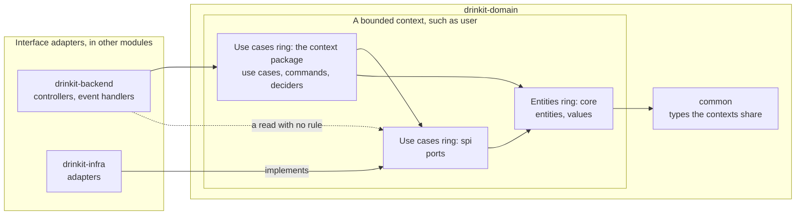
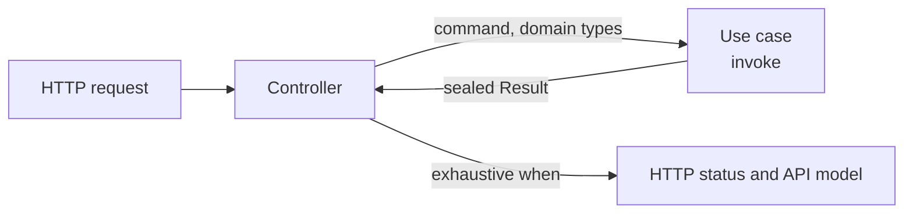
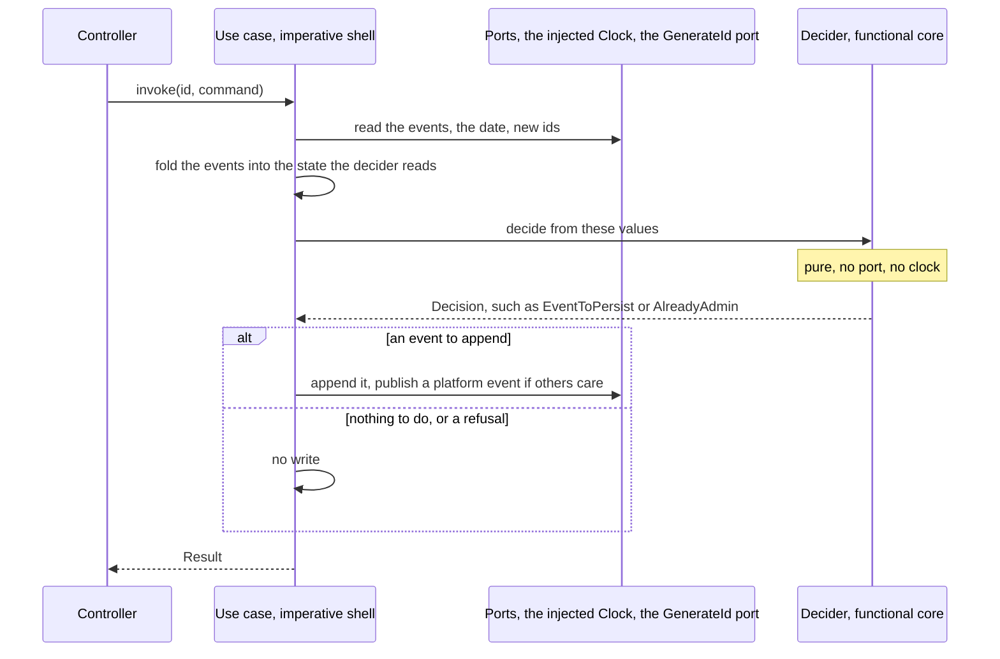

# Clean Architecture

Robert C. Martin's Clean Architecture puts the business rules at the center of an application: the entities in the
middle, the use cases around them, and every dependency of the code pointing inward, so that the database and the web
framework stay details. In DrinkIt, the domain module, `drinkit-domain`, holds the two inner rings. Each business
action is one use case, a class with one `invoke` that returns the outcomes of the action as a sealed `Result` of its
own. The build fails on a dependency that points outward. When a use case takes decisions worth testing alone, as on
an [event-sourced aggregate](event-sourcing.md), it moves them into a pure function, its decider, after Gary
Bernhardt's Functional Core / Imperative Shell: DrinkIt uses that pattern where it pays and does not require it.
Annotations such as `@Usecase` and `@FunctionalCore` mark both patterns in the code. The
[hexagonal architecture](hexagonal-architecture.md) page covers the ports and adapters around the domain, and this
page covers what lies inside. Read this page before you add or change a use case.

## 🧭 The pattern

Clean Architecture draws an application as rings, and its dependency rule says that code depends only inward: an
inner ring never names a class, a function or a data format of an outer ring.

| Ring | What it holds | In DrinkIt |
|---|---|---|
| Entities | The business rules that hold in any application | The entities and values of each context's `core` package, such as `User` |
| Use cases | The rules of this application, one action each, which drive the entities | The use cases, with their commands (the input of an action) and their deciders (the pure functions some of them decide with), and the ports of each context's `spi` package (the interfaces the use cases need) |
| Interface adapters | The conversion between the use cases and the outside | The controllers and [platform event](platform-events.md) handlers of `drinkit-backend`, the adapters of `drinkit-infra` |
| Frameworks and drivers | The tools themselves | Spring Boot, PostgreSQL, jOOQ, the [tech starters](tech-starters.md) |

## 🧱 The rings in the code

A bounded context, a part of the business with its own words such as `user` or `cellar`, is a package of
`drinkit-domain`. A `common` package holds the types the contexts share, such as the base class of the ids. Each arrow
below is a dependency, and every one points inward, or to the shared `common`:

When a use case writes to the database, the call flows outward through a port, while the dependency still points
inward: the adapter implements the port. Gradle keeps the outer rings out of the domain module: `drinkit-domain`
depends on no other module of the application. The [architecture tests](../writing-code/testing/architecture-tests.md)
check the arrows between packages, and a dependency that points outward fails the build with its fix in the message.

DrinkIt leaves out the presenter and the request and response models of Martin's article: the controller maps the
`Result` to the API models generated from the [OpenAPI contract](contract-first.md), which already keep the HTTP shape
out of the domain. The domain also carries a few Spring annotations, a deviation that the
[hexagonal architecture](hexagonal-architecture.md) page accepts and explains.

## 🎯 One use case per business action

A use case, also called an interactor, carries one business action and is named after it with a verb, such as
`CreateNewUser` or `PromoteAsAdmin`, never with a `UseCase` suffix that says what it is rather than what it does. A
request goes through it as below:

Each rule answers a red flag of the use case articles in Sources:

- **One public `invoke`**, taking, when the action applies to something that exists, its id first, then a command, an
  immutable data class such as `PromoteAsAdminCommand`. A second action gets a class of its own, so that a class name
  always says what it does.
- **Domain types only.** The controller builds the command from the request and an adapter maps the database rows, so
  that a change of the API or of the schema never reaches the use case.
- **Every outcome is a case of the sealed `Result`**, such as `Success`, `UserNotFound` or `Forbidden`, never an HTTP
  status or a message, which are the caller's to choose. A new case fails the compilation of the controller's `when`
  until it answers it. The trap: an outcome thrown as an exception reaches the exception handler of the backend, which
  answers 500, as a few validation failures of the `user` context still do.
- **No interface and no state.** An interface with one implementation adds a file and no seam a test needs, and a
  use case is a Spring singleton that concurrent requests share.

A read that decides nothing needs no use case, which would only pass the call through: the controller calls the
port in a read-only transaction. A query, a
read with a rule of its own such as the currency conversion of `FindExchangeRate`, is a use case that returns its
value, with no command and no sealed `Result`. The cellar use cases, `CreateCellar` and `DeleteCellar`, predate these
rules and return no sealed `Result`: they are no model to copy.

## 🧮 Functional core, imperative shell, when it pays

Functional Core / Imperative Shell keeps the decisions in a pure core and the input and output in a thin shell around
it, a shape Mark Seemann calls an impureim sandwich. Clean Architecture says nothing of how a use case is written
inside, and the pattern fits there: the use case is the shell, and a decider is the core, which returns a sealed
`Decision` of what the shell must do. It pays when the decisions are rich enough to deserve tests of their own, most
of all on an event-sourced aggregate: the use case folds the events into the state the decider reads, and the decider
returns the event to append. Today the deciders all belong to the `User` aggregate, and the cellar and exchange rate
use cases decide in their own body:

A decider is named after the decision it takes, such as `AdminPromotionDecider`, and is an `internal object`: nothing
outside its module calls it, and it holds nothing. The use case maps each case of its `Decision` to a case of its
`Result`. A test calls the decider with plain values. The architecture tests keep it pure, so that its result depends
on its arguments alone: it uses only the domain's own types, Kotlin, `java.time` and `java.math`, never a port or a
`java.time.Clock`.

## 🏷️ The annotations that mark the patterns

Annotations of the `documentation-starter` [tech starter](tech-starters.md) name the pattern a class follows. The
generator of the [living documentation](../writing-code/best-practices/living-documentation.md) and the architecture
tests read them from the source:

| Annotation | On | What reads it |
|---|---|---|
| `@CoreDomain` | A main type of a context, such as `User` or `Cellar` | The documentation generator, which writes a page for it |
| `@Usecase` | A use case | The documentation generator, which lists it on the page of its context's `@CoreDomain`. The architecture tests require it on every `@Service` of the domain |
| `@ImperativeShell` | A use case with a decider | No tool: it tells the reader of the code |
| `@FunctionalCore` | A decider | The architecture tests, which check that it is pure and an `internal object` |

The generator finds the `@CoreDomain` of a use case through its package, so a use case stays in the parent package
of `core`.

## 📚 Sources

- [The Clean Architecture](https://blog.cleancoder.com/uncle-bob/2012/08/13/the-clean-architecture.html), Robert C. Martin, 2012
- [Functional Core, Imperative Shell](https://www.destroyallsoftware.com/screencasts/catalog/functional-core-imperative-shell), Gary Bernhardt, Destroy All Software
- [Impureim sandwich](https://blog.ploeh.dk/2020/03/02/impureim-sandwich/), Mark Seemann
- [Notre implémentation de la Clean Architecture, zoom sur les Use Cases](https://medium.com/ceetiz/notre-impl%C3%A9mentation-de-la-clean-architecture-zoom-sur-les-use-cases-1da8f2022fc5), Nicolas Poste, Ceetiz
- [UseCase Red Flags and Best Practices in Clean Architecture](https://medium.com/teknasyon-engineering/usecase-red-flags-and-best-practices-in-clean-architecture-76e2f6d921eb), ilyas ipek, Teknasyon Engineering
