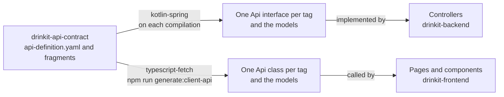

# Contract first

The Nuxt frontend and the Spring Boot backend talk through an HTTP API described in one OpenAPI contract:
`api-definition.yaml` and the files it references, in the `drinkit-api-contract` module. We write that contract
before the code, then OpenAPI Generator generates both sides from it: the backend's Spring interfaces and models on
each compilation, the frontend's TypeScript client with `npm run generate:client-api`. Neither is committed. The
contract is the one place where the two sides agree, so a change to the API starts there. No change breaks a
consumer: one that would takes two pull requests, following the [expand and contract][expand-and-contract] pattern.
Read this page before you change the contract, and follow the [`api-contract-change` skill][skill] for the steps.

## 🧭 Why contract first

Writing the contract first means the API is designed and reviewed in a YAML file before anyone implements it. The
usual alternative, code first, derives the description from the backend code once it exists. We chose the contract
first for four reasons:

- **The API is reviewed before it is built.** A pull request that changes the API shows the contract diff: paths,
  fields and statuses, in one file that a frontend and a backend developer both read.
- **One source of truth.** The server interfaces, the client and the Swagger UI all come from the contract, so none
  of them drifts from the others.
- **Both sides start at once.** The frontend codes against the generated client while the backend implements the
  generated interfaces.
- **A mismatch fails the build.** A controller implements a generated interface, so when the contract adds or changes
  an operation, the backend no longer compiles until the controller follows.

It has a price. The generators decide the shape of the code, and some Kotlin types have no OpenAPI equivalent: a
generic paginated result becomes one class per item type. Each side upgrades its own generator separately. The
contract also stays on OpenAPI 3.0.3, because OpenAPI Generator 7.26.0 supports 3.1 in beta only.

## 📜 What the contract describes

An OpenAPI contract lists the paths of the API, what each operation takes and returns, and the data types they share.
We use OpenAPI because one file is enough to generate the Kotlin server and the TypeScript client, and Swagger UI,
linters and diff tools all read that same file.

Each part of the contract becomes something in the code:

| Part | What it holds | What the generators make of it |
|---|---|---|
| `paths` | Each path, and one operation per HTTP method | One method per operation |
| `operationId` | The unique name of an operation | The name of that method, on both sides |
| `tags` | The area of the API an operation belongs to, such as cellars | One backend interface and one frontend class per tag, named `<Tag>Api` |
| `components/schemas` | The data types, with their required fields and constraints | One Kotlin data class and one TypeScript interface per schema |
| `responses` | Each status an operation answers, with its body | The return type of the method |
| `$ref` | A reference to a schema, in the same file or another | Nothing of its own: it ties the files together |

## ⚙️ From the contract to the code

On the backend, the `contract-first-convention` plugin runs the `kotlin-spring` generator of OpenAPI Generator before
each compilation of `drinkit-backend`. The generated code lands in the `build` folder and is never committed:
regenerated on each build, it cannot drift from the contract. The [build tool page](../build-and-data/build-tool.md)
lists this convention with the others. Each of its settings has a reason:

- **Interfaces only.** The generator writes the interfaces, with their Spring MVC mappings, and the models. A
  controller implements the interface and turns the result of a use case into a status, as the [hexagonal
  architecture](hexagonal-architecture.md) describes. Generated controllers would hold that code in files each build
  overwrites.
- **No default body.** An operation that no controller overrides fails the compilation. Left to its default, the
  generator would answer 501 Not Implemented at runtime instead. A new tag has no controller yet, so nothing fails
  until one implements its interface.
- **One interface per tag.** The tag of an operation names its interface, so a controller covers one area of the API.
- **Validation from the schema.** The required fields and constraints of a schema become Bean Validation annotations:
  a request that breaks them gets a 400 before the controller runs. Business rules stay in the domain.
- **Domain types for identifiers.** A string with a custom `format`, such as `cellar-id`, becomes the domain's
  `CellarId` through the type and import mappings of `drinkit-backend/build.gradle.kts`. The controller gets a typed
  value, as the [coding rules](../writing-code/best-practices/coding-rules.md) ask, and the frontend keeps a string.

Only the dev profile turns on springdoc, which serves the running API's description and its Swagger UI to the admin
role, at the URLs of the [Commands section of `AGENTS.md`][agents-commands]. It reads the annotations of the
generated interfaces, so what you see there is the contract as the backend implements it.

On the frontend, `npm run generate:client-api` runs the `typescript-fetch` generator into `src/openapi`, which git
ignores. CI runs it before each frontend build, as the [CI/CD page](../delivery/ci-cd.md) describes. A Nuxt page
creates the `<Tag>Api` client of an area and calls its methods. Each side pins its own generator version, the Gradle
catalogs for the backend and `openapitools.json` for the frontend. A construct can therefore generate on one side and
fail on the other: build both after a contract change.

The frontend build does not check types yet ([#388](https://github.com/mboisnard/drinkit/issues/388)). Until it does,
a contract change that breaks a page still builds, and only a review or a run of that page shows it.

## 🗂️ Organizing the contract

`api-definition.yaml` is the entry point: it holds the `info`, the tags and every path, and the generators read this
file only. The schemas live in fragments next to it, one per area, such as `cellarsResponse.yaml`, and `common.yaml`
holds what several areas share. A fragment is a whole OpenAPI document with empty `paths` and `x-fragment: true`
under `info`. No tool reads that marker: it tells whoever opens the file that it is not an entry point. The
generators reach a schema only by following `$ref`s from the entry point, so a schema that nothing references is not
generated.

Four practices are worth knowing, even though DrinkIt does not apply them yet:

- **A folder per kind of object.** Redocly's multi-file layout keeps a short root file, with each path in `paths/`
  and each component in `components/<type>/`. It pays off once the entry point no longer fits a few screens, and
  `redocly split` produces it from a single file.
- **A bundled file for the tools.** Some tools do not follow a `$ref` to another file. `redocly bundle` merges the
  fragments into one document for them, while people keep editing the fragments.
- **A linter in CI.** Spectral or Redocly lint check a ruleset on each change: a unique `operationId`, a declared tag
  on each operation, no unused component, the naming conventions. Today, only what breaks the generation fails.
- **One error body.** The contract declares the error statuses without a body, so neither side has a type for an
  error. RFC 9457 defines Problem Details, a standard JSON body for HTTP errors, and Spring has a `ProblemDetail`
  type for it. Described once in `common.yaml`, it would type the errors on both sides.

## 🔀 Evolving the contract

A change is breaking when a consumer that followed the old contract stops working under the new one. Consumers read
tolerantly, as in Martin Fowler's Tolerant Reader: they ignore the fields they do not know. The generated TypeScript
models, for one, read only the fields they declare from a response. With that, here is what breaks:

| Change | Breaking | Why |
|---|---|---|
| Add an operation, or an optional request field | No | An old consumer neither calls nor sends it |
| Add a response field | No | An old consumer ignores it |
| Relax a validation | No | Every request that passed still passes |
| Rename an `operationId` or a tag | No | Only the generated names change, and both sides follow in the same pull request |
| Remove or rename a field, an operation or a path | Yes | An old consumer still sends or reads it. A rename is a removal and an addition |
| Add a required request field, or tighten a validation | Yes | The request of an old consumer now gets a 400 |
| Change the type or the default value of a field | Yes | An old consumer relies on the old one |
| Add an enum value to a response | Yes | A consumer that lists the values has no case for the new one |

A breaking change never lands in one pull request, even one that adapts both the frontend and the backend. The
frontend and the backend come from the same commit but deploy separately. During a deployment, the old and the new
versions run side by side, and a browser tab opened before it keeps the old client until it reloads. Malte Ubl calls
this version skew. [ADR 0003][adr] records this decision and the options it weighed.

So a breaking change goes through [expand and contract][expand-and-contract], in two pull requests:

1. **Expand.** Add the new field or operation next to the old one, and mark the old one `deprecated: true` so that no
   new code starts using it. The backend serves both, and the frontend moves to the new one in the same pull request,
   so that the old one has no user left once it ships. A new required request field starts optional, so that the old
   client, which does not send it, keeps working.
2. **Contract.** Once the first pull request is deployed and the tabs opened before it have reloaded, remove the old
   element. A field added as optional becomes required at this step.

Renaming a response field from `name` to `label`, for example, takes a first pull request that adds `label`, marks
`name` deprecated and moves the pages to `label`, then a second one that removes `name`. This works as long as the
backend deploys before the frontend. A frontend that goes live first reads `label` from a backend that lacks it:
where that can happen, the pages move to `label` in a pull request of their own, once the expand is deployed. Nothing
deploys the application yet, so that order is still to be set.

Nothing checks the rule yet. [#526](https://github.com/mboisnard/drinkit/issues/526) tracks a CI check, such as
oasdiff, that fails on a breaking change and lets through the removal of a deprecated element.

## 🔌 Between two backends

DrinkIt has one backend today. When a second application calls it, or the other way round, the same approach applies,
with stricter rules, because each backend deploys on its own schedule:

- **The provider owns the contract,** since it serves it and deploys its changes. The contract sits in a module of
  its own, so that each consumer generates its client without depending on the provider's code.
- **A service API has its own rules.** It takes its own path prefix and authenticates the calling service instead of
  a user session. The security rules of the frontend API and of the service API then never mix.
- **Contracts stay small.** A contract groups the operations of one use case, such as importing bottles, not every
  operation of an application, so that a consumer depends only on the operations it calls.
- **Only applications call web services.** A [tech starter](tech-starters.md) never calls one, so an application's
  dependencies show what it calls.
- **A removal waits for every consumer.** It waits until each consumer is deployed without the old element.
  Consumer-driven contract tests, such as Pact, add a check from the other side: the provider replays what each
  consumer expects of it.

## 🧩 Generator templates

The generators write the code from Mustache templates. When no option does what you need, you can copy one of them,
change it, and point the generator's `templateDir` to your copy. That copy is a fork: each generator upgrade can
change the original, and you merge it into your copy by hand. Before you override a template, try in this order:

1. a generator option, as `openapi-generator config-help -g <generator>` lists them
2. a type, import or schema mapping, as for the identifiers above
3. a vendor extension, an `x-` key of the contract that the upstream templates already read

If you still need a template, override only that one and change as little of it as you can. Commit the upstream file
of the exact generator version first, then your change in a second commit: the next upgrade shows your change as a
diff of its own.

## 📚 Sources

- [OpenAPI Specification](https://spec.openapis.org/oas/latest.html), OpenAPI Initiative
- [Best Practices](https://learn.openapis.org/best-practices.html), OpenAPI Initiative
- [API Design-First vs. Code First](https://blog.stoplight.io/api-design-first-vs-code-first), Phil Sturgeon, Stoplight
- [RESTful API and Event Guidelines](https://opensource.zalando.com/restful-api-guidelines/), Zalando, for API first, compatibility and deprecation
- [AIP-180: Backwards compatibility](https://google.aip.dev/180), Google
- [Parallel Change](https://martinfowler.com/bliki/ParallelChange.html), Danilo Sato
- [Tolerant Reader](https://martinfowler.com/bliki/TolerantReader.html), Martin Fowler
- [Version Skew](https://www.industrialempathy.com/posts/version-skew/), Malte Ubl
- [RFC 9457: Problem Details for HTTP APIs](https://www.rfc-editor.org/rfc/rfc9457.html), IETF
- [Multi-file OpenAPI definitions](https://redocly.com/docs/resources/multi-file-definitions), Redocly
- [Spectral](https://github.com/stoplightio/spectral), Stoplight
- [oasdiff](https://github.com/oasdiff/oasdiff), oasdiff
- [How Pact works](https://docs.pact.io/getting_started/how_pact_works), Pact
- [Templating](https://openapi-generator.tech/docs/templating) and [Customization](https://openapi-generator.tech/docs/customization), OpenAPI Generator
- [kotlin-spring](https://openapi-generator.tech/docs/generators/kotlin-spring) and [typescript-fetch](https://openapi-generator.tech/docs/generators/typescript-fetch) generators, OpenAPI Generator

[skill]: https://github.com/mboisnard/drinkit/blob/master/.claude/skills/api-contract-change/SKILL.md
[agents-commands]: https://github.com/mboisnard/drinkit/blob/master/AGENTS.md#commands
[adr]: ../adr/0003-api-contract-changes-by-expand-and-contract.md
[expand-and-contract]: ../writing-code/best-practices/coding-rules.md#evolve-a-contract-in-steps
