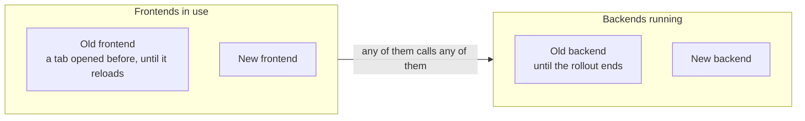

# Contract first

Contract first means writing the description of an API before its code, and generating the code of both sides from
it, so that the client and the server cannot disagree on what they exchange. In DrinkIt, the Nuxt frontend and the
Spring Boot backend talk through an HTTP API described in one OpenAPI contract: `api-definition.yaml` and the files
it references, in the `drinkit-api-contract` module. OpenAPI Generator generates both sides from it, so a change to
the API starts there. The two
sides deploy separately, so a change that would break the frontend goes in steps, each in its own pull request,
following the [expand and contract][expand-and-contract] pattern. Read this page before you change the contract,
and follow the [`api-contract-change` skill][skill] for the steps.

## 🧭 Why contract first

We chose it over code first, which derives the API description from the backend code:

- **The API is reviewed before it is built.** The pull request shows the contract diff, which a frontend and a
  backend developer both read.
- **One source of truth.** The server interfaces and the client come from the contract, so neither drifts from the
  other.
- **Both sides start at once.** The frontend codes against the generated client while the backend implements the
  generated interfaces.
- **A mismatch fails the backend build.** When the contract changes an operation, or adds one to an existing tag,
  the backend no longer compiles until its controller follows.

It has a price. The generators decide the shape of the code. Some types have no OpenAPI equivalent: a
generic paginated result becomes one class per item type. The two sides pin separate generator versions, so a
construct can generate on one side and fail on the other.

## ⚙️ From the contract to the code

Neither side commits the generated code, so that it never drifts from the contract nor gets edited by hand. The
backend generates it on each compilation, and CI runs `npm run generate:client-api` before each frontend build.

A controller implements the generated interface and turns the result of a use case into a status, as the
[hexagonal architecture](hexagonal-architecture.md) describes. A request that breaks the constraints of a schema gets a 400 before it reaches the controller. A string
with a custom `format`, such as an identifier, becomes a domain type on the backend and stays a string on the
frontend. The [build tool page](../build-and-data/build-tool.md) lists the convention that runs the generator.

The frontend build does not check types yet ([#388](https://github.com/mboisnard/drinkit/issues/388)). Until it does,
a contract change that breaks a page still builds, and only a review or a run of that page shows it.

## 🗂️ Organizing the contract

`api-definition.yaml` holds the tags and every path. The schemas live in fragments next to it, split by area and by
request or response, such as `cellarsParameters.yaml`, and `common.yaml` holds what several areas share. The
generators reach a schema only through the `$ref`s that start from `api-definition.yaml`, so a schema that nothing
references is not generated.

Practices worth knowing, not applied yet:

- **A folder for the paths and one per kind of OpenAPI component,** once `api-definition.yaml` outgrows a few screens.
- **A bundled file** for the tools that do not follow a `$ref` to another file.
- **A linter in CI,** such as Spectral, so that the naming and the shape of the contract follow written rules.
- **One error body,** the Problem Details of RFC 9457, so that both sides get a type for an error.

## 🔀 Evolving the contract

The frontend reads as Martin Fowler's Tolerant Reader does: the generated client ignores a response field it does not
know. A change is breaking when it fails a consumer built before it:

| Change | Breaking | Why |
|---|---|---|
| Add an operation, or an optional request field | No | An old consumer neither calls nor sends it |
| Add a response field | No | An old consumer ignores it |
| Relax a validation | No | Every request that passed still passes |
| Rename an `operationId` or a tag | No | Neither travels over HTTP: only the generated names change |
| Remove or rename a field, an operation or a path | Yes | An old consumer still sends or reads it |
| Add a required request field, or tighten a validation | Yes | An old consumer's request now gets a 400 |
| Change the type or the default value of a field | Yes | An old consumer relies on the old one |
| Add an enum value to a response | Yes | A consumer that lists the values has no case for the new one |

The frontend and the backend come from the same commit but deploy separately. During a deployment, both versions of
each side are in use:

So a breaking change never lands in one pull request, even one that adapts both sides, as [ADR 0003][adr] records.
It takes an expand and a contract, each in its own pull request:

1. **Expand.** Add the new element next to the old one, which becomes `deprecated: true` so that no new code uses it,
   and move the frontend to the new one. A new required request field starts optional.
2. **Contract.** Once the first pull request is deployed, remove the old element, or make the new field required.

Two pull requests suffice when the backend deploys before the frontend. Otherwise, the frontend moves in a pull
request of its own once the expand is deployed, since a frontend deployed first would call what the backend lacks.
Nothing deploys DrinkIt yet, so the order of deployment is still to be set. A new enum value in a response goes in
the opposite order: the frontend handles it first, then the backend sends it. No check enforces these steps yet
([#526](https://github.com/mboisnard/drinkit/issues/526)).

## 🔌 Between two backends

DrinkIt has one backend today. When a second one calls it, or the other way round, each deploys on its own schedule:

- **The provider owns the contract,** in a module of its own, and each consumer generates its client from it without
  depending on the provider's code.
- **An API called by another backend has its own path prefix and authenticates the calling service,** so its
  security rules never mix with the frontend's.
- **A removal waits for every consumer,** and consumer-driven contract tests, such as Pact, check what each one
  expects.

## 🧩 Generator templates

The generators write code from Mustache templates, and a copied template is a fork to merge by hand on each
generator upgrade. Try a generator option, a type mapping or a vendor extension first. When a template is still
needed, override that one only. Commit the upstream file first, then your change, so that the next upgrade shows
your change as a diff of its own.

## 📚 Sources

- [OpenAPI Specification](https://spec.openapis.org/oas/latest.html), OpenAPI Initiative
- [API Design-First vs. Code First](https://blog.stoplight.io/api-design-first-vs-code-first), Phil Sturgeon, Stoplight
- [RESTful API and Event Guidelines](https://opensource.zalando.com/restful-api-guidelines/), Zalando
- [AIP-180: Backwards compatibility](https://google.aip.dev/180), Google
- [Parallel Change](https://martinfowler.com/bliki/ParallelChange.html), Danilo Sato
- [Tolerant Reader](https://martinfowler.com/bliki/TolerantReader.html), Martin Fowler
- [Version Skew](https://www.industrialempathy.com/posts/version-skew/), Malte Ubl
- [RFC 9457: Problem Details for HTTP APIs](https://www.rfc-editor.org/rfc/rfc9457.html), IETF
- [Multi-file OpenAPI definitions](https://redocly.com/docs/resources/multi-file-definitions), Redocly
- [Spectral](https://github.com/stoplightio/spectral), Stoplight
- [How Pact works](https://docs.pact.io/getting_started/how_pact_works), Pact
- [Customization](https://openapi-generator.tech/docs/customization), OpenAPI Generator

[skill]: https://github.com/mboisnard/drinkit/blob/master/.claude/skills/api-contract-change/SKILL.md
[adr]: ../adr/0003-api-contract-changes-by-expand-and-contract.md
[expand-and-contract]: ../writing-code/best-practices/coding-rules.md#evolve-a-contract-in-steps
