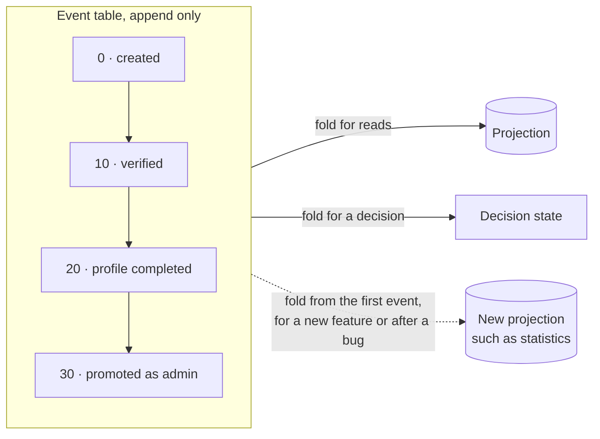
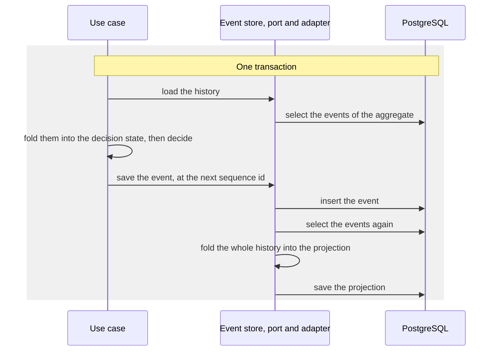
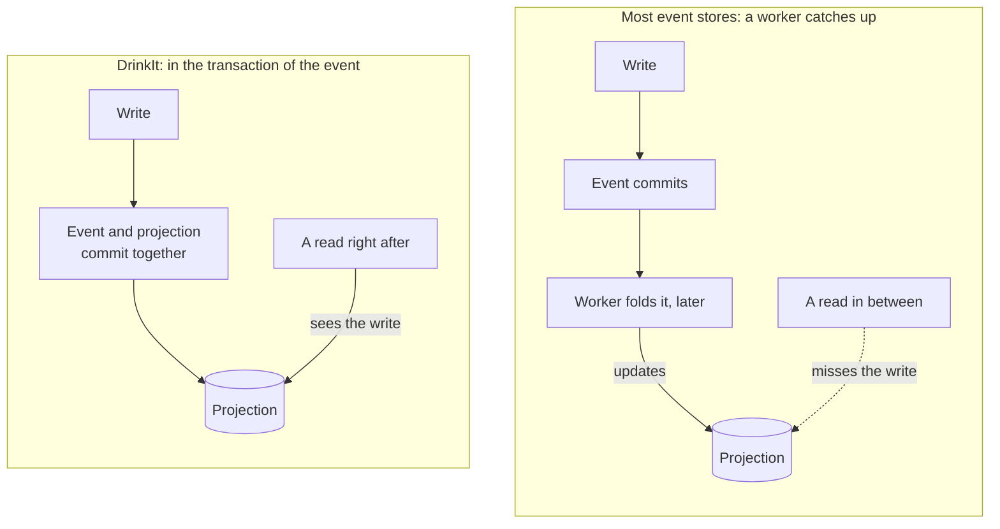

# Event sourcing

An event-sourced aggregate is stored as its events, the list of what happened to it, and its state is the fold of
those events in order. Its main value is a business one: a feature added later reads the whole history, as if it had
been there from the start. DrinkIt does it with PostgreSQL tables and a small [tech starter](tech-starters.md),
[`event-sourcing-starter`][starter], no framework. Each new event recomputes the read model, the projection, in the
same transaction, so a read always sees the last write. Read this page before you store an aggregate as events or
change one of its events. The `User` aggregate is the first stored this way.

## 🧭 The pattern

An event states a fact in the past tense, such as `PromotedAsAdmin`, with its date and its author. The events are
appended, never changed outside the rare rewrite described below, and every state the code needs is a fold of them:

The value is a business one before it is a technical one:

- **A new feature starts with the whole history.** The business asks a new question, such as how long users take to
  complete their profile after signing up. A projection added today answers it for every user since the first one,
  from the day it ships. A table updated in place never kept those dates: the feature would start empty and fill up
  from then on.
- **The history is the data.** Who did what, and when, is kept for every change, not only the last state, for
  support and audit to read as it happened.
- **Decisions see the whole history.** A business rule can refuse a change because of what happened before.
- **A projection is rebuilt, never migrated.** One that a bug left wrong, or whose shape changes, is computed again
  from the events.

It has a price. A stored event stays readable for as long as it exists: its name and its payload are a contract
with the past. Every read goes through a projection, and an aggregate takes more code than a table updated in
place. An aggregate whose history nobody needs stays a table.

## ⚙️ How DrinkIt applies it

Each event-sourced aggregate has an event table of its own, keyed by the aggregate's id and a sequence id, the
position of the event in the history. The event store is a port of the
[hexagonal architecture](hexagonal-architecture.md), implemented by a jOOQ adapter. A use case that changes the
aggregate runs in one transaction:

The decider is a pure function of the domain, with no port nor database: it takes the decision state, the command
and the date, and returns a refusal, nothing to do, or the event to append. The fold has a handler per event type, a
function that applies the event to the state. An event type without a handler is ignored with no error, so the
projection never gets what it carries. The [`backend-feature` skill][user-events] lists every place a new event
goes.

Annotations of `documentation-starter` mark the pattern in the code. `@FunctionalCore` marks each decider, and
`@Aggregate` the decision state and most deciders. `@Projection` marks the projection `User`, and `@Command` each
command. They generate nothing and tell whoever reads a class its part in the pattern, as [living
documentation](../writing-code/best-practices/living-documentation.md) explains.

Two writes on the same aggregate can read the same history and compute the same next sequence id. The primary key
refuses the second one. The use case carries the starter's `@RetryableTransactional`, which runs it again on the new
history, three attempts at most, each in a transaction of its own.

## ⚖️ The projection in the same transaction

Most event-sourced systems update their projections asynchronously, from a worker that catches up with the new
events. Their projections are eventually consistent: a read may miss a write until the worker catches up. DrinkIt
updates them in the transaction of the event, so that they are always consistent with the events:

What it brings:

- **A read sees the last write,** and the frontend has no lag to handle.
- **Nothing runs beside the application.** No worker, no checkpoint, no catch-up after a crash.
- **The event and the projection commit together.** A failure leaves neither of them.

The write pays for it: each append folds the whole history. The projection also lives in the database of the events,
so a projection kept elsewhere, such as in a search index, cannot use this path. The same transaction fits while a
projection covers one aggregate and its history stays short. A projection that joins several aggregates, or one too
costly to compute on each write, would move to an asynchronous update, and its readers would have to live with
eventual consistency.

## 🔢 Gaps between sequence ids

The sequence ids of an aggregate go 0, 10, 20, not 0, 1, 2. The gap lets a rewrite of the history insert an event
between two others, at 15 for instance, and the events after it stay as they were: an event a bug forgot to write,
or the second half of an event split into two. Most event stores number without gaps: the gap is our choice, and
the fold only needs the order.

## 🛠️ Rewriting the history

A business mistake is corrected by a new event, appended after the others, so that the history keeps both the
mistake and its correction. Rewriting stored events is a last resort: when a bug wrote a wrong event or forgot one,
or when the payload of an event changes shape and we do not want to read the old shape forever. A one-off job does
it:

1. **Read both shapes,** when a payload changes shape, since both stay in the table until the job ends. The code
   reads the old payload with a default for what it lacks, and a test reads an event stored in the old shape.
2. **Rewrite the events.** The job, open to administrators only, goes through the aggregates page by page. Each page
   has its own transaction, so a failure stops at one page and the job resumes from there. The job rewrites or
   inserts the events of each aggregate, skips one already done, then rebuilds its projection.
3. **Remove the job,** so that nobody runs it again, and the reading of the old shape, once every aggregate is
   migrated.

When SQL can express the rewrite, a [`dml/` changelog](../build-and-data/database.md) can do it instead of the job.
The projections still need a rebuild, since only the fold computes them. A rebuild is safe, since
the projection always comes from the whole history, never from a delta. No rebuild command exists yet: the first
rewrite adds one.

## 📚 Sources

- [Event Sourcing](https://martinfowler.com/eaaDev/EventSourcing.html), Martin Fowler
- [Event Sourcing pattern](https://learn.microsoft.com/en-us/azure/architecture/patterns/event-sourcing), Microsoft Azure Architecture Center
- [Retroactive Event](https://martinfowler.com/eaaDev/RetroactiveEvent.html), Martin Fowler
- [Eventually Consistent - Revisited](https://www.allthingsdistributed.com/2008/12/eventually_consistent.html), Werner Vogels
- [Guide to Projections and Read Models in Event-Driven Architecture](https://event-driven.io/en/projections_and_read_models_in_event_driven_architecture/), Oskar Dudycz
- [Rebuilding Event-Driven Read Models in a safe and resilient way](https://event-driven.io/en/rebuilding_event_driven_read_models/), Oskar Dudycz
- [Simple patterns for events schema versioning](https://event-driven.io/en/simple_events_versioning_patterns/), Oskar Dudycz
- [Versioning in an Event Sourced System](https://leanpub.com/esversioning), Greg Young
- [Inline projections](https://martendb.io/events/projections/inline.html), Marten

[user-events]: https://github.com/mboisnard/drinkit/blob/master/.claude/skills/backend-feature/user-events.md
[starter]: https://github.com/mboisnard/drinkit/tree/master/tech-starters/backend/event-sourcing-starter
