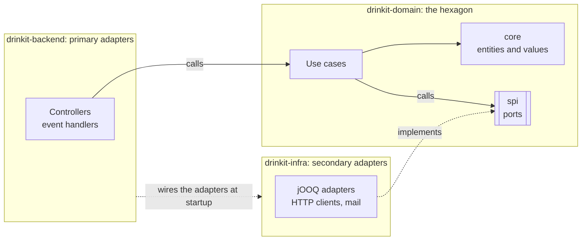

# Hexagonal architecture

The backend follows the hexagonal architecture, also called ports and adapters. The business code, in
`drinkit-domain`, depends on no infrastructure: `drinkit-backend` calls its use cases, and `drinkit-infra` implements
the ports it declares. A use case runs in a unit test without a database, and replacing PostgreSQL or REST changes
an adapter only. Gradle and the [architecture tests](../writing-code/testing/architecture-tests.md) fail the build when a dependency
points the wrong way. Read this page before you add a port, an adapter or a dependency between modules.

## 🧭 The pattern

The hexagon talks to the outside world through ports only. The primary side is what calls the application, the
secondary side what the application calls, and each side has its ports and its adapters. Spring plugs each adapter
into its port at startup. [Clean Architecture](clean-architecture.md) describes the inside of the hexagon: its
entities, its use cases and the pure functions that take their decisions.

Each part goes by several names, depending on the article:

| Part | Also called | What it is | In DrinkIt |
|---|---|---|---|
| Primary port | Driving port, inbound port, API | The operations the application offers | The use cases, such as `CreateNewUser` |
| Primary adapter | Driving adapter, inbound adapter | Turns an outside request into a call to a primary port | The controllers and event handlers of `drinkit-backend` |
| Secondary port | Driven port, outbound port, SPI, service provider interface | An interface the application declares for what it needs | The interfaces of the `spi` packages, such as `Cellars` |
| Secondary adapter | Driven adapter, outbound adapter | Implements a secondary port with a technology | The classes of `drinkit-infra`, such as `JooqCellars` |

Below, "port" alone means a secondary port. Inside the hexagon, names come from the business, the ubiquitous
language of Domain-Driven Design: a port is named after what it holds or does, such as `Cellars` or
`NotificationSender`, never after its pattern, such as `CellarRepository`.

## 🧱 The three modules

- **`drinkit-domain`** holds one package per bounded context: the use cases at its root, entities and values in
  `core`, ports in `spi`, and the ports several contexts share in `common/spi`. A context may depend on another,
  never in a cycle, so a capability several contexts use, such as notification, is a context of its own. The
  module depends on no other module of the application, and time and new ids come through `Clock` and
  `GenerateId`, so tests control them.

> [!NOTE]
> **Accepted: Spring in the domain.** The domain uses three Spring annotations, `@Service`, `@Component` and
> `@Transactional`, and KotlinLogging, and no other technical library. Its use cases declare themselves as beans,
> so no configuration class in the backend has to build them one by one.

- **`drinkit-infra`** holds the secondary adapters, each in the package of its port's context and named after its
  technology and its port, such as `JooqCellars`. Every class is `internal`, and jOOQ appears in no other module.
- **`drinkit-backend`** is the Spring Boot application and holds the primary adapters. A controller implements the
  interface generated from the [OpenAPI contract](contract-first.md) of `drinkit-api-contract`, and maps each case of the sealed `Result`
  a use case returns to an HTTP status. Event handlers react to the [platform events](platform-events.md) of `messaging-starter`. A read
  with no business rule may call a port directly, in a read-only transaction, as `UserController` does: a use case
  would only pass the call through. The backend depends on `drinkit-infra` only so that Spring finds the adapters:
  being `internal`, they stay out of a controller's reach.

The [architecture tests](../writing-code/testing/architecture-tests.md) check each of these rules and give its reason.

## 🧪 Testing through the ports

A port's behavior is written once, in an abstract test contract of the domain's test fixtures, such as
`ExchangeRatesTestContract`. The [in-memory double](../writing-code/testing/testdouble.md) and the jOOQ adapter both run it, so the
double cannot drift from the adapter. Use cases are tested against these doubles, with no mocking library.

## 📚 Sources

- [The Hexagonal (Ports & Adapters) Architecture](https://alistair.cockburn.us/hexagonal-architecture/), Alistair Cockburn
- [Ports and Adapters Pattern (Hexagonal Architecture)](https://jmgarridopaz.github.io/content/hexagonalarchitecture.html), Juan Manuel Garrido de Paz
- [DDD, Hexagonal, Onion, Clean, CQRS, … How I put it all together](https://herbertograca.com/2017/11/16/explicit-architecture-01-ddd-hexagonal-onion-clean-cqrs-how-i-put-it-all-together/), Herberto Graça
- [Ready for changes with Hexagonal Architecture](https://netflixtechblog.com/ready-for-changes-with-hexagonal-architecture-b315ec967749), Netflix Technology Blog
- [Ubiquitous Language](https://martinfowler.com/bliki/UbiquitousLanguage.html), Martin Fowler
