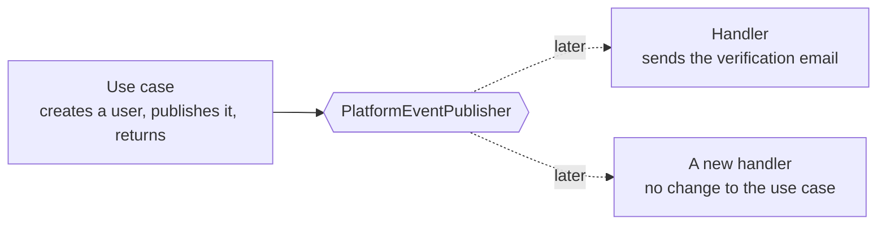
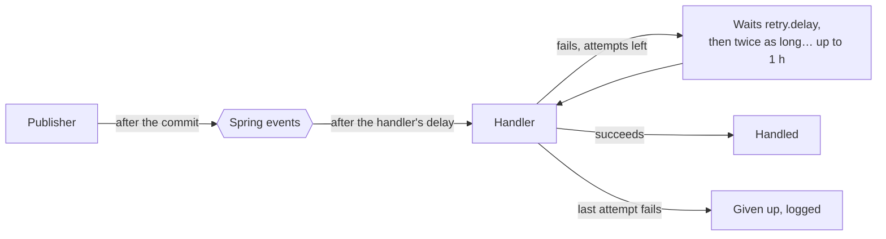
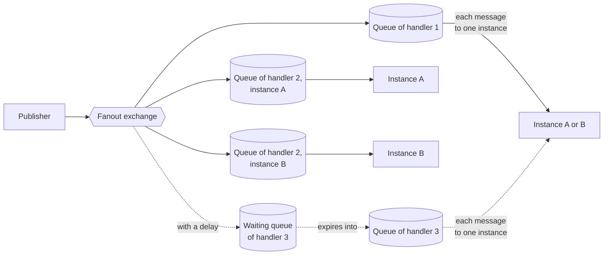

# Platform events

A platform event is a message that one part of the application publishes and that other parts handle later, apart
from the code that published it. The creation of a user, for one, triggers the verification email. Code publishes
through `PlatformEventPublisher` and handles it in a method annotated `@PlatformEventHandler`, whose parameter is the
event. Both come from [`messaging-starter`][starter], a [tech starter](tech-starters.md), and neither shows the
transport, what carries the event from one to the other. It is Spring application events inside the process today,
and RabbitMQ is the target. Read this page before you publish or handle a platform event.

The name "platform event" keeps it apart from the events of [event sourcing](event-sourcing.md), which are the
stored history of one aggregate. A platform event tells other parts of the application that something happened, and
is gone once handled.

## 🧭 Why asynchronous messages

A use case publishes what happened and returns. The work that follows, such as an email or an update in another
[bounded context](modular-monolith.md), runs later in a handler:

The handler neither slows the use case down nor makes it fail. Its effect is eventually consistent with the use
case: the email leaves some time after the creation, and a failed handler leaves the user created. The publisher
does not know its handlers, so a new reaction is a new handler. A business handler lives in `drinkit-backend` and
calls a use case, as a primary adapter of the [hexagonal architecture](hexagonal-architecture.md), while a technical
one lives in its starter. Once a broker carries the events, a message also survives a restart and reaches several
queues.

## 🏷️ One annotation, whatever the broker

`@PlatformEventHandler` declares what a handler needs from the transport, and the starter turns it into what that
transport understands. Moving from Spring events to RabbitMQ, or later to Kafka, changes the starter and none of the
handlers. The publisher's interface also lets tests run without any transport: `SpyPlatformEventPublisher` records
what a use case published. The attributes of the annotation ask a broker for:

- **`name`**: the handler's durable queue, which the instances of the application share.
- **`exchange`**: the exchange that the event is published to, and that the handler's queue is bound to.
- **`oneQueuePerInstance`**: a queue per instance, so that every instance gets every event. It serves what lives in
  the memory of one instance, such as the browser connection that a server-sent event must reach.
- **`delay`**: the time in milliseconds to wait before the first delivery to the handler.
- **`maxAttempts`**: how many deliveries the handler gets before its event is given up, 3 by default.

Spring events honor `delay` and `maxAttempts` today, and ignore the other attributes. Every handler still sets
its `name`, so that the move to a broker changes no handler.

## 🔁 Retries with an exponential backoff

A handler that fails gets its event again, after a wait that starts at `starters.messaging.retry.delay`, 30 seconds
by default, and doubles each time, up to one hour, until its `maxAttempts`. The growing wait gives a failing dependency
time to recover. With `starters.messaging.retry.exponential-backoff` switched off, every retry waits the same delay.
The rule is the same whatever the transport: with Spring events, the next attempt waits on a thread of its own, and
RabbitMQ will send the event back to that handler's queue only, so that the other handlers do not get it twice, with
the attempt number in a header. The handler's `delay` applies to the first delivery only.

## ⚙️ Today: Spring events in the process

The publisher publishes the event as a Spring application event once the publishing transaction commits, never when
it rolls back, and at once when there is no transaction. A Spring listener per handler calls it on a virtual thread of
its own. This keeps the starter simple as long as one instance runs, with these limits:

- an event still waiting, for its delay or its next attempt, is lost when the application stops
- the event of a handler that fails every attempt is dropped, after a log line
- an event published inside a nested transaction that rolls back to its savepoint still goes out when the outer
  transaction commits. The retry of an [event-sourced](event-sourcing.md) write runs in such a nested transaction:
  publish once that write has succeeded, never inside it, as the creation of a user does

[#549](https://github.com/mboisnard/drinkit/issues/549) plans to keep these events in the database until a handler
succeeds.

## 🐇 Toward RabbitMQ

A RabbitMQ publisher sends a message to an exchange, never to a queue, and the exchange copies it into the queues
bound to it. The layout below is the target, and none of it runs yet. Handler 1 is a plain handler, handler 2 sets
`oneQueuePerInstance` and handler 3 a `delay`, with the application running on instances A and B:

- **Publish-subscribe, through a fanout exchange.** It copies every message into every queue bound to it, so each
  handler gets its own copy, and a new handler is one more queue. A topic exchange does the same for the messages
  whose routing key matches a pattern, for a handler that wants only part of the events.
- **Competing consumers, on the handler's queue.** The instances read the same queue, and each message goes to one
  of them. The load spreads, and a message that a stopped instance did not acknowledge goes to another.
- **Broadcast to the instances, through a queue per instance.** Each instance binds a queue of its own, which
  expires once the instance is gone. An event published before an instance started never reaches it.
- **Delayed delivery, through a waiting queue.** Its messages expire after the delay into the handler's queue.
  Declared as an argument of the waiting queue, the delay changes only with a new queue. A delay does not combine
  with a queue per instance, since the waiting queue would outlive the instance it feeds: the starter refuses to
  start on a handler that sets both.

The starter already publishes an event only once its transaction commits, so that no handler sees an event whose
transaction rolled back. With a broker, an event can still be lost if the application stops between the commit and
the publication: a transactional outbox, which stores the event in the same transaction, would close that gap. A
failed message will come back after the same growing delay as today, which gives a failing dependency time to
recover, then wait in a dead-letter queue for someone to look at it. Delivery will be at least once, and in no set
order. Write events and handlers by these rules now, so that the move costs nothing:

- **An event is named in the past tense,** such as `UserCreated`: it states a fact, so the publisher depends on none
  of the handlers that react to it.
- **An event carries ids and facts that serialize to JSON, never an entity.** An entity ties the handler to the
  publisher's model, and is out of date by the time the handler runs.
- **A handler is idempotent,** since a message can arrive twice: handling it twice has the effect of handling it
  once.
- **No handler relies on the order of events,** since retries and competing consumers reorder them.
- **An event changes by [expand and contract][expand-and-contract].** A message can wait in a queue, or come back from
  a retry, long after it was published. Switching a publisher and its handlers at the same moment, with a feature
  flag for instance, therefore fails: an old message still arrives after the switch.

## 📚 Sources

- [Guaranteed Delivery](https://www.enterpriseintegrationpatterns.com/patterns/messaging/GuaranteedMessaging.html), [Publish-Subscribe Channel](https://www.enterpriseintegrationpatterns.com/patterns/messaging/PublishSubscribeChannel.html), [Competing Consumers](https://www.enterpriseintegrationpatterns.com/patterns/messaging/CompetingConsumers.html) and [Idempotent Receiver](https://www.enterpriseintegrationpatterns.com/patterns/messaging/IdempotentReceiver.html), Gregor Hohpe and Bobby Woolf, Enterprise Integration Patterns
- [Eventually Consistent - Revisited](https://www.allthingsdistributed.com/2008/12/eventually_consistent.html), Werner Vogels
- [Publisher-Subscriber pattern](https://learn.microsoft.com/en-us/azure/architecture/patterns/publisher-subscriber), Microsoft Azure Architecture Center
- [Pattern: Transactional outbox](https://microservices.io/patterns/data/transactional-outbox.html), Chris Richardson, microservices.io
- [Events](https://docs.spring.io/spring-modulith/reference/events.html), Spring Modulith reference documentation
- [Binder abstraction](https://docs.spring.io/spring-cloud-stream/reference/spring-cloud-stream/binders.html), Spring Cloud Stream reference documentation
- [AMQP 0-9-1 Model Explained](https://www.rabbitmq.com/tutorials/amqp-concepts), [Exchanges](https://www.rabbitmq.com/docs/exchanges), [Work Queues](https://www.rabbitmq.com/tutorials/tutorial-two-java), [Publish/Subscribe](https://www.rabbitmq.com/tutorials/tutorial-three-java), [Reliability Guide](https://www.rabbitmq.com/docs/reliability), [Dead Letter Exchanges](https://www.rabbitmq.com/docs/dlx) and [Time-To-Live and Expiration](https://www.rabbitmq.com/docs/ttl), RabbitMQ

[starter]: https://github.com/mboisnard/drinkit/tree/master/tech-starters/backend/messaging-starter
[expand-and-contract]: ../writing-code/best-practices/coding-rules.md#evolve-a-contract-in-steps
