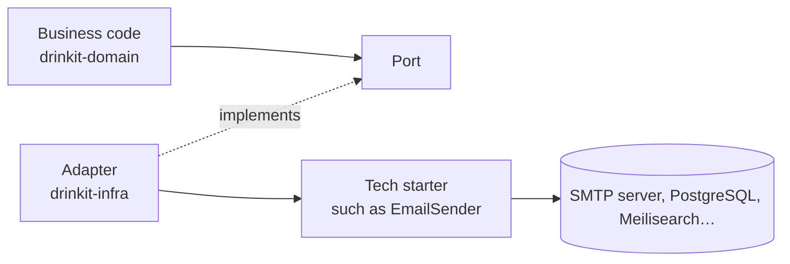

# Tech starters

A tech starter brings one technical concern to an application, ready to use, and holds no business code. On the
backend it is a Spring Boot starter of our own, under `tech-starters/backend/`: an application adds the dependency
and gets the feature wired, with defaults it can override. On the frontend it is a Nuxt layer, and none exists yet.
The application's code says what DrinkIt does, the starters say with which technology. Read this page before you
create a starter or add one to an application.

## 🎯 Why starters

- **The business code stays free of technical detail.** An adapter of `drinkit-infra` calls a starter, and the
  domain never sees it, as the [hexagonal architecture](hexagonal-architecture.md) asks.
- **A technology changes in one place.** Replacing the mail server behind `mail-starter` moves no line of business
  code.
- **The next application starts with its technical base ready**, one dependency per concern, set up the same way.
  Spotify calls this a golden path, Chris Richardson a microservice chassis.

## 🧩 What makes a good starter

- **One concern, no business word.** A starter depends on no module of the application and reads no table of a
  bounded context. A starter that needs two sentences to describe is two starters.
- **Adding the dependency is enough.** Its `@AutoConfiguration` classes do the wiring, one plus one per optional
  integration, with no Spring profile, and `starters.<name>.enabled=false` turns it off. A bean found by component
  scan cannot reliably back off.
- **The application has the last word.** Every bean backs off when the application declares its own, and every
  setting has a default under `starters.<name>.*` that an environment variable overrides.
- **A small public API.** Everything else is Kotlin `internal`. A starter over a vendor SDK wraps what it must
  control and exposes the SDK for the rest, as [ADR 0008](../adr/0008-index-through-an-abstraction-search-with-meilisearch.md)
  records for the search engine.
- **Tests come with it.** Its test fixtures hold a [hand-written double](../writing-code/testing/testdouble.md), and a
  test contract, passed by both the double and the real implementation, keeps the double faithful.

Some starters predate these rules: the component scan of the application wires them, often with a Spring profile.
Copy their tests, not their wiring. The [architecture tests](../writing-code/testing/architecture-tests.md) check the
rules that show in the code.

## 🔧 Using or creating a starter

An application adds a starter as a dependency, such as `implementation(project(":mail-starter"))`. The README of
each starter, published in the [generated pages](../resources/tech-starters/tech-starters.md) with its public API,
gives its usage and its settings. The
[`new-backend-tech-starter` skill](https://github.com/mboisnard/drinkit/blob/master/.claude/skills/new-backend-tech-starter/SKILL.md)
gives the steps to create one.

In the [monorepo](monorepo.md), a starter has no version of its own: whoever changes a starter updates, in the same
pull request, the applications the change breaks.

## 🖥️ Frontend starters

On the Nuxt side, a starter is a [Nuxt layer](https://nuxt.com/docs/3.x/guide/going-further/layers) that the app
lists in the `extends` of its `nuxt.config.ts`, and the app's own files win over the layer's. Good candidates are the
concerns every page needs and no feature owns, such as the HTTP client generated from the
[OpenAPI contract](contract-first.md). The
[`new-frontend-tech-starter` skill](https://github.com/mboisnard/drinkit/blob/master/.claude/skills/new-frontend-tech-starter/SKILL.md)
gives the steps.

## ⚖️ What it costs

- **Shared code couples what uses it.** A change to a starter reaches every application at once. That is why
  starters stay technical: shared business rules would tie the applications together.
- **A convention to learn.** A developer has to know which starter brings what before writing their own
  configuration.
- **Building for needs that do not exist.** A starter is extracted from a concern an application already has.
- **One set per stack.** A concern both sides need, such as monitoring, takes a Spring starter and a Nuxt layer.

## 📚 Sources

- [Pattern: Microservice chassis](https://microservices.io/patterns/microservice-chassis.html), Chris Richardson
- [How We Use Golden Paths to Solve Fragmentation in Our Software Ecosystem](https://engineering.atspotify.com/2020/08/how-we-use-golden-paths-to-solve-fragmentation-in-our-software-ecosystem), Gary Niemen, Spotify Engineering
- [What I Talk About When I Talk About Platforms](https://martinfowler.com/articles/talk-about-platforms.html), Evan Bottcher
- [Don't Share Libraries among Microservices](https://www.phauer.com/2016/dont-share-libraries-among-microservices/), Philipp Hauer
- [Creating Your Own Starter](https://docs.spring.io/spring-boot/reference/features/developing-auto-configuration.html#features.developing-auto-configuration.custom-starter), Spring Boot reference documentation
- [Authoring Nuxt Layers](https://nuxt.com/docs/3.x/guide/going-further/layers), Nuxt documentation
