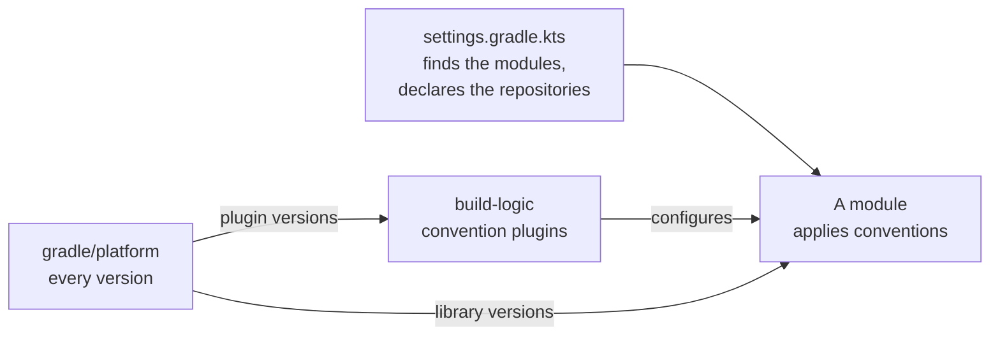

# Build tool

DrinkIt builds with [Gradle](https://gradle.org/), and its build scripts are written in Kotlin. One Gradle build
holds every backend module: the application, its [tech starters](../architecture/tech-starters.md), the
[database updater](database.md) and the [architecture tests](../writing-code/testing/architecture-tests.md). The idea to keep: a
module's build file says only what makes that module different. What modules share lives in convention plugins,
pieces of build configuration under `build-logic/` that each module applies. Every library and plugin version lives in
`gradle/platform/`.

Read this page before you add a module, change a convention or bump a dependency. Three things fail the build
there: a detekt finding, a dependency change without its new checksums and lock, and a convention that breaks the
configuration cache. The commands, such as `./gradlew build`, are in the [Commands section of `AGENTS.md`](https://github.com/mboisnard/drinkit/blob/master/AGENTS.md#commands).
The Nuxt frontend and this documentation site build with npm, outside Gradle.

## 🐘 Why Gradle

We chose Gradle over Maven for a build that grows one module at a time and runs in CI. A new tech starter or a new
application must build like the others from its first commit, without copying configuration from a neighbour.
What Gradle brings to that:

- **The build logic is Kotlin.** Build scripts and convention plugins are written in the language of the code,
  and detekt, the Kotlin linter of the project, checks them like the rest of it.
- **Shared configuration comes in small plugins.** A module applies the few convention plugins it needs, and
  each plugin holds one concern.
- **Gradle skips the work it can.** It reruns a task only when its inputs change, and [two caches](#fast-builds)
  skip work done before. A small change in a large build rebuilds little.
- **The tools of the stack are Gradle plugins.** Spring Boot, GraalVM native images, the KSP annotation
  processor, jOOQ, OpenAPI Generator, detekt and Konture each plug into the build the same way.
- **Dependency control is built in.** Gradle aligns versions across the whole dependency graph, locks them, and
  verifies the checksum of what it downloads.

## 🗺️ How the build is laid out



- **Modules join the build by folder.** `settings.gradle.kts` includes every folder directly under `drinkit/`
  or `tech-starters/backend/` that holds a `build.gradle.kts`, as a project named after the folder. A new
  starter needs no edit to the settings.
- **Repositories are declared once.** The settings declare Maven Central for every project, and
  `FAIL_ON_PROJECT_REPOS` fails the build when a project declares a repository of its own. No module can pull a
  library from a source the rest of the build does not use. The one other repository is the GitHub releases of
  Squawk, the SQL linter of the [database updater](database.md#checked-rules). It serves only Squawk's `sbdchd`
  group, and no other repository serves that group.
- **The root project holds no code.** What the root project applies reaches the whole build, so its
  `build.gradle.kts` keeps to what concerns the build as a whole: detekt on every Gradle script, and the graph of
  dependencies between modules that the architecture tests read. Code goes in a module, where it gets the
  conventions of its kind.

## 🧩 Convention plugins

A convention plugin is a Kotlin script in `build-logic/`. Its plugin id is its file name:
`com.drinkit.library-convention.gradle.kts` is the plugin `com.drinkit.library-convention`. `build-logic` is an
included build, a separate build whose plugins the main build applies like any other. Gradle recommends it over
`buildSrc`, its older folder for build logic, because a change to one convention then invalidates less of the
build.

A Kotlin module applies one archetype, the convention that sets up its kind of module. It then adds the add-ons
it needs, each for a single concern. It configures neither Kotlin, Java nor repositories itself, so two modules
of the same kind cannot drift apart. `drinkit-infra`, the module of the application's
[adapters](../architecture/hexagonal-architecture.md), starts with:

```kotlin
plugins {
    id("com.drinkit.library-convention")
    id("com.drinkit.jooq-codegen-convention")
}
```

The three archetypes:

| Archetype | For | What it adds |
|---|---|---|
| `common-convention` | Every Kotlin module, directly or through the two others | The Java toolchain, Kotlin with its Spring support, the [internal BOM](#versions-in-one-place), `code-analysis-convention` and `test-convention` |
| `library-convention` | The domain, its adapters and most tech starters | `common-convention`, `documentation-convention`, Spring context and transactions, the Kotlin and [event sourcing](../architecture/event-sourcing.md) starters |
| `api-convention` | `drinkit-backend`, the Spring Boot application | `common-convention`, `documentation-convention`, Spring MVC, build and git details for Actuator's info endpoint, GraalVM native images, a lock on every resolved version |

The add-ons a module chooses, and the conventions the archetypes apply for it:

| Convention | What it gives | Applied by |
|---|---|---|
| `test-fixtures-convention` | A `testFixtures` source set, where a module shares its [test doubles](../writing-code/testing/testdouble.md) | The modules that share test doubles |
| `openapi-contract-convention` | Exposes the [OpenAPI contract](../architecture/contract-first.md) and its generator templates to other modules | `drinkit-api-contract`, the module of the contract |
| `contract-first-convention` | Generates the Spring interfaces and models of the API from that contract | `drinkit-backend` |
| `jooq-codegen-convention` | Generates the jOOQ classes from the schema of a running PostgreSQL, only on `./gradlew jooqCodegen`. They are committed, as the [database page](database.md) explains | The modules that own tables |
| `squawk-convention` | Downloads the Squawk binary of your platform and runs it on the module's SQL changelogs, as part of `check`, with no Node | `deployment/updater` |
| `documentation-convention` | Writes the [generated pages](../writing-code/best-practices/living-documentation.md) of this site with KSP, only on `./gradlew kspKotlin` | `library-convention`, `api-convention` |
| `test-convention` | JUnit Platform and the test libraries of `test-starter` | `common-convention` |
| `code-analysis-convention` | detekt, which fails the build on any finding outside `code-analysis/detekt/baseline.xml`, the findings older than that rule, a file that never grows. It also runs after each Kotlin edit of an agent, as the [hooks](../coding-assistants/hooks.md) page explains | `common-convention`, the root project |
| `architecture-tests-convention` | Konture, chosen in [ADR 0001](../adr/0001-architecture-tests-with-konture.md), which builds the module graph and checks the architecture rules | The root project, `architecture-tests` |

Each convention explains its own choices in comments, in
[`build-logic/src/main/kotlin`](https://github.com/mboisnard/drinkit/tree/master/build-logic/src/main/kotlin). Read
the file before you change it.

## 📌 Versions in one place

Three files of `gradle/platform/` hold every version:

- **`libs.versions.toml`** is the version catalog of the libraries, of the JDK and of Squawk, the one tool the
  build downloads as a binary. Every module reads it as `libs`.
- **`pluginLibs.versions.toml`** is the catalog of the Gradle plugins the conventions apply. Only `build-logic`
  reads it.
- **`build.gradle.kts`** is the internal BOM. A BOM, bill of materials, is a list of versions meant to be used
  together. Ours is a Gradle platform. It imports the BOMs of Spring Boot, Spring AI and Spring Cloud GCP, then sets
  the catalog version of each library listed in its `constraints` block. Squawk has no constraint there, since no
  library depends on a binary.

The catalog and the platform each do one job. The catalog names each version once, so a bump is one line. The
platform takes part in dependency resolution: it sets a library's version wherever the library appears, as a
transitive dependency too. `common-convention` adds the platform to every module, so a module declares
`implementation("org.springframework:spring-tx")` with no version.

The `jdk` entry of the catalog sets the Java version every module compiles and runs its tests with.
`gradle/gradle-daemon-jvm.properties` names the JDK that runs Gradle itself, whatever `java` is on your `PATH`.
Gradle finds both among the JDKs installed on your machine and never downloads one, so install that version
first.

## ⚡ Fast builds

`gradle.properties` turns on three settings for every build:

- **Parallel execution.** Modules that do not depend on each other build at the same time.
- **The build cache.** A task whose inputs have not changed takes its outputs from the cache instead of running.
  In CI, every job restores this cache. Only the backend job on master saves it, so that a single writer keeps it
  under the 10 GB GitHub allows.
- **The configuration cache.** Gradle stores the result of configuring the build, its task graph included. The
  next run with the same inputs skips configuration and starts the tasks at once.

The configuration cache matters more with each module added, since configuring all of them costs time on every
command, even one that runs a single test. Since Gradle 9.0, it is Gradle's preferred mode. It also constrains
the build logic. A convention reads values through providers, values that Gradle computes only when needed. It
registers its tasks lazily, and never touches the project while a task runs. When a convention breaks these
rules, Gradle discards the cache or fails the build. Two choices of `build-logic` come from it:

- `documentation-convention` reads which tasks you asked for while the build is configured, a value the
  configuration cache can store. It runs KSP only when `kspKotlin` is among them.
- `architecture-tests-convention` stops Konture 1.0.2 from listing every module's sources while the build is
  configured. That listing discarded the cache on every Kotlin edit.

## 🔒 Trusting what the build downloads

A build runs code it downloads: Gradle itself, the plugins and the libraries. Three checks make sure that code is
the one we expect.

- **Gradle itself.** `gradlew`, the Gradle wrapper, downloads the version that
  `gradle/wrapper/gradle-wrapper.properties` pins, and checks its SHA-256 checksum. CI also checks the wrapper JAR
  against Gradle's official releases.
- **Every plugin, library and binary.** `gradle/verification-metadata.xml` holds the SHA-256 checksum of each
  artifact, the Squawk binary of every platform included.
  The build refuses one whose checksum differs or is missing, which stops a tampered or replaced file. A few
  artifacts that only IntelliJ or a plugin fetches on its own are trusted by name, each with its reason.
- **The application's classpath.** `api-convention` locks the dependencies of `drinkit-backend`, which then
  resolves exactly the versions its `gradle.lockfile` lists. A new release inside a version range cannot reach the
  application unnoticed. The library modules of DrinkIt are not locked on their own: they reach production only
  through the application.

After a dependency change, the commands of the
["Dependencies" section of `AGENTS.md`](https://github.com/mboisnard/drinkit/blob/master/AGENTS.md#dependencies)
regenerate the checksums and the lock. Without them, the build fails with "Dependency verification failed".

## 🩺 Auditing the build

Gradle Inc. publishes [gradle-skills](https://github.com/gradle/gradle-skills), agent skills for Gradle builds.
One of them, `gradle-best-practices`, audits a build against the official Gradle best practices. Install the
plugin in your coding agent and ask it to audit the build: it reports first, and changes nothing until you ask.

The build has already been audited this way.

## 📚 Sources

- [Structuring builds](https://docs.gradle.org/current/userguide/best_practices_structuring_builds.html), Gradle best practices: convention plugins, `build-logic` as an included build, no source in the root project
- [Dependencies](https://docs.gradle.org/current/userguide/best_practices_dependencies.html), Gradle best practices: version catalogs, repositories in the settings
- [Performance](https://docs.gradle.org/current/userguide/best_practices_performance.html), Gradle best practices: build cache, configuration cache
- [Security](https://docs.gradle.org/current/userguide/best_practices_security.html), Gradle best practices: the distribution checksum
- [Configuration Cache](https://docs.gradle.org/current/userguide/configuration_cache.html), Gradle user guide
- [Platforms](https://docs.gradle.org/current/userguide/platforms.html), Gradle user guide
- [Verifying Dependencies](https://docs.gradle.org/current/userguide/dependency_verification.html), Gradle user guide
- [Locking Versions](https://docs.gradle.org/current/userguide/dependency_locking.html), Gradle user guide
- [Gradle vs Maven: Feature Comparison](https://gradle.org/maven-vs-gradle), Gradle Inc.
- [gradle-skills](https://github.com/gradle/gradle-skills), Gradle Inc.
