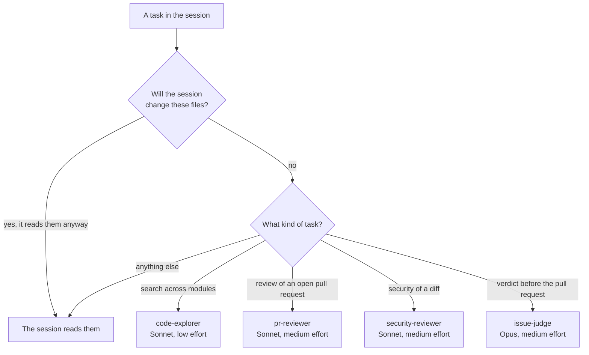

# Cost optimization

A Claude Code session sends its whole context to the model at every call, and the prompt cache only makes the reread
cheaper, not free. A session that reads a file early pays for it again at every later step, so its cost grows with
both its length and the size of its context. The rule that follows: keep the context of the session small, and hand
narrow tasks to [subagents](sub-agents.md) on cheaper models. This page gives the settings that apply it, where a
task runs, and how to measure a session. Read it before you change the model of an agent or the settings of
`.claude/settings.json`, or when a session uses up the limit of the plan.

## 🧮 What a session spends

A Claude plan counts its limit in what the tokens would cost on the API. Priced in input tokens, a cache write costs
1.25, a cache read 0.1 and an output token 5. On the DrinkIt sessions measured while every agent still ran on Opus,
the main session made between half and four fifths of the cost: each of its calls reread several hundred thousand
tokens of cache, and its context grew towards the 1M-token context window.

Three levers follow, in the order of what they save:

- **A smaller context.** A token kept out of the session is never reread.
- **The effort.** Thinking and long answers are output tokens.
- **The model.** An agent runs on Sonnet unless its task is the verdict of `issue-judge`, which gates a pull request.

## ⚙️ The settings of the repository

| Setting | In | What it does |
|---|---|---|
| `CLAUDE_CODE_AUTO_COMPACT_WINDOW` | `env` of `.claude/settings.json` | Claude Code summarizes the session once its context reaches 450 K tokens, so that a long task, such as an issue taken to its pull request, is summarized less often, while its context stays under half the 1M window |
| `CLAUDE_CODE_SUBAGENT_MODEL` | `env` of `.claude/settings.json` | Sonnet for an agent that declares no model, such as the general-purpose agent built into Claude Code |
| `model` and `effort` | the frontmatter of each [subagent](sub-agents.md), a file of `.claude/agents/` | Opus only for `issue-judge`, which decides whether a pull request opens, Sonnet for the others |
| `omitClaudeMd` | the frontmatter of `code-explorer` | Starts the explorer without `AGENTS.md`, which Claude Code loads as the instructions of every session, which a search does not need. The built-in Explore inherits the model of the session, hence an explorer of DrinkIt's own |

The frontmatter `model` wins over `CLAUDE_CODE_SUBAGENT_MODEL` from Claude Code 2.1.251: on an older version, the
judge would run on Sonnet. `omitClaudeMd` exists from 2.1.271, and an older version ignores it without a word.
`CLAUDE_CODE_SUBAGENT_MODEL_FORCE` stays unset, since it would put the judge on Sonnet too.

## 🧭 Where a task runs

An agent starts cold, at about 20 K tokens of instructions and tool definitions, and hands back only its answer. It
pays off when its work would add more than these 20 K tokens to the session, and when the session will not read
the same files again.

[Subagents](sub-agents.md) describes each of these agents.

[`/implement-issue`][skill-issue] runs the judge once per commit it wants to push, each run a round. From the
second round on, the judge checks the gaps the previous verdict listed, then only the diff since that verdict.

## 🧑‍💻 The maintainer's own settings

The model and effort of the session itself live in `~/.claude/settings.json`, outside the repository.

- **Medium effort by default**, high for a design or a hard bug, with `/effort`. Always-on thinking spends output
  tokens on every answer.
- **`opusplan`** plans on Opus and carries out the plan on Sonnet.
- **One issue per session.** `/clear` between two tasks drops the context of the first, which the second would
  otherwise reread at every call. `/implement-issue` resumes from the step it reached, so clearing once the pull request is open loses nothing.

## 📏 Measuring a session

`.hooks/tools/session-tokens <transcript>` reads a transcript of `~/.claude/projects/` and those of its agents.
It prints a row per model for the main session and for each type of agent: the calls, each kind of token, the
largest context of one call and the weighted total. The weighting ignores the price gap between models, so a move
to Sonnet saves more than the total shows. Compare two sessions
of the same kind of work, per pull request opened: a [tech starter](../architecture/tech-starters.md) costs more
than a page of documentation, and one session may open several pull requests.

## 📚 Sources

- [Manage costs effectively](https://code.claude.com/docs/en/costs), Anthropic
- [Create custom subagents](https://code.claude.com/docs/en/sub-agents), Anthropic
- [Model configuration](https://code.claude.com/docs/en/model-config), Anthropic
- [Prompt caching pricing](https://platform.claude.com/docs/en/build-with-claude/prompt-caching#pricing), Anthropic

[skill-issue]: https://github.com/mboisnard/drinkit/blob/master/.claude/skills/implement-issue/SKILL.md
