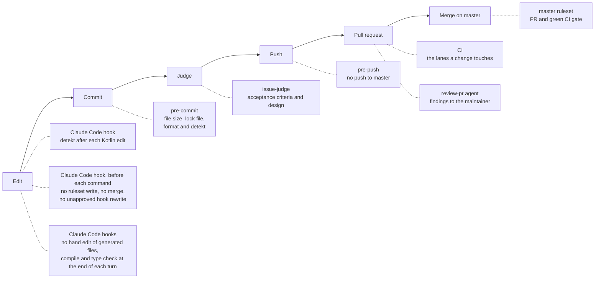

# Harness

A harness is everything around a coding agent that steers it before it acts and checks its work after. DrinkIt is
written with Claude Code, and its harness keeps humans and agents alike from merging a change that breaks master or
that nobody checked. It is made of [`AGENTS.md`][agents-md] and the [skills](skills.md) the agent reads, the
[hooks](hooks.md) it cannot skip, the reviewing and exploring [subagents](sub-agents.md), the [CI](../delivery/ci-cd.md) and the
master ruleset. Only the maintainer, who owns the repository, merges. A person without an agent meets the same CI and
ruleset, and the git hooks once they turn them on in their clone. [Tooling](tooling.md) lists the tools used around the
agents.

## 🧭 Guides and sensors

Birgitta Böckeler splits a harness into guides, which steer the agent before it acts, and sensors, which observe its
output so that it corrects itself. Claude Code's best practices add a second split: an instruction the model reads is
advisory, while a hook, a permission rule or a test runs every time.

| | Advisory, the model decides | Deterministic, it always runs |
|---|---|---|
| Guides, before the agent acts | `AGENTS.md`, the skills, this documentation | The permission rules and the [hooks](hooks.md) that refuse a merge, a ruleset write or a hand edit of a generated file |
| Sensors, after the agent acts | The [judge, the security reviewer and the review of the pull request](sub-agents.md) | detekt after each edit, the compilation and architecture tests at the end of each turn, the tests, CI, the master ruleset |

## 🗺️ What the agent reads

`AGENTS.md` is the file most coding agents read when a session starts, and Claude Code reads it too since the
repository has no `CLAUDE.md`. Following OpenAI's advice, it is a map: the build commands, the traps no tool catches,
and which skill to read before which change. The detail lives in the skills and in this site, so the file stays short
enough for every rule in it to stay in the agent's sight. The pages say why the code is the way it is, and the
[decision records](../adr/index.md) keep the reason of each structuring choice.

## 🔁 The feedback loop

Each check comes back pass or fail, so the agent fixes its work before a person sees it. Each layer catches a mistake
as early as it can, and none counts on an earlier one having run.

The judge and the review are steps of the [`/implement-issue`](skills.md) skill, which takes an issue to a pull
request. Before the judge, it squashes the branch into one commit per functional or technical unit, so that a
reviewer reads the change commit by commit. On the pull request, CI runs only the lanes, groups of checks, that the change touches, and the required
`CI gate` check sums them up. A failing [architecture rule](../writing-code/testing/architecture-tests.md) or
[changelog rule](../build-and-data/database.md#checked-rules) names itself and says how to fix it, so the agent fixes
it without guessing. A person can skip the git hooks with `--no-verify`. A Claude Code session cannot skip pre-push,
and nobody can skip the GitHub layers.

## 🔒 GitHub, the last word

The [master ruleset][ruleset] has no bypass, since an agent session works with the owner's token: a bypass for the
owner would be one for the agents too. It requires a pull request whose `CI gate` is green on a branch up to date
with master, with every conversation resolved. It refuses a force push or a deletion. Rebase is the only merge
method, merged branches are deleted, and auto-merge is allowed for the Renovate updates that merge themselves once CI
is green. Secret scanning with push protection is on, and [`SECURITY.md`][security-md] says how to report a
vulnerability. Dependabot alerts are off: Renovate flags a vulnerable dependency from the OSV database. The
[CI/CD](../delivery/ci-cd.md#securing-the-workflows) page covers the settings of the workflows themselves.

The [issue forms][issue-forms], the [pull request template][pr-template] and the [contributing guide][contributing]
give people and agents the same shape for what they write on GitHub.

## 🚧 Not covered yet

- The owner's token in an agent session could still change the ruleset. Only the guard hook refuses it, and it reads
  commands as text, so an unusual command shape can slip past it.
- The judge and the review are required by `/implement-issue`, not by a hook. The pull request shows the judge's
  verdict line, which the maintainer checks before merging.
- No linting or tests run on the frontend yet, and no detekt or coverage report shows on a pull request.

## 📚 Sources

- [Harness engineering for coding agent users](https://martinfowler.com/articles/harness-engineering.html), Birgitta Böckeler
- [Harness engineering: leveraging Codex in an agent-first world](https://openai.com/index/harness-engineering/), OpenAI
- [Best practices for Claude Code](https://code.claude.com/docs/en/best-practices), Anthropic
- [AGENTS.md](https://agents.md/), agents.md

[agents-md]: https://github.com/mboisnard/drinkit/blob/master/AGENTS.md
[ruleset]: https://github.com/mboisnard/drinkit/blob/master/.github/rulesets/master.json
[security-md]: https://github.com/mboisnard/drinkit/blob/master/SECURITY.md
[issue-forms]: https://github.com/mboisnard/drinkit/tree/master/.github/ISSUE_TEMPLATE
[pr-template]: https://github.com/mboisnard/drinkit/blob/master/.github/pull_request_template.md
[contributing]: https://github.com/mboisnard/drinkit/blob/master/CONTRIBUTING.md
