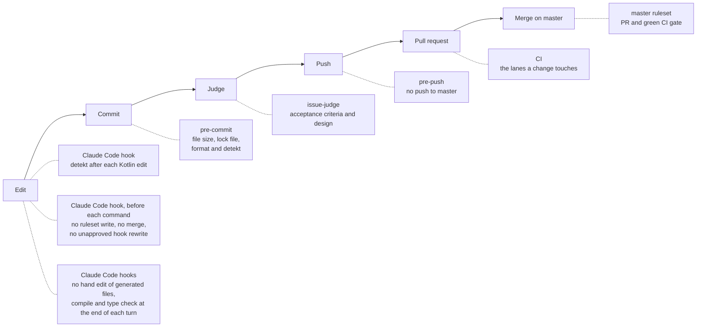

# Harness

A harness is everything around a coding agent that steers it before it acts and checks its work after. DrinkIt is
written with Claude Code, and its harness keeps humans and agents alike from merging a change that breaks master or
that nobody checked. It is made of [`AGENTS.md`][agents-md] and the [skills](skills.md) that the agent reads, the
Claude Code [hooks](hooks.md) it cannot skip, two reviewing [subagents](sub-agents.md), the [CI](../delivery/ci-cd.md)
and the master ruleset. The maintainer, who owns the repository, alone merges. A person without an agent meets the
same CI and ruleset, and the git hooks once `git config core.hooksPath .hooks/git` turns them on in a clone. This page
gives the concepts and how they fit, and [tooling](tooling.md) lists the tools used around the agents.

## 🧭 Guides and sensors

Birgitta Böckeler splits a harness into guides, which steer the agent before it acts, and sensors, which observe its
output so that it corrects itself. With guides alone, no rule is ever checked. With sensors alone, the agent makes the
same mistake every time for the sensor to catch. Claude Code's best practices add a second split: an instruction the
model reads is advisory, while a hook, a permission rule or a test runs every time.

| | Advisory, the model decides | Deterministic, it always runs |
|---|---|---|
| Guides, before the agent acts | `AGENTS.md`, the skills, this documentation | The `deny` and `ask` permission rules and the [hooks](hooks.md) that refuse a merge, a ruleset write or a hand edit of a generated file |
| Sensors, after the agent acts | The [judge and the security reviewer](sub-agents.md) | detekt after each edit, the compilation and architecture tests at the end of each turn, the tests, CI, the master ruleset |

## 🗺️ AGENTS.md, the map

`AGENTS.md` is the file Codex, Cursor and Copilot read when a session starts, and Claude Code reads it too since the
repository has no `CLAUDE.md`. Following OpenAI's advice, it is a map rather than a manual: the build commands, the traps
no tool catches, and which skill or page to read before which change. The detail of a rule lives in the skill
or the page it points to, so the file stays short and every rule in it stays in the agent's sight.

## 📚 Documentation the agents explore

Agents read this site as a newcomer would. The pages say why the code is the way it is, the
[decision records](../adr/index.md) keep the reason of each structuring choice, and the
[living documentation](../writing-code/best-practices/living-documentation.md), generated from the annotations of
the code, lists each domain type, use case and tech starter. An agent that lacks context opens the page `AGENTS.md`
or a skill points to, instead of copying the code next door.

## 🔁 The feedback loop

Each check comes back pass or fail, so the agent fixes its work before a person sees it. Each layer catches a mistake
as early as it can, and none counts on an earlier one having run.

- **While the agent works**, the [hooks](hooks.md) run detekt after each Kotlin edit, then compile the code with its
  tests and run the [architecture tests](../writing-code/testing/architecture-tests.md) at the end of each turn.
- **Before the pull request**, the [`/implement-issue`](skills.md) skill, which takes an issue to a pull request,
  runs the checks CI would run and a fresh [judge](sub-agents.md).
- **On the pull request**, [CI](../delivery/ci-cd.md) runs the build, the tests, the
  [changelog rules](../build-and-data/database.md#checked-rules) and the security analyses, in the lanes, groups of
  checks, that the change touches.
- **At the merge**, the master ruleset requires a green `CI gate`, the one check that sums up the lanes.

An architecture rule or a changelog rule that fails names itself, says why it exists and how to fix it, so the agent
fixes it without guessing. A person can skip the local git hooks with `--no-verify`. A Claude Code session cannot skip
pre-push, since the guard refuses `git push --no-verify`, and nobody can skip the GitHub layers.

## 🔒 GitHub, the last word

- **The [master ruleset][ruleset]** has no bypass, since an agent session works with the owner's token: a bypass for
  the owner would be one for the agents too. It requires a pull request whose `CI gate` is green on a branch up to
  date with master, with every conversation resolved, and refuses a force push or a deletion.
- **Merge settings**: rebase is the only merge method, merged branches are deleted, and auto-merge is allowed for the
  Renovate updates that merge themselves once CI is green.
- **Secret scanning with push protection and private vulnerability reporting** are on.
  [`SECURITY.md`][security-md] says how to report a vulnerability. Dependabot alerts are off: Renovate flags a
  vulnerable dependency from the OSV database and opens its security update.
- **The [issue forms][issue-forms], the [pull request template][pr-template] and the
  [contributing guide][contributing]** give people and agents the same shape for what they write on GitHub. Agents
  create issues through `gh` or the API, which skip the forms, so the `new-issue` skill tells them to reuse their
  headings.

The settings of the workflows themselves, a read-only token, pinned actions and approved fork runs, are on the
[CI/CD](../delivery/ci-cd.md#securing-the-workflows) page.

## 🧪 To try

- `/doctor prompt-audit`, which looks for stale or conflicting instructions in `AGENTS.md`, the skills and the
  agents.
- An `AGENTS.md` in the frontend once it grows: agents read the nearest one, so each app gets its own commands.
- A browser the agent drives to check a frontend change as a user would, which Anthropic found catches what tests
  miss.
- A recurring agent that looks for drift between the documentation and the code and opens small pull requests, as
  OpenAI does.

## 🚧 Not covered yet

- The owner's token in an agent session could still change the ruleset: only the guard hook refuses it. The guard
  reads commands as text, and the command shapes it still misses are listed in the
  [agent harness epic](https://github.com/mboisnard/drinkit/issues/363).
- The judge is required by `/implement-issue`, not by a hook: the pull request shows its verdict line, which the
  maintainer checks before merging.
- No linting or tests run on the frontend yet ([#400](https://github.com/mboisnard/drinkit/issues/400)), and no
  detekt or coverage report shows on a pull request ([#404](https://github.com/mboisnard/drinkit/issues/404)).

## 📚 Sources

- [Harness engineering for coding agent users](https://martinfowler.com/articles/harness-engineering.html), Birgitta Böckeler
- [Harness engineering: leveraging Codex in an agent-first world](https://openai.com/index/harness-engineering/), OpenAI
- [Best practices for Claude Code](https://code.claude.com/docs/en/best-practices), Anthropic
- [Effective harnesses for long-running agents](https://www.anthropic.com/engineering/effective-harnesses-for-long-running-agents), Anthropic
- [How Claude remembers your project](https://code.claude.com/docs/en/memory), Anthropic
- [AGENTS.md](https://agents.md/), agents.md
- [Claude Academy](https://academy.claude.com/) and [the Claude certifications](https://claude.com/blog/four-role-based-claude-certifications), Anthropic

[agents-md]: https://github.com/mboisnard/drinkit/blob/master/AGENTS.md
[ruleset]: https://github.com/mboisnard/drinkit/blob/master/.github/rulesets/master.json
[security-md]: https://github.com/mboisnard/drinkit/blob/master/SECURITY.md
[issue-forms]: https://github.com/mboisnard/drinkit/tree/master/.github/ISSUE_TEMPLATE
[pr-template]: https://github.com/mboisnard/drinkit/blob/master/.github/pull_request_template.md
[contributing]: https://github.com/mboisnard/drinkit/blob/master/CONTRIBUTING.md
