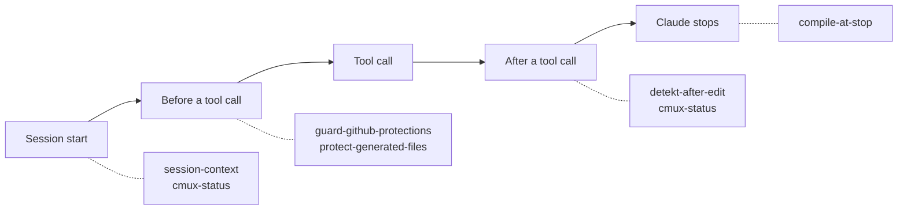

# Hooks

A hook is a script that runs on an event, whatever the agent or the person decides. An instruction in
[`AGENTS.md`][agents-md] or a [skill](skills.md) is advisory, a hook is not. DrinkIt keeps every hook as a POSIX `sh`
script under [`.hooks/`][hooks-folder]. Claude Code hooks run on the events of a session and are on for everyone, since
the project settings declare them. Git hooks run on a commit or a push, once a clone turns them on. Before you add or
change a hook, read this page, then follow the [`harness-change` skill][skill-harness].

## ⚙️ How Claude Code runs them

[`.claude/settings.json`][settings] declares each hook with its event, a matcher on the tool and a timeout. A hook
that runs before a tool call can refuse it or ask the person. One that runs after a call, or when Claude stops, sends
its findings back, and Claude keeps working until they are fixed.

The same file holds the permissions. Two `deny` rules refuse `gh pr merge` and `git push --no-verify`, a second line
behind the guard hook. An `ask` rule makes Claude ask before it edits a file under `.hooks/`, for the reason of
[the last section](#a-hook-the-agent-cannot-rewrite). Claude Code also loads the personal settings of whoever runs it,
which add their own hooks and rules to the project's.

## 🪝 The hooks of DrinkIt

| Hook | Runs | What it does |
|---|---|---|
| [`guard-github-protections`][guard], the guard | Before a shell command | Refuses a merge, a write to a ruleset or to branch protection, a push protection bypass and any way around `pre-push`, and asks before a write under `.hooks/` |
| [`protect-generated-files`][protect] | Before a file edit | Refuses a hand edit of a file a tool writes, or of a `.env` file, and names the command that changes it |
| [`detekt-after-edit`][detekt] | After a Kotlin edit | Formats and checks the file with detekt, and shows the findings to Claude |
| [`compile-at-stop`][compile] | When Claude stops | Compiles changed Kotlin with its tests and runs the [architecture tests](../writing-code/testing/architecture-tests.md), or type checks a changed frontend, once per state |
| [`session-context`][session] | At session start | Tells Claude its branch, the issue it points to, its uncommitted work, the worktrees to clean up and whether the git hooks run |
| [`cmux-status`][cmux] | At start, on `gh pr` commands, around the judge | Shows the issue, the step and the verdicts in the cmux tab, as [tooling](tooling.md) describes |
| [`pre-commit`][pre-commit] | On a commit | Refuses a file over 5 MB or a `package.json` without its lock file, and formats and checks staged Kotlin with [`lint-kotlin`][lint-kotlin] |
| [`pre-push`][pre-push] | On a push | Refuses a push, force push or deletion of master, which changes only through a pull request |

`compile-at-stop` also runs at session start, only to record the state it compares against. The git hooks guard a
person working without an agent too, once `git config core.hooksPath .hooks/git` turns them on in the clone.

## 🧪 Tested like code

Claude writes most of the hooks, so each one is tested before it guards anything. A [bats suite][tests] per hook feeds
it the input Claude Code or git gives it and checks its answer. A hook runs under the `sh` of the machine, so the Hooks
[lane](../delivery/ci-cd.md#lanes) of CI runs every suite under dash, `bash --posix` and macOS `sh`, after ShellCheck.
[`harness.bats`][harness-bats] checks the harness itself. It fails on a hook without a suite, a setting that runs a
missing hook or has no timeout, a skill glob that matches no file, and a dead relative link under `.claude/`.

## 🔒 A hook the agent cannot rewrite

An agent that could edit a hook could switch off the check that watches it. Claude Code protects `.claude/` on its
own, but not `.hooks/`. The `ask` rule covers Claude's edit tools, and the guard asks before a shell command that
writes there. In bypassPermissions mode, where nobody answers a prompt, the guard refuses that command instead.
`harness.bats` fails when the `ask` rule disappears.

## 📚 Sources

- [Automate actions with hooks](https://code.claude.com/docs/en/hooks-guide), Anthropic
- [Configure permissions](https://code.claude.com/docs/en/permissions), Anthropic
- [Bash Automated Testing System](https://github.com/bats-core/bats-core), bats-core

[hooks-folder]: https://github.com/mboisnard/drinkit/tree/master/.hooks
[skill-harness]: https://github.com/mboisnard/drinkit/blob/master/.claude/skills/harness-change/SKILL.md
[settings]: https://github.com/mboisnard/drinkit/blob/master/.claude/settings.json
[agents-md]: https://github.com/mboisnard/drinkit/blob/master/AGENTS.md
[guard]: https://github.com/mboisnard/drinkit/blob/master/.hooks/claude/guard-github-protections
[protect]: https://github.com/mboisnard/drinkit/blob/master/.hooks/claude/protect-generated-files
[detekt]: https://github.com/mboisnard/drinkit/blob/master/.hooks/claude/detekt-after-edit
[compile]: https://github.com/mboisnard/drinkit/blob/master/.hooks/claude/compile-at-stop
[session]: https://github.com/mboisnard/drinkit/blob/master/.hooks/claude/session-context
[cmux]: https://github.com/mboisnard/drinkit/blob/master/.hooks/claude/cmux-status
[pre-commit]: https://github.com/mboisnard/drinkit/blob/master/.hooks/git/pre-commit
[pre-push]: https://github.com/mboisnard/drinkit/blob/master/.hooks/git/pre-push
[lint-kotlin]: https://github.com/mboisnard/drinkit/blob/master/.hooks/git/lint-kotlin
[tests]: https://github.com/mboisnard/drinkit/tree/master/.hooks/tests
[harness-bats]: https://github.com/mboisnard/drinkit/blob/master/.hooks/tests/harness.bats
