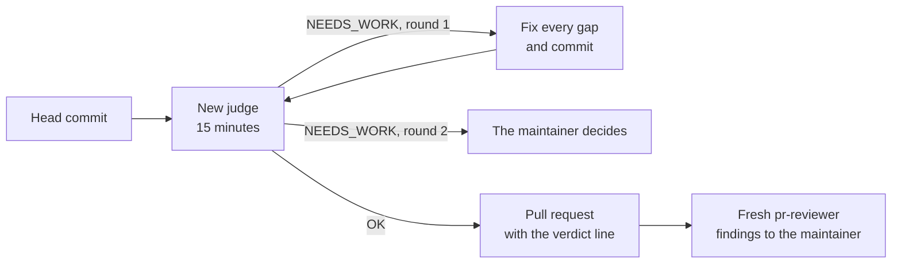

# Subagents

A subagent is an agent that a Claude Code session starts for one task. It gets its own context window, its own
instructions, the tools it is allowed and the model it runs on, and it hands back only its report. DrinkIt defines
three reviewers that the [`/implement-issue`][skill-issue] skill starts, a judge of the branch against its issue, a
security reviewer and a pull request reviewer, and a code explorer that keeps wide searches out of the session.
Each is a Markdown file in [`.claude/agents`][agents-folder], a frontmatter with its name, description, tools, model
and effort, then its instructions. Before you add or change an agent, read this page, then follow the
[`harness-change` skill][skill-harness].

## 🎯 Why a subagent per review

- **Fresh eyes.** The judge gets the issue, the commits of the branch, the draft of the pull request and the test
  list, which pairs each acceptance criterion with its proof. Its prompt carries no account of the work, which would
  anchor it on what the author believes, and it names in its report any hint that slips in.
- **Read-only.** Every agent can read, search and run commands, but has no edit tool. A reviewer that fixed what it
  found would end up reviewing its own work.
- **A model sized to the task.** Only the judge runs on Opus, since its verdict gates the pull request. The others run
  on Sonnet, and the built-in agents that declare no model too. [Cost optimization](cost-optimization.md) gives the
  settings and how to measure a session.

## 🧑‍⚖️ The subagents of DrinkIt

| Agent | What it checks | Started by |
|---|---|---|
| [`issue-judge`][judge] | Each acceptance criterion, rerunning its proof, then the design against `AGENTS.md`, the skills and the [coding rules](../writing-code/best-practices/coding-rules.md). Returns a Spec and a Design verdict, and `OK` only when both are | `/implement-issue`, before the pull request opens |
| [`security-reviewer`][security] | The security-sensitive parts of the diff, from endpoints to workflows. Ranks findings Blocking, Important or Minor, and runs nothing from the branch | `/implement-issue` or [`/review-pr`][skill-review-pr], when the diff touches those areas |
| [`pr-reviewer`][pr-reviewer] | The open pull request, through `/review-pr`, without posting. Ranks findings like the security reviewer | `/implement-issue`, once the pull request is open |
| [`code-explorer`][explorer] | Nothing: it answers a search across modules or conventions with facts and their `path:line` | Any session, on its own or when a skill names it |

## 🔁 The judge in /implement-issue

A verdict counts for one commit, so any later commit, a fix for CI included, needs a new round. Each round starts a
new judge, whose prompt lists the previous gaps with the facts that close them and the head of the previous verdict:
the judge checks the gaps, then only the diff since that head. A round lasts 15 minutes, and what
the judge has not checked by then reads "cannot verify". The pull request reads `Judge: OK, round <n>, at <commit>`,
so the maintainer sees before merging which commit the judge approved.

Once the pull request opens, the skill starts a fresh `pr-reviewer` that follows `/review-pr` and hands its findings
to the maintainer without posting them.

## 📚 Sources

- [Create custom subagents](https://code.claude.com/docs/en/sub-agents), Anthropic
- [Manage costs effectively](https://code.claude.com/docs/en/costs), Anthropic

[skill-issue]: https://github.com/mboisnard/drinkit/blob/master/.claude/skills/implement-issue/SKILL.md
[skill-review-pr]: https://github.com/mboisnard/drinkit/blob/master/.claude/skills/review-pr/SKILL.md
[skill-harness]: https://github.com/mboisnard/drinkit/blob/master/.claude/skills/harness-change/SKILL.md
[agents-folder]: https://github.com/mboisnard/drinkit/tree/master/.claude/agents
[judge]: https://github.com/mboisnard/drinkit/blob/master/.claude/agents/issue-judge.md
[security]: https://github.com/mboisnard/drinkit/blob/master/.claude/agents/security-reviewer.md
[pr-reviewer]: https://github.com/mboisnard/drinkit/blob/master/.claude/agents/pr-reviewer.md
[explorer]: https://github.com/mboisnard/drinkit/blob/master/.claude/agents/code-explorer.md
