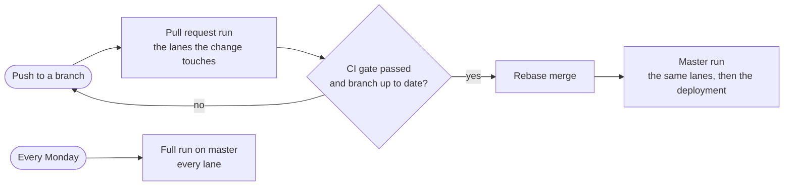
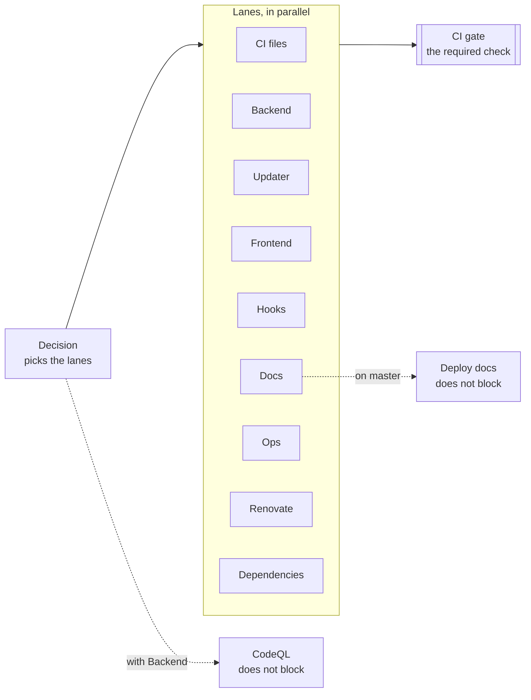

# CI/CD

Every change reaches master through a pull request, and GitHub Actions checks it first, from
[`.github/workflows/ci.yml`][ci-yml]. The checks come in lanes, one per part of the repository, and a pull request
runs only the lanes its changed files can affect, or all of them when in doubt. One check, `CI gate`, sums up the
run and decides whether the pull request can merge. The documentation site is the only thing deployed so far.
Read this page before you change a workflow, and before you add a folder: a folder that no lane knows runs every
lane.

## 🧭 Principles

DrinkIt keeps five practices of continuous integration and delivery, as Martin Fowler and DORA describe them:

1. **Master always works.** Master changes only through a pull request whose `CI gate` passed on a branch up to
   date with master. The [harness](../coding-assistants/harness.md) lists the guardrails that enforce this.
2. **Feedback within minutes.** In the [monorepo](../architecture/monorepo.md), a frontend change never waits for
   the backend tests. A run of every lane took about six minutes in October 2026.
3. **No check skipped by mistake.** A file that no lane knows runs every lane, and every lane runs on master each
   week.
4. **The pipeline is guarded like the code.** A workflow runs third-party code with access to the repository. Its
   actions are pinned, its tokens get the least they need, and two linters check every change to it.
5. **What is deployed is what was checked.** The documentation site is deployed from the build that checked it,
   never from a second build that could differ.

## 🔄 The life of a change

- **Each push runs [`ci.yml`][ci-yml]** on the pull request. A new push cancels the run still going, since only
  the last commit can merge.
- **The merge waits for a green `CI gate` on a branch up to date with master**, and rebases the commits onto it.
  A branch behind master is rebased first, with "Update branch" on the pull request or
  `gh pr update-branch <number> --rebase`.
- **Master runs again after each merge**, on the new commits the rebase made. This run is also the one that saves
  the Gradle cache, submits the dependency graph and deploys the site, so it is never cancelled.
- **Every Monday, [`weekly.yml`][weekly-yml] starts a full run on master**, so the checks also see the code no
  recent change touched. It lives in a file of its own because GitHub disables a scheduled workflow after 60 days
  without activity, and a disabled `ci.yml` would block every pull request.

## 🛤️ Lanes

A lane is the group of checks one part of the repository needs, in a workflow file of its own, `ci-<lane>.yml`.
`ci.yml` reads like a table of contents: the triggers, a `Decision` job that picks the lanes, one short job per
lane and the gate.

| Lane | Runs when the change touches | What it checks |
|---|---|---|
| CI files | The workflows, the in-repo actions, `.github/actionlint.yaml` | actionlint checks the syntax and expressions of the workflows, zizmor audits their security |
| Backend | The backend and [tech starter](../architecture/tech-starters.md) sources, the architecture tests, the [API contract](../architecture/contract-first.md), the build logic and Gradle files | `./gradlew build detektAll`: compiles, runs the tests and the [architecture tests](../writing-code/testing/architecture-tests.md), then detekt |
| Updater | The database changelogs of `deployment/updater`, the build logic and Gradle files | `./gradlew :updater:check`: the [changelog rules and Squawk](../build-and-data/database.md#checked-rules), each finding shown on its line of the pull request |
| Frontend | The Nuxt app, the API contract, `.nvmrc` | Generates the API client and builds the app. No linter or test runs on it yet |
| Hooks | `.hooks/`, `.claude/`, `.nvmrc` | ShellCheck on the git and Claude Code [hooks](../coding-assistants/hooks.md), then the bats suites of the hooks and of the harness files, under dash, `bash --posix` and macOS `sh` |
| Docs | `docs/`, the tech starter READMEs, every path of Backend, `.nvmrc` | Generates the [living documentation](../writing-code/best-practices/living-documentation.md) and builds the site, which fails on a dead link |
| Ops | `deployment/local/` | Validates the compose file, pulls its images and starts the services until each one is healthy |
| Renovate | `.github/renovate.json` | Renovate's own validator, in strict mode |
| Dependencies | Every run on master. On a pull request, a Gradle script or lock file, `gradle/`, a `package.json` or its lock | Submits the Gradle dependency graph, and on a pull request fails on an added dependency with a known vulnerability |

[`ci-lanes.yml`][ci-lanes] holds the exact paths. Some lanes watch more than their own folder:

- **Docs watches the backend**, because the living documentation generates the domain and tech starter pages from
  the backend sources.
- **Frontend watches the API contract**, because the TypeScript client is generated from it.
- **Three lanes watch `.nvmrc`**, the Node version that runs the Nuxt app, the site and bats.
- **Hooks runs under three shells**, because a hook runs under the `sh` of the machine: bash 3.2 on macOS, dash on
  Debian and Ubuntu, bash in POSIX mode on Fedora or Arch.
- **Ops starts the services**, because Renovate merges a new image digest on its own: the image must exist and
  start. The integration tests do not use these images, [Testcontainers](../writing-code/testing/testcontainers.md)
  starts its own.

Four jobs are not lanes: `Decision` picks the lanes, `CI gate` sums up their results, `CodeQL` runs with
Backend, and `Deploy docs` publishes the site on master.

## 🗺️ How Decision picks the lanes

`Decision` matches the changed files against the lists of [`ci-lanes.yml`][ci-lanes] with
[`dorny/paths-filter`][paths-filter]. A run started by hand or by `weekly.yml` runs every lane.

- **A file no list knows runs every lane.** `Decision` compares what `changed`, every file, and `known`, all the
  lists, match. A missing mapping costs a full run, never a skipped check.
- **`none` lists the files no job reads**, such as Markdown or the issue forms. A change limited to them runs no
  lane.
- **Every list includes `workflows`**, so a change to the CI runs every lane.
- **No `!` pattern.** Under the defaults of `paths-filter`, it would match every file it does not name.

## 🚦 One required check

The master ruleset requires only `CI gate`, so adding or renaming a lane never touches the ruleset. The gate fails
when a lane failed or was cancelled, and a skipped lane passes. Two behaviors of GitHub shape it:

- A workflow that a `paths` filter skips leaves its required check pending, while a job that its `if:` skips
  reports success. So lanes are skipped per job, in `ci.yml`.
- With `!cancelled()`, a cancelled run would skip the gate, and a skipped gate passes. So its condition is
  `always()`.

`CodeQL` and `Deploy docs` stay outside the gate. A Kotlin upgrade can fail CodeQL for no fault of the change, and
a failed deployment should not block the next change.

## 🔒 Securing the workflows

The workflows follow GitHub's secure use reference:

- **Pinned actions.** Every action is referenced by commit SHA, with its version as a comment that Renovate keeps
  up to date. The repository refuses a tag or a branch. In-repo actions go by `$/`, which GitHub counts as pinned.
- **Pinned tools.** actionlint, ShellCheck and Renovate's validator run from images pinned by digest, never from
  the runner's copy, which changes with the runner image.
- **Least privilege.** `ci.yml` starts from `permissions: {}`, and each job asks only for what it needs. No
  checkout keeps the token.
- **Approved forks.** A fork pull request runs only once a maintainer approves it.
- **Linted workflows.** [actionlint][actionlint] and [zizmor][zizmor] check every workflow change, and a finding
  fails `CI files`. zizmor does not upload to code scanning, where it would never block the merge.

actionlint runs from the kjanat fork, since the original rejects `$/` ([rhysd/actionlint#711][actionlint-711]).

## 🔍 Analysing the code and the dependencies

| Check | What it finds | When it runs | Blocks the merge |
|---|---|---|---|
| detekt | Kotlin rule breaks, formatting included | In Backend | Yes |
| CodeQL, `security-extended` queries | Security flaws in the Kotlin and Java code | With Backend, and weekly on all the code | No |
| zizmor | Security flaws in the workflows | In CI files, and weekly | Yes |
| Dependency review | An added dependency with a known vulnerability | On a pull request that changes dependencies | Yes |

CodeQL supports a new Kotlin release some time after it ships, so a Kotlin upgrade can fail it for a while.

The dependency review compares the graph of the pull request with the one of its base commit, so every master
commit submits its graph. Submitting needs a write token: the build of a branch gets one, a fork gets none and
skips the review. The review fails on development dependencies too, since Nuxt and the site ship from them.

## 🤖 Dependency updates

Renovate opens the update pull requests on Monday mornings, a week after a release, and pins actions and images by
digest. Security fixes and undated releases skip the wait, and majors and lock file refreshes wait for a checkbox on
the Dependency Dashboard, as [`renovate.json`][renovate] configures it. The minor and patch updates of GitHub Actions
and of the Renovate image, and new digests of an image tag, merge themselves once `CI gate` is green: the run of their
pull request already uses them. Renovate rebases those when they fall behind master, as the ruleset requires, and the
others only on conflict, which keeps the runs within the 20 jobs the repository runs at once.

## ⚡ Caches

Only `Backend` on master saves the Gradle cache, within the 10 GB GitHub allows, and every other job restores it.
The `GRADLE_ENCRYPTION_KEY` secret keeps the configuration cache between runs. The
[build tool](../build-and-data/build-tool.md) page explains both caches.

## 🚀 Continuous deployment

Only the documentation site is deployed: on master, `Deploy docs` publishes to GitHub Pages the site that `Docs`
built and checked. The backend and the frontend are not deployed yet.

## 🛠️ Changing the CI

The [`ci-workflow-change` skill][skill] gives the rules and the checklist, and the
["Compose file, workflows and Renovate configuration" block of `AGENTS.md`][agents-md] the local checks.

- **A new folder or module** goes into the list of the lane that reads it, or into `none`. Until then, a change to
  it runs every lane.
- **To see why a lane ran**, read the `Decision` log: it lists the files each list matched.
- **The weekly run stops** after 60 days without activity in the repository: `gh workflow enable weekly.yml`
  restarts it.

### Add a lane

1. Write its `ci-<lane>.yml`, with an `on: workflow_call` trigger.
2. In `ci-lanes.yml`, add its list with an anchor, starting with `- *workflows`, and add the anchor to `known`.
3. In `ci.yml`, add a job that calls the file when the lane is in `needs.decision.outputs.lanes`, with the
   permissions the file needs, and add that job to the `needs` of `gate`.
4. Add the lane to the table of this page.

## 📚 Sources

- [Continuous Integration](https://martinfowler.com/articles/continuousIntegration.html), Martin Fowler
- [Capabilities: Continuous integration](https://dora.dev/capabilities/continuous-integration/), DORA
- [Continuous delivery patterns](https://continuousdelivery.com/implementing/patterns/), Jez Humble
- [Secure use reference](https://docs.github.com/en/actions/reference/security/secure-use), GitHub
- [Scorecard checks](https://github.com/ossf/scorecard/blob/main/docs/checks.md), OpenSSF
- [Troubleshooting required status checks](https://docs.github.com/en/pull-requests/collaborating-with-pull-requests/collaborating-on-repositories-with-code-quality-features/troubleshooting-required-status-checks), GitHub
- [Disabling and enabling a workflow](https://docs.github.com/en/actions/how-tos/manage-workflow-runs/disable-and-enable-workflows), GitHub
- [Workflow configuration options for code scanning](https://docs.github.com/en/code-security/how-tos/scan-code-for-vulnerabilities/configure-code-scanning/customizing-your-advanced-setup-for-code-scanning), GitHub
- [Audit Rules](https://docs.zizmor.sh/audits/), zizmor
- [Automerge configuration and troubleshooting](https://docs.renovatebot.com/key-concepts/automerge/), Renovate

[ci-yml]: https://github.com/mboisnard/drinkit/blob/master/.github/workflows/ci.yml
[renovate]: https://github.com/mboisnard/drinkit/blob/master/.github/renovate.json
[ci-lanes]: https://github.com/mboisnard/drinkit/blob/master/.github/workflows/config/ci-lanes.yml
[weekly-yml]: https://github.com/mboisnard/drinkit/blob/master/.github/workflows/weekly.yml
[skill]: https://github.com/mboisnard/drinkit/blob/master/.claude/skills/ci-workflow-change/SKILL.md
[agents-md]: https://github.com/mboisnard/drinkit/blob/master/AGENTS.md#commands
[paths-filter]: https://github.com/dorny/paths-filter
[zizmor]: https://docs.zizmor.sh
[actionlint]: https://github.com/kjanat/actionlint
[actionlint-711]: https://github.com/rhysd/actionlint/issues/711
