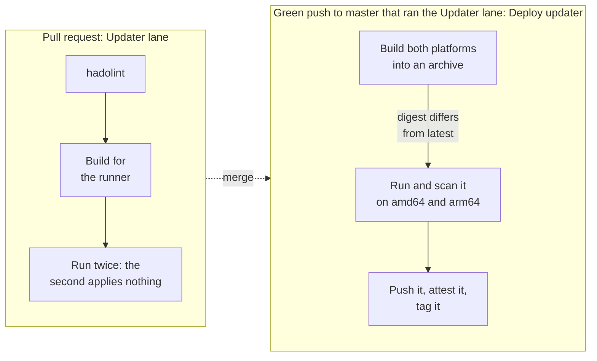

# Container images

DrinkIt publishes the programs it deploys as container images on GHCR. The first is the updater, the short-lived
program that applies the database changelogs before the backend uses the database. An image is published from
master only, and tagged only after CI ran that exact image, so what an environment pulls by tag is what CI
checked. This page describes the updater image, how master publishes it, and what a new image takes from it. Read
it before you add an image or change a Dockerfile.

## 📦 The updater image

`ghcr.io/mboisnard/drinkit-updater` holds the [updater](../build-and-data/database.md#liquibase) but none of its
changelogs, so a new changelog needs no new image. The updater reads them from the classpath under `/workspace`,
where they are mounted, or copied by an image built from this one.
[ADR 0004](../adr/0004-one-updater-image-for-every-environment.md) records why one image serves every environment.

Gradle and the Dockerfile build it:

1. Gradle's `extractLayers` task splits the jar into Spring Boot's layers, the dependencies apart from the
   updater's own classes.
2. [`deployment/updater/Dockerfile`][dockerfile] copies those layers onto
   [distroless](https://github.com/GoogleContainerTools/distroless) Java 25, once for amd64 and once for arm64.

- **Distroless** leaves out the shell and the package manager, and runs as a non-root user: fewer packages carry
  fewer CVEs, and a broken-in process has no shell to run.
- **Layers** let a change to the updater's code replace a layer of a few kilobytes, while the dependencies keep
  theirs, so the next pull stays small.
- **Copies only** in the Dockerfile let an amd64 runner build the arm64 image without emulating a CPU, the image
  that Apple Silicon Macs run natively, and the image build runs no code of the jar.
- **The C1 compiler alone**, set in the Dockerfile, starts this short program about 14% faster, measured on the
  image.
- **No default credentials**: the image fails at startup until it is given a database URL, a user and a password,
  so a deployment that forgets them never reaches a database by chance. The test checks that it does.

The test of the next section runs it with a read-only file system, `/tmp` in memory, no Linux capability and no
privilege escalation. A write elsewhere fails the test before an environment that enforces those limits meets it.

## 🚀 How master publishes it

- **No pull request pushes an image.** A pull request runs code nobody merged yet, so it never gets the right to
  write packages. The [Updater lane](ci-cd.md#lanes) lints the Dockerfile with
  [hadolint](https://github.com/hadolint/hadolint), builds the image for the runner and runs it twice against the
  PostgreSQL of `deployment/local/compose.yml`. On master, the lane leaves that to `Deploy updater`.
- **Master builds the image when the Updater lane ran, and publishes it only when it changed.** The lane's paths
  cover every input of the image: its code, its Dockerfile, the build logic, the Gradle files and the workflows. A
  push that touches only the frontend or the docs builds nothing. The build is reproducible, the same jar and base
  giving the same digest, so a path that leaves the image unchanged costs a build but never a publication, nor a
  Renovate pull request.
- **Build once, test that archive, push it as it is.** `Deploy updater` builds both platforms into an archive,
  without the Gradle cache that other jobs of master write. Its test job loads the archive, runs the image twice
  and scans it with [Trivy](https://trivy.dev), on an amd64 runner and on an arm64 one, so the image that Apple
  Silicon Macs pull runs too. Only then does its publish job push that archive, with the digest it was tested
  under, and tag it with its commit SHA and `latest`. A failure pushes nothing.
- **`latest` never goes back.** Deployments run one at a time, and a run that comes after a newer commit of master
  published its own image leaves `latest` alone. A publication that fails halfway is recovered by re-running all
  the jobs of its run: the build is reproducible, so the archive comes back with the same digest, tested again. A
  commit that leaves the image unchanged gets no tag of its own, since `latest` already names the same image.
- **Trivy blocks the publication, never a pull request.** A CVE disclosed upstream would otherwise fail every
  pull request of the lane, whatever it changes. Trivy fails on a HIGH or CRITICAL CVE that has a fix, the ones a
  bump can remove. The weekly full run scans `latest` again, so a CVE disclosed after its publication shows too.
- **Only the publish job holds a package token.** It builds and checks nothing: it pushes the tested archive with
  `skopeo`, a tool of the runner, attests it and tags it, and logs out before the post steps of its actions.
- **The tools update like the rest of the CI.** The minor and patch releases of the workflow's actions, and the new
  digests of BuildKit and Trivy, merge themselves as the [dependency updates](ci-cd.md#dependency-updates) say: a
  compromised one would reach the image, or the package token of the publish job. A new version of BuildKit or
  Trivy waits for a review, as a new version of hadolint does.
- **The base updates on its own.** Renovate merges a new digest of the distroless base without a review, so a CVE
  fix ships at the next push. The test and Trivy still check the image before it is pushed.
- **The provenance can be checked.** GitHub signs a record of the workflow and the commit that built the image,
  which `gh attestation verify oci://ghcr.io/mboisnard/drinkit-updater@<digest> --owner mboisnard` checks.

## 🧪 Working on the image

- **The updater's code** runs from the IDE as `UpdaterApplication`, with the `dev` profile.
- **The image** builds from the jar, as the [updater's README][readme] shows.
- **A new image** follows the same build, test and publish jobs. hadolint, Trivy and BuildKit run from images
  pinned by digest, so that a new release of a tool changes no check before Renovate proposes it.

## 📚 Sources

- [Efficient container images](https://docs.spring.io/spring-boot/reference/packaging/container-images/efficient-images.html), Spring Boot
- [Reproducible builds](https://docs.docker.com/build/ci/github-actions/reproducible-builds/), Docker
- [Using artifact attestations](https://docs.github.com/en/actions/security-for-github-actions/using-artifact-attestations/using-artifact-attestations-to-establish-provenance-for-builds), GitHub

[dockerfile]: https://github.com/mboisnard/drinkit/blob/master/deployment/updater/Dockerfile
[readme]: https://github.com/mboisnard/drinkit/blob/master/deployment/updater/README.md
