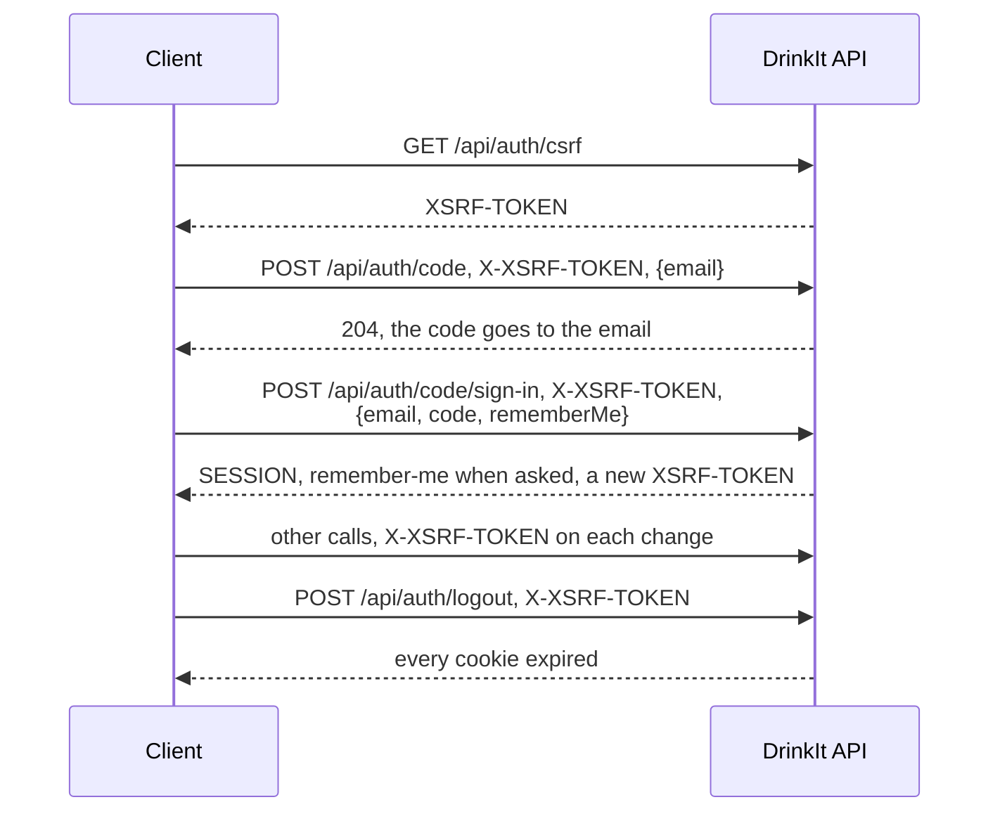

# Calling the API

The API recognizes a signed-in user by a session cookie, and refuses a request that changes state without the CSRF
token. A client keeps the cookies the API sets, and copies the CSRF cookie into the `X-XSRF-TOKEN` header of every
request but `GET`, `HEAD` and `OPTIONS`. The [security principles](principles.md) explain why.

## Cookies by profile

Every path starts with the context path `/drinkit`: `http://localhost:8080/drinkit` under
`./gradlew :drinkit-backend:bootRun`.

| Cookie | `dev` profile, plain HTTP | Other profiles, HTTPS |
|---|---|---|
| Session | `SESSION` | `__Host-SESSION` |
| CSRF token | `XSRF-TOKEN` | `__Host-XSRF-TOKEN` |
| Remember-me | `remember-me` | `__Host-remember-me` |

A browser accepts a `__Host-` cookie only from a secure origin, so the `dev` profile drops the prefix and the
`Secure` flag.

## A session, call by call



A sign-in, by code or by the remember-me cookie, sets a new CSRF token in its response, which the next request
sends. A logout expires it, so the client calls `GET /api/auth/csrf` again before its next change.

## From the Nuxt app

The app does not call the API through the generated client yet. Once it does, the client needs
`credentials: 'include'`, so that the browser sends and stores the cookies, and a middleware that copies the CSRF
cookie into the header. The app then calls `GET /api/auth/csrf` when it starts and after a logout, and
`GET /api/user/me` once when it starts: a 401 means nobody is signed in.

```ts
import { Configuration, type Middleware } from '~/openapi'

function xsrfToken(): string | undefined {
  const cookies = Object.fromEntries(document.cookie.split('; ').map((cookie) => cookie.split('=')))
  return cookies['__Host-XSRF-TOKEN'] ?? cookies['XSRF-TOKEN']
}

const xsrf: Middleware = {
  async pre({ url, init }) {
    const token = xsrfToken()
    if (['GET', 'HEAD', 'OPTIONS'].includes(init.method ?? 'GET') || !token) return { url, init }
    return { url, init: { ...init, headers: { ...init.headers, 'X-XSRF-TOKEN': token } } }
  },
}

export const apiConfiguration = new Configuration({ basePath: '/drinkit', credentials: 'include', middleware: [xsrf] })
```

## From Postman

Postman keeps the cookies in its cookie jar, and a pre-request script of the collection copies the CSRF cookie into
the header:

1. In the cookie jar settings, add `localhost` to the domains that scripts may read.
2. Add this script to the collection, under "Pre-request".
3. Send `GET {{baseUrl}}/api/auth/csrf`, then `POST {{baseUrl}}/api/auth/code` with `{"email": "demo@drinkit.test"}`.
4. Read the code in the backend logs: the `dev` profile sets no mail server, so each email is logged instead.
5. Send `POST {{baseUrl}}/api/auth/code/sign-in` with `{"email": "demo@drinkit.test", "code": "<the code>"}`.

```js
const url = pm.variables.replaceIn(pm.request.url.toString())
pm.cookies.jar().get(url, 'XSRF-TOKEN', (error, token) => {
  if (token) pm.request.headers.upsert({ key: 'X-XSRF-TOKEN', value: token })
})
```

## Sources

- [Cross Site Request Forgery, single-page applications](https://docs.spring.io/spring-security/reference/servlet/exploits/csrf.html#csrf-integration-javascript-spa), Spring Security
- [Script with cookies](https://learning.postman.com/docs/tests-and-scripts/write-scripts/postman-sandbox-reference/pm-cookies/), Postman
