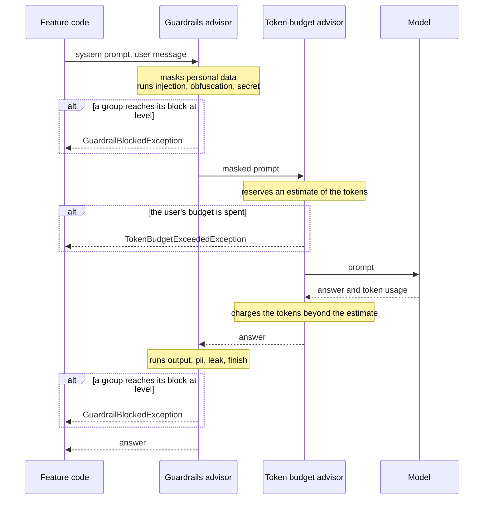

# LLM guardrails

A guardrail is a check around a call to a language model: on the prompt before it leaves, and on the answer before
the code uses it. A model follows an instruction wherever it reads one, in a user's question as in the text of a
wine label, so it cannot tell its orders from the data it is given. Guardrails catch the known attacks, keep
personal data from leaving, and cap what each user spends. They lower the risk without removing it, so the code
still treats every answer as untrusted. Read this page before you send a model text that DrinkIt did not write, or
change a guardrail.

DrinkIt runs these checks in the application, inside the [tech starter](../architecture/tech-starters.md)
`ai-starter`, since no gateway stands between the application and the models.
[ADR 0021](../adr/0021-serve-ai-models-outside-the-application-and-reach-them-through-ai-starter.md) records that
choice and where the checks move once a gateway exists. The
[README of `ai-starter`](https://github.com/mboisnard/drinkit/blob/master/tech-starters/backend/ai-starter/README.md)
lists the groups of rules and their settings.

## 🛣️ The path of a call

Two Spring AI advisors, hooks that wrap each call of a model, carry the checks. A group of rules covers one threat,
such as `injection` on the prompt or `leak`, an answer that repeats the system prompt. The guardrails run before the
token budget, so a call they block costs no token.

A call that lists fallback models runs the advisors once per model it tries. A failure of a model hands over to the
next one, while a refusal of the advisors stops the call: the next model would get the same prompt.

## 🚦 Block or observe

Each group of rules gives a finding a threat level, from `LOW` to `CRITICAL`. A group blocks once a finding reaches
its `block-at` level, or only observes: the finding is logged and traced, the call goes on, and the code receives it with the answer to act on it. The groups block by
default where a miss costs much and a false alarm little: an injection, an instruction hidden by an encoding, a
secret in the system prompt, an answer that repeats it. The others observe until their traces show which rules hold on real questions, since a rule that refuses
a sommelier's question is worse than no rule.

A log line and a trace name the group, the rule and the level, never the text, which can hold personal data, as
[ADR 0016](../adr/0016-observe-through-micrometer-and-export-over-opentelemetry-on-demand.md) requires of every
observation.

## 🔤 Untrusted text

The code wraps each text it did not write, such as a user's question or the text of a label, in `UntrustedText`. It
normalizes the text, so that a rule sees what the model reads, escapes its tags, and puts it between
`<untrusted_input>` tags. The advisor then tells the model, in the system prompt, that what lies between them is data.
This is the [spotlighting](https://arxiv.org/abs/2403.14720) defense: it makes an injection less likely to work, and the escaping keeps a text from
closing its tags early.

## 🪙 Token budget

A call of a signed-in user counts against a budget of tokens per hour, kept by
[`rate-limit-starter`](https://github.com/mboisnard/drinkit/blob/master/tech-starters/backend/rate-limit-starter/README.md)
with GCRA, the algorithm of the limits on requests, as
[ADR 0020](../adr/0020-rate-limit-in-the-application-with-gcra-on-postgresql.md) explains. A call learns its cost
only once answered, so it reserves an estimate first and pays what it used beyond it. A call made outside a request, such as
by a job, has no user and no budget. An endpoint answers `TokenBudgetExceededException` with a 429 and its
`Retry-After`.

## 🧾 Coverage of the OWASP risks

| Risk | Covered by |
|---|---|
| [LLM01 Prompt injection](https://genai.owasp.org/llmrisk/llm01-prompt-injection/) | the `injection` and `obfuscation` groups, `UntrustedText` |
| [LLM02 Sensitive information disclosure](https://genai.owasp.org/llmrisk/llm022025-sensitive-information-disclosure/) | the masking of the prompt, the `pii` group |
| [LLM03 Supply chain](https://genai.owasp.org/llmrisk/llm032025-supply-chain/) | the LocalAI image of compose, pinned by its digest |
| [LLM04 Data and model poisoning](https://genai.owasp.org/llmrisk/llm042025-data-and-model-poisoning/) | nothing to cover: DrinkIt trains no model |
| [LLM05 Improper output handling](https://genai.owasp.org/llmrisk/llm052025-improper-output-handling/) | the `output` and `finish` groups, the schema of a typed answer |
| [LLM06 Excessive agency](https://genai.owasp.org/llmrisk/llm062025-excessive-agency/) | not yet: no model calls a tool |
| [LLM07 System prompt leakage](https://genai.owasp.org/llmrisk/llm072025-system-prompt-leakage/) | the `secret` and `leak` groups |
| [LLM08 Vector and embedding weaknesses](https://genai.owasp.org/llmrisk/llm082025-vector-and-embedding-weaknesses/) | not yet: no embedding model |
| [LLM09 Misinformation](https://genai.owasp.org/llmrisk/llm092025-misinformation/) | the feature that shows an answer, which lets the user check it |
| [LLM10 Unbounded consumption](https://genai.owasp.org/llmrisk/llm102025-unbounded-consumption/) | the token budget, the timeout of each endpoint |

The rules match known patterns: a reworded attack escapes them, and they never see a streamed call or the result of
a tool.
The README of `ai-starter` lists these limits.

## 📚 Sources

- [OWASP Top 10 for LLM Applications 2025](https://genai.owasp.org/llm-top-10/), OWASP
- [LLM Prompt Injection Prevention Cheat Sheet](https://cheatsheetseries.owasp.org/cheatsheets/LLM_Prompt_Injection_Prevention_Cheat_Sheet.html), OWASP
- [Defending Against Indirect Prompt Injection Attacks With Spotlighting](https://arxiv.org/abs/2403.14720), Microsoft
- [Advisors API](https://docs.spring.io/spring-ai/reference/api/advisors.html), Spring
