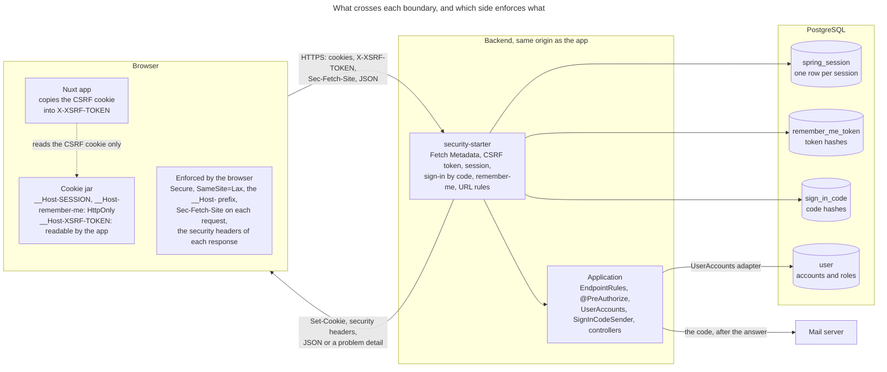
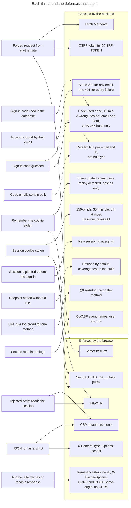
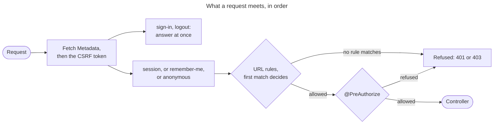
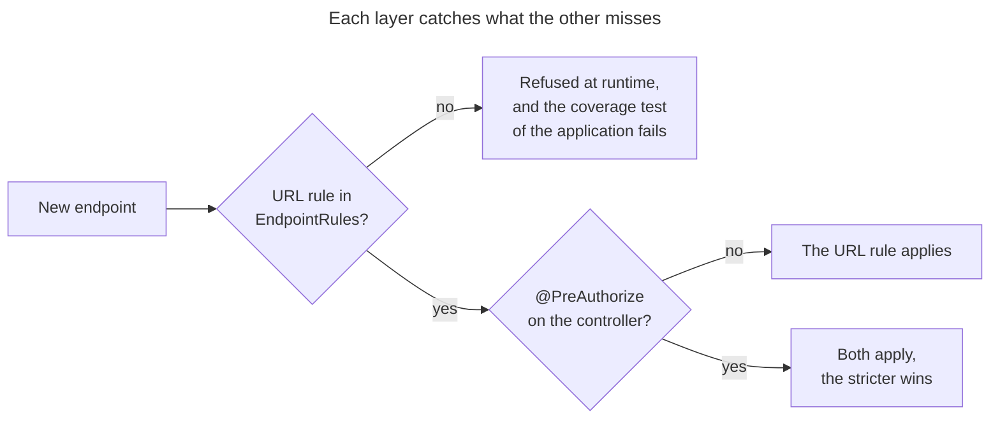
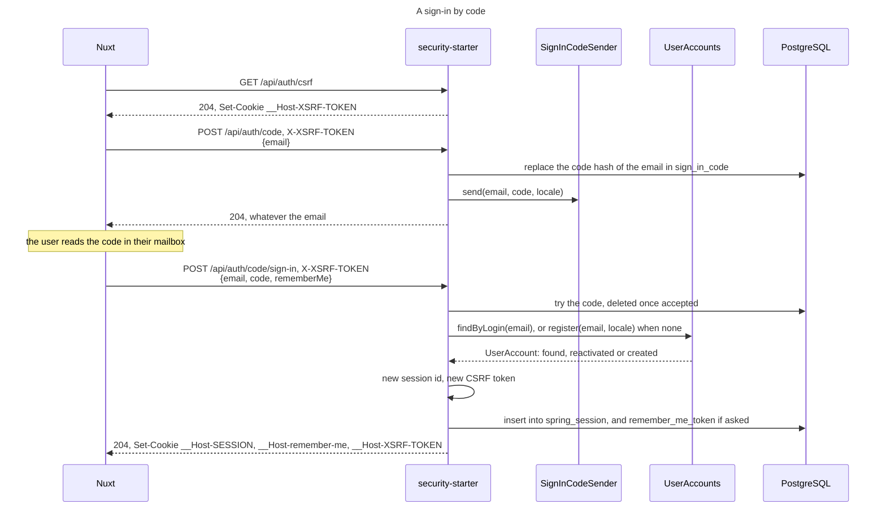
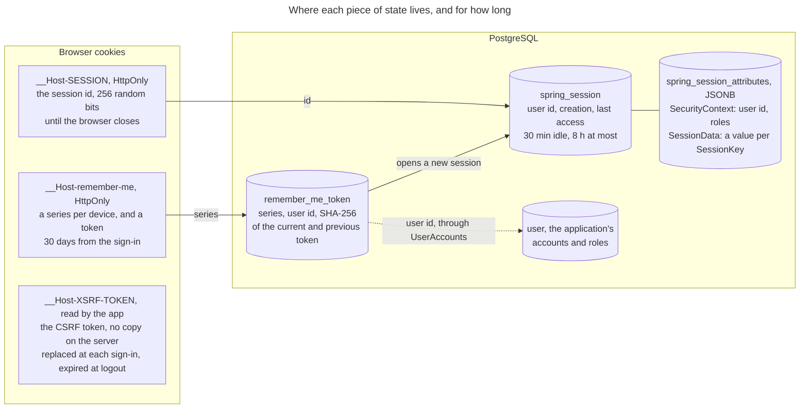
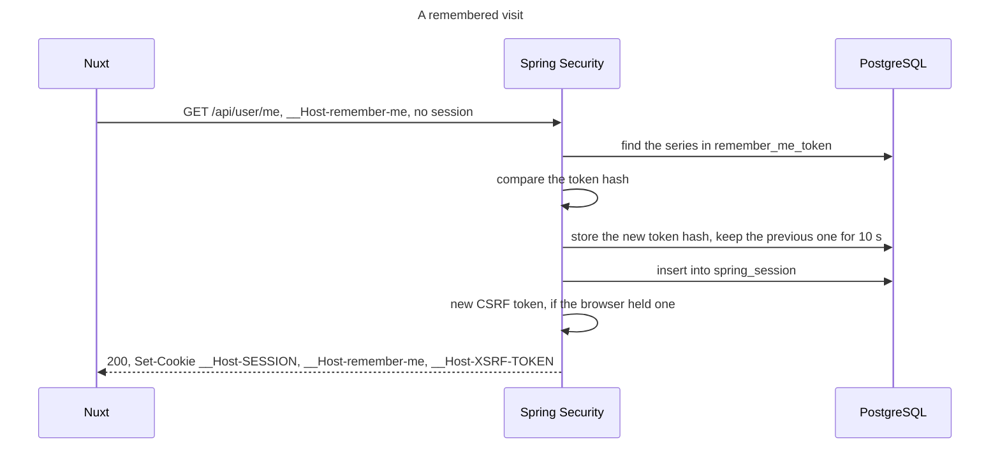
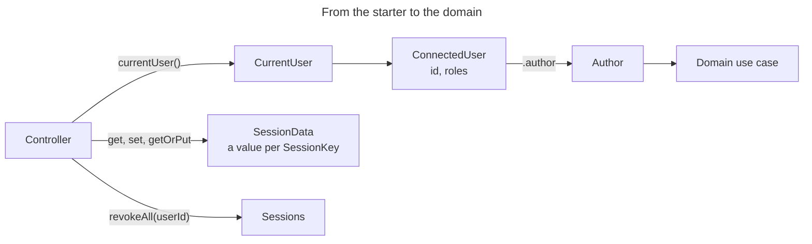

# Security principles

The API of DrinkIt has one client: the browser that runs the Nuxt frontend, on the same origin. The session lives
on the server, in PostgreSQL, and the browser holds only its id, in a cookie that no script can read and no other
site can use. The backend refuses by default: an endpoint answers only once a rule says who may call it, so that a
forgotten rule closes an endpoint instead of opening it. Read this page before you add an endpoint, or change a
cookie, a header or the way users sign in.

The [tech starter](../architecture/tech-starters.md) `security-starter` builds all of this from Spring Security and
Spring Session. The backend application that uses it gives it its users and its rules, and
[calling the API](calling-the-api.md) shows what a client sends in return.

## 🗺️ The whole picture

The browser holds random ids and the CSRF token, and what they grant lives in PostgreSQL. The browser's defenses keep
other sites away from a user, but hold only in a browser: curl sends any cookie and any header. The backend's checks
hold for every client, so none of them relies on the browser alone.

## 🎯 Threats and their defenses

Most threats meet more than one defense, so that one gap leaves another standing. A dashed line is a defense that
does not exist yet.

## 🛣️ The path of a request

Forged requests are refused first, before they reach the sign-in or the logout. The URL rules then run from top to
bottom: the starter's code, sign-in, logout and CSRF endpoints, `/actuator/health`, the `EndpointRules` beans by
`@Order`, and a last rule that refuses anything else. The starter's endpoints come first so that no rule of the
application can lock users out, and health so that no rule hides it from the platform's probes. A broad pattern such
as `/api/**` goes in the last `EndpointRules` bean, since the first match decides. The beans are the application's,
and those of the other tech starters that serve an endpoint, such as the stream of `sse-starter`:
[ADR 0015](../adr/0015-push-server-events-over-sse-to-a-user-or-a-session.md) records why that starter brings the rule
of its own stream.

The application adds `@PreAuthorize` to a controller method that needs more than its URL rule, such as a role, and
the stricter of the two wins. A forgotten URL rule refuses the endpoint, and a test of the backend fails the build
when an operation of the API contract has none. A forgotten annotation leaves the URL rule in force.

Every refusal answers a JSON problem detail: 403 for a forged request, and for a rule 401 to an anonymous caller,
403 to a signed-in one. The starter rethrows a refusal from a controller ahead of the application's exception
handlers, so that a catch-all handler cannot turn it into a 500.

## 🔑 Signing in

A user signs in with a code of six digits sent to their email, in two calls: one asks for the code, the other
sends it back. [ADR 0011](../adr/0011-sign-in-without-a-password.md) records why DrinkIt signs users in this way.

The starter draws the code at random and keeps only its SHA-256 hash, for 10 minutes. An email gets 3 wrong tries per
hour, whatever code it holds: a new request replaces the earlier code of that email, never its tries. The request never
looks the email up, so it answers the same 204, as fast, whether an account exists or not. The email is trimmed and
lower-cased before anything else.

The code is accepted once. The starter then asks the application for the account, and DrinkIt's backend brings back
a user deleted less than 30 days ago or creates a new one. A user therefore exists only once a code has proven their
email, and a new user completes their profile to get `ROLE_USER`. A wrong, used or expired code, the last try spent,
or an account the application refuses give the same 401.

The sign-in changes the session id, so that an id planted before it is worth nothing after it, and replaces the CSRF
token in its own response. It also grants the factor of a one-time token, with its time, for a later check of a
recent sign-in. The application changes the session id the same way through `CurrentUser`, when it signs in a user
proven another way or reloads their roles.

A code of six digits can be found back from its hash, which is why it lives minutes. Nothing limits the requests per
email or per address yet: a caller can ask for code after code, and so send emails to any address.

### Where each piece lives

| Piece | Kind | Where |
|---|---|---|
| The code: its draw, hash, expiry and tries | Authentication | `security-starter`, in `drinkit_session.sign_in_code` |
| The sending of the code | A channel the application picks | `SignInCodeSender`: `drinkit-backend` publishes a [platform event](../architecture/platform-events.md), whose handler emails the code after the answer |
| The account: its creation, reactivation and roles | Business | The `user` [event stream](../architecture/event-sourcing.md), which the starter reaches through `UserAccounts` |

`UserAccounts` and `SignInCodeSender` are the ports the application implements, so that the starter reads no table
of the application and sends no email itself.

## 🍪 Sessions and cookies

The cookies hold random values only, and what they grant lives in rows that a revocation deletes. A session ends
after 30 idle minutes or 8 hours, and `Sessions.revokeAll` signs a user out everywhere at once.
[ADR 0012](../adr/0012-keep-sessions-in-postgresql.md) records why the session lives in PostgreSQL and how long it
lasts. An anonymous caller gets no row: the CSRF token lives in its cookie, and the starter keeps no refused request.

Every cookie is `Secure`, `SameSite=Lax` and `Path=/`, and the session and remember-me cookies are `HttpOnly`:

- **`Secure`** keeps the cookie off plain HTTP, where anyone on the network reads it.
- **`HttpOnly`** keeps the session out of reach of a script injected into the page.
- **`SameSite=Lax`** leaves the cookies out of a request another site starts, except a top-level navigation, so a
  link from an email still opens DrinkIt signed in.
- **The `__Host-` prefix** makes the browser refuse a cookie set by a subdomain or a plain HTTP page.
- **`Path=/`** is set by hand: the backend runs under the context path `/drinkit`, and the browser drops a
  `__Host-` cookie with any other path.

The `dev` profile runs over plain HTTP on `localhost`, and drops both the prefix and `Secure`. The starter refuses to
start with a prefix and no `Secure`.

A remember-me cookie opens a new session once the current one has ended. Its token changes at each use and is stored
hashed, so that a stolen copy shows itself the first time both copies are used, and it lasts 30 days from the
sign-in. [ADR 0013](../adr/0013-remember-me-with-a-rotating-hashed-token.md) explains the rotation, its grace for
parallel requests and the theft detection.

## 🛡️ Forged requests

A forged request comes from another site, with the victim's cookies. `SameSite=Lax` already keeps them off a
cross-site `POST`, and two checks of the backend stand behind it, on every method but `GET`, `HEAD`, `OPTIONS` and
`TRACE`:

- **CSRF token.** The client copies the `__Host-XSRF-TOKEN` cookie into the `X-XSRF-TOKEN` header, which another
  site cannot read to fill.
- **Fetch Metadata.** The starter refuses a request whose `Sec-Fetch-Site` is neither `same-origin` nor `none`, a URL
  the user typed. A client that sends no such header, such as curl, still needs the token.

The sign-in needs the token too: without it, another site could sign the victim in to the attacker's account.
[ADR 0014](../adr/0014-protect-against-csrf-with-a-cookie-token-and-fetch-metadata.md) records why the token lives in
a cookie rather than in the session.

## 📋 Security headers

DrinkIt sends no CORS header: the app and the API share one origin in production, and the Nuxt dev server forwards
the API calls in development. The browser then keeps any other origin from reading a response. Each response also
carries these headers, which cost nothing to a JSON API:

| Header | Value | Protects against |
|---|---|---|
| `Content-Security-Policy` | `default-src 'none'; frame-ancestors 'none'` | A response rendered as a page that loads scripts, or framed by another site |
| `Strict-Transport-Security` | `max-age=31536000; includeSubDomains` | A first request in plain HTTP, sent even when TLS ends at a proxy |
| `X-Content-Type-Options` | `nosniff` | A JSON response that the browser guesses to be a script |
| `X-Frame-Options` | `DENY` | Framing, for browsers that ignore `frame-ancestors` |
| `Referrer-Policy` | `strict-origin-when-cross-origin` | A URL and its parameters sent to another site |
| `Permissions-Policy` | Camera, microphone and location turned off | A page of DrinkIt that uses them |
| `Cross-Origin-Opener-Policy` | `same-origin` | A window of another site that keeps a handle on DrinkIt's |
| `Cross-Origin-Resource-Policy` | `same-origin` | Another site that embeds a response of the API |
| `Cache-Control` | `no-cache, no-store, max-age=0, must-revalidate` | Personal data left in a shared or browser cache |
| `Clear-Site-Data` | `"cache", "storage"`, at logout, over HTTPS | What the app stored in the browser, kept after logout |

`Clear-Site-Data` leaves out `"cookies"`, which Chrome applies to every subdomain. The logout expires DrinkIt's
cookies one by one instead.

## 📝 Security events in the logs

The starter logs each security event under a name of OWASP's
[logging vocabulary](https://cheatsheetseries.owasp.org/cheatsheets/Logging_Vocabulary_Cheat_Sheet.html), such as
`authn_login_success`, `authn_login_fail`, `authn_token_reuse`, `authz_fail` or `session_revoked`, so that an alert
can match on them. A success names its method, such as `authn_login_success:<id>,method=email_code` or
`method=remember_me`. A user appears by their id only, and no email, sign-in code, token, cookie or session id
reaches the [logs](../build-and-data/logging.md): a log is read by more people than the database. An anonymous
caller refused is the normal start of every visit, and is not logged.

## 🧩 What the business code uses

A controller reads the connected user from `CurrentUser`, and turns it into the `Author` that the use cases of the
domain take, so that the domain never depends on the starter. `SessionData` keeps values in the user's session, and
`Sessions.revokeAll` signs a user out everywhere, after a role change or a deletion. The
[README of `security-starter`](https://github.com/mboisnard/drinkit/blob/master/tech-starters/backend/security-starter/README.md)
shows how an application plugs it in.

## 📚 Sources

- [Application Security Verification Standard 5.0](https://github.com/OWASP/ASVS/tree/v5.0.0), OWASP
- [Session Management Cheat Sheet](https://cheatsheetseries.owasp.org/cheatsheets/Session_Management_Cheat_Sheet.html), OWASP
- [HTTP Security Response Headers Cheat Sheet](https://cheatsheetseries.owasp.org/cheatsheets/HTTP_Headers_Cheat_Sheet.html), OWASP
- [Spring Security reference](https://docs.spring.io/spring-security/reference/), Spring
