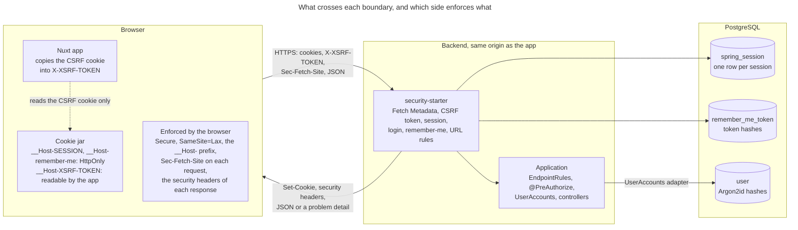
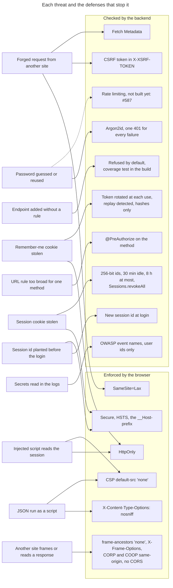
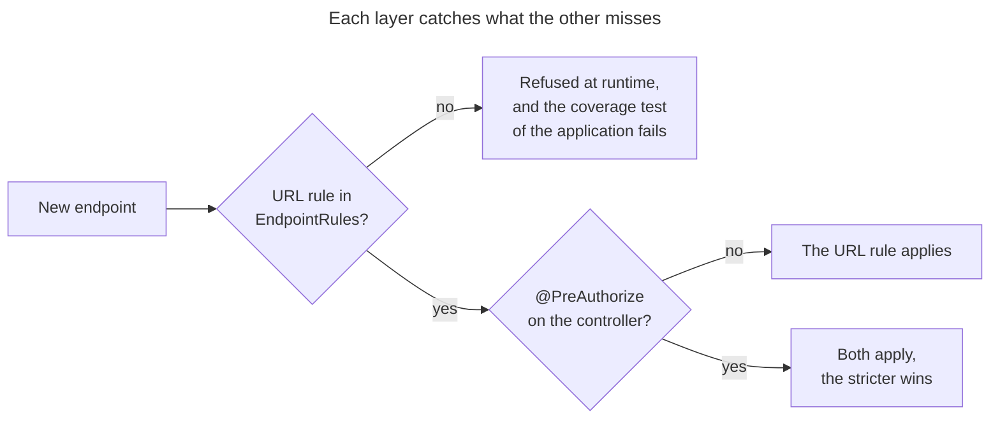
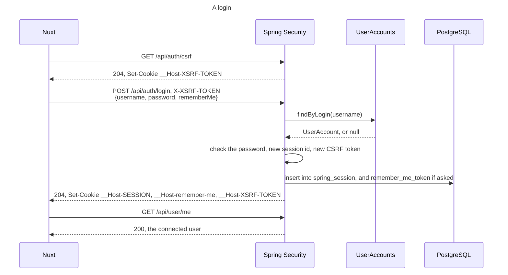
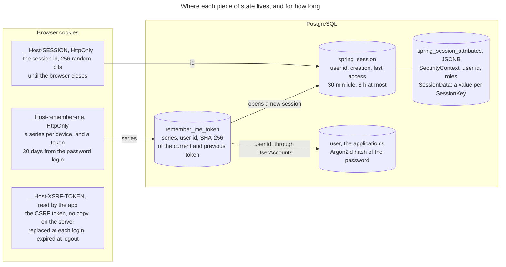
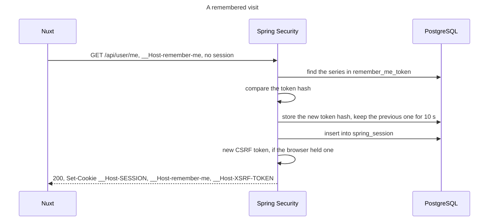
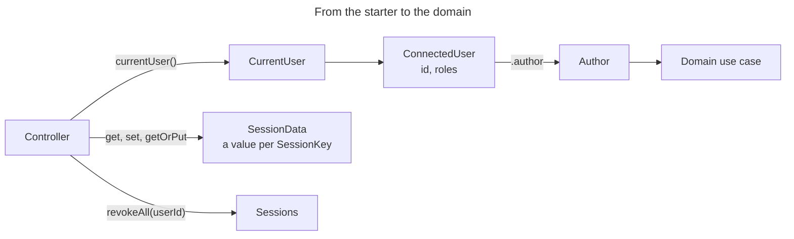

# Security principles

The API of DrinkIt has one client: the browser that runs the Nuxt frontend, on the same origin. The session lives
on the server, in PostgreSQL, and the browser holds only its id, in a cookie that no script can read and no other
site can use. The backend refuses by default: an endpoint answers only once a rule says who may call it, so that a
forgotten rule closes an endpoint instead of opening it. Read this page before you add an endpoint, or change a
cookie, a header or the way users sign in.

The [tech starter](../architecture/tech-starters.md) `security-starter` builds all of this from Spring Security and
Spring Session. The backend application that uses it gives it its users and its rules, and
[calling the API](calling-the-api.md) shows what a client sends in return.

## 🗺️ The whole picture

The browser holds random ids and the CSRF token, and what they grant lives in PostgreSQL. The browser's defenses keep
other sites away from a user, but hold only in a browser: curl sends any cookie and any header. The backend's checks
hold for every client, so none of them relies on the browser alone.

## 🎯 Threats and their defenses

Most threats meet more than one defense, so that one gap leaves another standing. A dashed line is a defense that
does not exist yet. The sections below give the reason for each.

## 🛣️ The path of a request

```mermaid
---
title: The filters a request goes through, in their order
---
flowchart TB
  request([Request]) --> repository["SessionRepositoryFilter, Spring Session<br/>getSession() reads spring_session"]
  subgraph chain["Spring Security filter chain"]
    subgraph prepare["Prepare"]
      encode["DisableEncodeUrlFilter<br/>never puts the session id in a URL"]
      async["WebAsyncManagerIntegrationFilter<br/>keeps the user on async requests"]
      context["SecurityContextHolderFilter<br/>loads the SecurityContext<br/>from the session on first use"]
      headers["HeaderWriterFilter<br/>CSP, HSTS, nosniff and the others"]
    end
    subgraph forgery["Refuse forged requests: POST, PUT, PATCH, DELETE"]
      fetch["FetchMetadataFilter, the starter's<br/>Sec-Fetch-Site of another site: 403"]
      csrf["CsrfFilter<br/>X-XSRF-TOKEN missing<br/>or not the cookie's: 403"]
    end
    subgraph endpoints["Endpoints of the starter, which answer at once"]
      logout["LogoutFilter<br/>POST /api/auth/logout: 204"]
      login["JsonLoginFilter, the starter's<br/>POST /api/auth/login: 204 or 401"]
    end
    subgraph identify["Find who is calling"]
      cache["RequestCacheAwareFilter<br/>NullRequestCache: keeps no request"]
      aware["SecurityContextHolderAwareRequestFilter<br/>request.isUserInRole() reads the user"]
      remember["RememberMeAuthenticationFilter<br/>nobody yet and __Host-remember-me:<br/>rotates the token, signs in"]
      anonymous["AnonymousAuthenticationFilter<br/>still nobody: anonymous"]
      management["SessionManagementFilter<br/>a sign-in no filter saved:<br/>new session id"]
    end
    subgraph decide["Decide"]
      translation["ExceptionTranslationFilter<br/>a refusal from below:<br/>401 when anonymous, else 403"]
      authorization["AuthorizationFilter<br/>URL rules, the first match decides"]
    end
    encode --> async --> context --> headers --> fetch --> csrf --> logout --> login
    login --> cache --> aware --> remember --> anonymous --> management --> translation --> authorization
  end
  repository --> encode
  authorization -.- rules["URL rules, top to bottom<br/>error dispatches<br/>the starter's login, logout, csrf<br/>/actuator/health<br/>EndpointRules beans, by @Order<br/>anything else: refused"]
  authorization -- allowed --> dispatcher[DispatcherServlet] --> method{"@PreAuthorize"}
  method -- allowed --> controller([Controller])
  authorization -. refused .-> translation
  method -. refused .-> translation
```

Spring Security fixes the order of its filters. The starter adds its own at fixed places: Fetch Metadata just
before CSRF, the JSON login in the slot of the form login, whose filter it extends. A forged request is refused
before it reaches the login or the logout. Every refusal answers a JSON problem detail.

The starter's endpoints come before the application's rules, so that no rule of the application can lock users out of
the login, and health comes before them so that no rule hides it from the probes of the platform. The application
declares its rules in `EndpointRules` beans, which `endpointRules {}` builds with the Kotlin DSL of Spring Security.
The first rule that matches a request decides, so a broad pattern such as `/api/**` goes in the last bean.

A refusal thrown in a controller, by `@PreAuthorize` or `CurrentUser`, goes back up to `ExceptionTranslationFilter`.
The starter rethrows it ahead of the application's exception handlers, so that a catch-all handler cannot turn it
into a 500.

## 🧱 Two layers of authorization

The application declares a URL rule for every endpoint, and adds `@PreAuthorize` to a controller method that needs
more, such as a role. A forgotten rule refuses the endpoint at runtime. A test of the backend also checks each
operation of the API contract against the rules, without starting the application, and fails the build when one
has no rule. A forgotten annotation leaves the URL rule in force.

## 🔑 Signing in

`UserAccounts` is the port the application implements to hand its accounts to the starter, which reads no table of the
application. The login changes the session id, so that an id planted in the browser before the login is worth nothing
after it. It also replaces the CSRF token, in the response of the login itself, which the next request sends. An
unknown login, a wrong password and a disabled account give the same 401 with the same body, so that the answer does
not tell which logins exist. The application changes the session id the same way when it signs a user in right after a
registration, and when it reloads a user's roles, through `CurrentUser`, and replaces the CSRF token there too.

## 🍪 Sessions and cookies

The cookies hold random values only, and what they grant lives in rows that a revocation deletes. An anonymous
caller gets no row: the CSRF token lives in its cookie, and the starter keeps no refused request.
[ADR 0012](../adr/0012-stateful-sessions-in-postgresql-serialized-as-jsonb.md) records why the session lives in
PostgreSQL, how long it lasts, and draws its life.

Every cookie is `Secure`, `SameSite=Lax` and `Path=/`:

- **`Secure`** keeps the cookie off plain HTTP, where anyone on the network reads it.
- **`HttpOnly`** keeps the session out of reach of a script injected into the page.
- **`SameSite=Lax`** leaves the cookies out of a request another site starts, except a top-level navigation. A link
  from an email still opens DrinkIt signed in, which `Strict` would prevent.
- **The `__Host-` prefix** makes the browser refuse the cookie unless it is `Secure`, has no `Domain` and has
  `Path=/`. Neither a subdomain nor a plain HTTP page can set it in DrinkIt's place.
- **`Path=/`** is set by hand. The backend runs under the context path `/drinkit`, which Spring would give as the
  path, and the browser silently drops a `__Host-` cookie with any path but `/`.

The `dev` profile runs over plain HTTP on `localhost`, and drops both the prefix and `Secure` through
`starters.security.cookie.prefix` and `starters.security.cookie.secure`. The starter refuses to start with a prefix
and no `Secure`.

## 🛡️ Forged requests

A forged request comes from another site, with the victim's cookies. `SameSite=Lax` already keeps them off a
cross-site `POST`, and two more checks stand behind it.

- **CSRF token.** On each request that changes state, the client reads the `__Host-XSRF-TOKEN` cookie and sends its
  value in the `X-XSRF-TOKEN` header, which another site cannot read to fill. The value travels raw, without Spring's
  masking against BREACH, since the token never appears in a response body.
- **Fetch Metadata.** Browsers send `Sec-Fetch-Site` with each request. The starter refuses a `POST`, `PUT`, `PATCH` or
  `DELETE` sent from another origin: the header must be `same-origin`, or `none` for a URL typed by the user. A client that sends no such header, such
  as curl, still needs the token.

The login needs the token too. Without it, another site could sign the victim in to the attacker's account, and what
the victim then saves would land there.

## 🌐 CORS

DrinkIt sends no CORS header. In production, the app and the API share one origin. In development, the Nuxt dev
server forwards the API calls to the backend. Without CORS headers, the browser keeps any other origin from reading a
response.

## 📋 Security headers

Each response carries these headers. They cost nothing to a JSON API and close what a browser would otherwise allow.

| Header | Value | Protects against |
|---|---|---|
| `Content-Security-Policy` | `default-src 'none'; frame-ancestors 'none'` | A response rendered as a page that loads scripts, or framed by another site |
| `Strict-Transport-Security` | `max-age=31536000; includeSubDomains` | A first request in plain HTTP, sent even when TLS ends at a proxy |
| `X-Content-Type-Options` | `nosniff` | A JSON response that the browser guesses to be a script |
| `X-Frame-Options` | `DENY` | Framing, for browsers that ignore `frame-ancestors` |
| `Referrer-Policy` | `strict-origin-when-cross-origin` | A URL and its parameters sent to another site |
| `Permissions-Policy` | Browser features turned off | A page of DrinkIt that uses the camera or the location |
| `Cross-Origin-Opener-Policy` | `same-origin` | A window of another site that keeps a handle on DrinkIt's |
| `Cross-Origin-Resource-Policy` | `same-origin` | Another site that embeds a response of the API |
| `Cache-Control` | `no-cache, no-store, max-age=0, must-revalidate` | Personal data left in a shared or browser cache |
| `Clear-Site-Data` | `"cache", "storage"`, at logout, over HTTPS only where browsers read it | What the app stored in the browser, kept after logout |

`Clear-Site-Data` leaves out `"cookies"`, which in Chrome clears the cookies of the whole registrable domain. The
logout expires DrinkIt's cookies one by one instead.

## 🔁 Remember-me

When the session has ended, the remember-me cookie opens a new one, and its token changes at each use. The previous
token stays valid for 10 seconds, the grace, for the parallel requests of the app.
[ADR 0013](../adr/0013-remember-me-by-a-rotating-hashed-token.md) explains why and draws the life of a token, its
theft detection and its 30 days.

A remembered session is not fully authenticated, so a sensitive action can ask for the password again, which
[#592](https://github.com/mboisnard/drinkit/issues/592) plans.

## 🔒 Passwords

Passwords are hashed with Argon2id only, and each hash keeps the `{argon2}` prefix so that a later change of algorithm
can still read it, as [ADR 0014](../adr/0014-argon2id-for-passwords-bouncycastle-as-a-dependency.md) records.

## 🚧 What does not exist yet

A password alone signs a user in, and nothing slows down repeated attempts.

- Refusing logins for a while after repeated failures: [#587](https://github.com/mboisnard/drinkit/issues/587)
- Signing in with a one-time link sent by email: [#586](https://github.com/mboisnard/drinkit/issues/586)
- A TOTP code from an authenticator app as a second factor: [#585](https://github.com/mboisnard/drinkit/issues/585)
- Signing in with a passkey: [#591](https://github.com/mboisnard/drinkit/issues/591)

## 📝 Security events in the logs

The starter logs each security event with the names of OWASP's
[logging vocabulary](https://cheatsheetseries.owasp.org/cheatsheets/Logging_Vocabulary_Cheat_Sheet.html), so that an
alert can match on them. A user appears by their id only, and no email, password, token, cookie or session id ever
reaches the [logs](../build-and-data/logging.md): a log is read by more people than the database.

- **`authn_login_success:<id>`**, with `method=password`, `remember_me`, or `sign_in` when the application signs a
  user in itself, as after a registration.
- **`authn_login_fail`**, a login refused.
- **`authn_token_reuse`**, a remember-me token replayed after its grace, and `authn_token_grace_used` within it.
- **`authz_fail`**, a signed-in user refused. An anonymous caller refused is the normal start of every visit, and is
  not logged.
- **`session_revoked`** and **`session_deserialization_fail`**, a session revoked, or one that could not be read.

## 🧩 What the business code uses

A controller reads the connected user from `CurrentUser`, and turns it into the `Author` that the use cases of the
domain take, so that the domain never depends on the starter. `SessionData` keeps values in the connected user's
session, one per `SessionKey`, and `Sessions.revokeAll` signs a user out everywhere, after a role change or a
deletion. The
[README of `security-starter`](https://github.com/mboisnard/drinkit/blob/master/tech-starters/backend/security-starter/README.md)
shows how an application plugs it in.

## 📚 Sources

- [Application Security Verification Standard 5.0](https://github.com/OWASP/ASVS/tree/v5.0.0), OWASP
- [Session Management Cheat Sheet](https://cheatsheetseries.owasp.org/cheatsheets/Session_Management_Cheat_Sheet.html), OWASP
- [Cross-Site Request Forgery Prevention Cheat Sheet](https://cheatsheetseries.owasp.org/cheatsheets/Cross-Site_Request_Forgery_Prevention_Cheat_Sheet.html), OWASP
- [Authentication Cheat Sheet](https://cheatsheetseries.owasp.org/cheatsheets/Authentication_Cheat_Sheet.html), OWASP
- [Password Storage Cheat Sheet](https://cheatsheetseries.owasp.org/cheatsheets/Password_Storage_Cheat_Sheet.html), OWASP
- [HTTP Security Response Headers Cheat Sheet](https://cheatsheetseries.owasp.org/cheatsheets/HTTP_Headers_Cheat_Sheet.html), OWASP
- [Logging Vocabulary Cheat Sheet](https://cheatsheetseries.owasp.org/cheatsheets/Logging_Vocabulary_Cheat_Sheet.html), OWASP
- [Digital Identity Guidelines: Authentication and Authenticator Management, SP 800-63B-4](https://pages.nist.gov/800-63-4/sp800-63b.html), NIST
- [Spring Security reference](https://docs.spring.io/spring-security/reference/), Spring
- [Cookie prefixes](https://developer.mozilla.org/en-US/docs/Web/HTTP/Guides/Cookies#cookie_prefixes), MDN
- [Fetch metadata request header](https://developer.mozilla.org/en-US/docs/Glossary/Fetch_metadata_request_header), MDN
