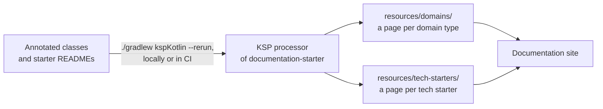

# Living documentation

Living documentation is documentation generated from the code, so it cannot drift from it. DrinkIt generates a page
per domain type (an entity or a value of the business) and per [tech starter](../../architecture/tech-starters.md),
from annotations of the `documentation-starter` tech starter. Its other annotations generate nothing and name the
pattern a class follows, for whoever reads it. Nothing generated is committed: CI writes the pages each time it
builds the site. Read this page before you add a domain type, a use case or a class to the public API of a tech
starter, since the build fails on one left without `@Usecase` or `@TechStarterTool`.

## 🧭 The idea

A hand-written page that names a class goes stale when the class changes, and nothing warns its author. A generated
page takes its content from the code. The class and its description change in the same file and the same pull
request, and the next generation shows the change.

The term comes from Gojko Adzic's Specification by Example. Cyrille Martraire's book Living Documentation applies it
to the code too, with annotations that name a design choice where the code makes it.

## ⚙️ How DrinkIt generates the pages

The annotations and their processor live in `documentation-starter`. The processor uses Kotlin Symbol Processing
(KSP), an API to write plugins of the Kotlin compiler that read the code of a module. The
`com.drinkit.documentation-convention` plugin runs the processor on a module. The `library-convention` and
`api-convention` [archetypes](../../build-and-data/build-tool.md), the plugins that set up a whole module, apply that
plugin. A module on `common-convention` alone, the base archetype with no Spring, applies it itself:

```kotlin
plugins {
    id("com.drinkit.documentation-convention")
}
```

The processor reads the annotated classes of each module and the `README.md` of each tech starter, and writes the
pages that the site then shows:



`documentation-convention` disables the KSP task unless you ask for `kspKotlin`, so a `build` never writes into
`docs/`. You run `./gradlew kspKotlin --rerun`. The processor writes outside the outputs of the task, so without
`--rerun` Gradle could find the task up to date and write nothing. The output, under
`docs/src/engineering/resources/`, is gitignored, since CI generates it before it builds the site. CI deploys the
site from master, as [CI/CD](../../delivery/ci-cd.md) describes.

You never edit a generated page, since the next generation overwrites it. Change the annotation, the KDoc or the
starter's `README.md` instead. A Claude Code [hook](../../coding-assistants/hooks.md) refuses a hand edit.

## 🏷️ The annotations

Some annotations of `documentation-starter` feed the generated pages, the others only mark a pattern in the code:

| Annotation | On | Generates | The pattern |
|---|---|---|---|
| `@CoreDomain` | A domain type, an entity or a value of the business, such as `User` | A page that lists its use cases | [Clean architecture](../../architecture/clean-architecture.md) |
| `@Usecase` | A use case, the `@Service` of the domain that carries out one business operation | A line on the page of the domain type of its package, or else of the one its name contains | [Clean architecture](../../architecture/clean-architecture.md) |
| `@TechStarterTool` | A class of a tech starter's public API | A line on the page of its starter, which opens with the starter's `README.md` | [Tech starters](../../architecture/tech-starters.md) |
| `@Command` | The input of a use case that changes the state | Nothing | [CQRS](https://martinfowler.com/bliki/CQRS.html) |
| `@Query` | The model a query returns, such as `User`, also a domain type and a projection | Nothing | [CQRS](https://martinfowler.com/bliki/CQRS.html) |
| `@Aggregate` | The decision state of an aggregate, and most of its deciders (the pure functions that pick the event a command appends) | Nothing | [Event sourcing](../../architecture/event-sourcing.md) |
| `@Projection` | A read model folded from events | Nothing | [Event sourcing](../../architecture/event-sourcing.md) |
| `@FunctionalCore` | Pure code with no I/O, such as a decider | Nothing | [Clean architecture](../../architecture/clean-architecture.md) |
| `@ImperativeShell` | The code that does the I/O around the core, such as a use case | Nothing | [Clean architecture](../../architecture/clean-architecture.md) |

The promotion of a user to admin carries annotations of both kinds, on its command, its use case and its decider:

```kotlin
@Command
data class PromoteAsAdminCommand(...)

@Service
@Usecase
@ImperativeShell
class PromoteAsAdmin(...) { ... }

@Aggregate @FunctionalCore
internal object AdminPromotionDecider { ... }
```

A generated title is the class name split into words, so the site keeps the words of the code, the ubiquitous
language of Domain-Driven Design. `@CoreDomain`, `@Usecase` and `@TechStarterTool` take an optional `name` that
replaces it, and an optional `description` that gives the text of the page or the line. Without a description, or
with a blank one, the processor takes the KDoc of the class, as `EventsReducer` of `event-sourcing-starter` does.
`@TechStarterTool` also compiles on a function, but the processor reads classes only, so an annotated function
gets no entry.

The [architecture tests](../testing/architecture-tests.md) keep the generated lists complete. A `@Service` of the
domain without `@Usecase` fails the build, and so does a public class of a tech starter without `@TechStarterTool`.

Every annotation of the starter has `AnnotationRetention.SOURCE`, since KSP reads them from the source. The compiler
drops them, so the compiled classes hold none. Unlike the annotations, the jar of the starter ships:
`documentation-convention` adds it as an `implementation` dependency, so the starter and the KSP API it uses are
on the runtime classpath of `drinkit-backend`, the Spring Boot application.

## 📚 Sources

- [Specification by Example](https://www.manning.com/books/specification-by-example), Gojko Adzic
- [Living Documentation: Continuous Knowledge Sharing by Design](https://www.goodreads.com/book/show/34927405-living-documentation), Cyrille Martraire
- [Domain-Driven Design](https://www.domainlanguage.com/ddd/), Eric Evans
- [CQRS](https://martinfowler.com/bliki/CQRS.html), Martin Fowler
- [Kotlin Symbol Processing API](https://kotlinlang.org/docs/ksp-overview.html), JetBrains
